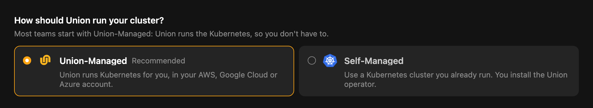
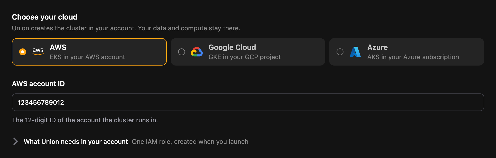
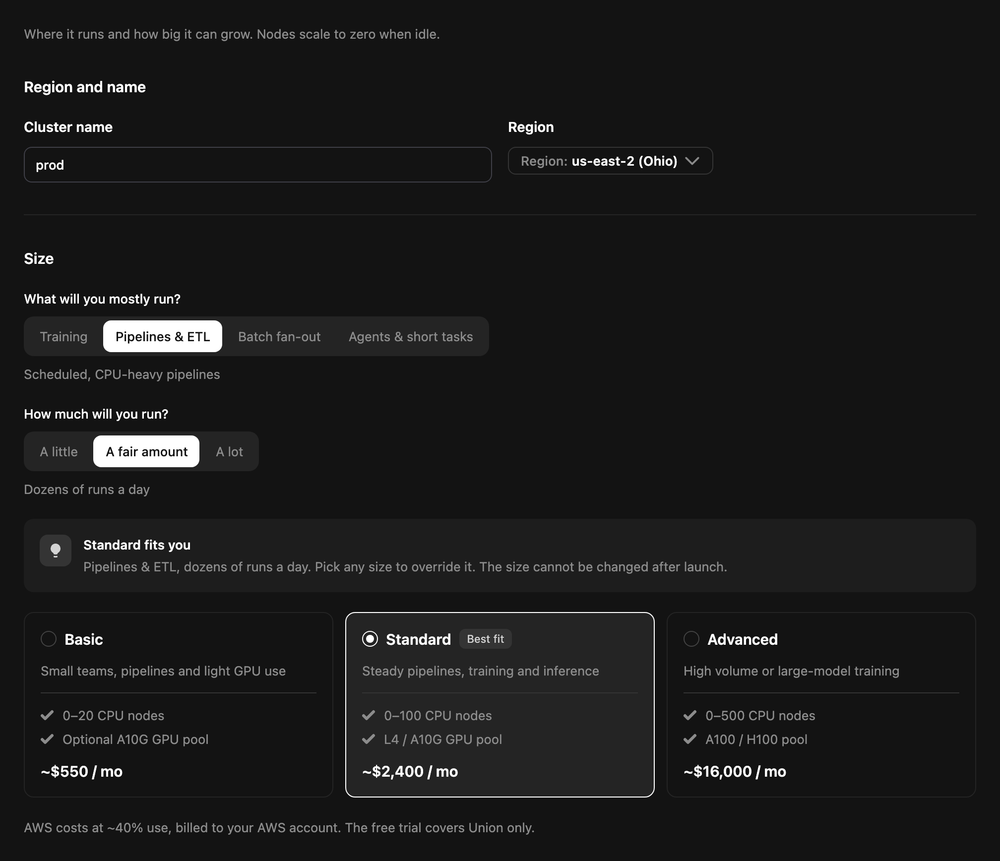
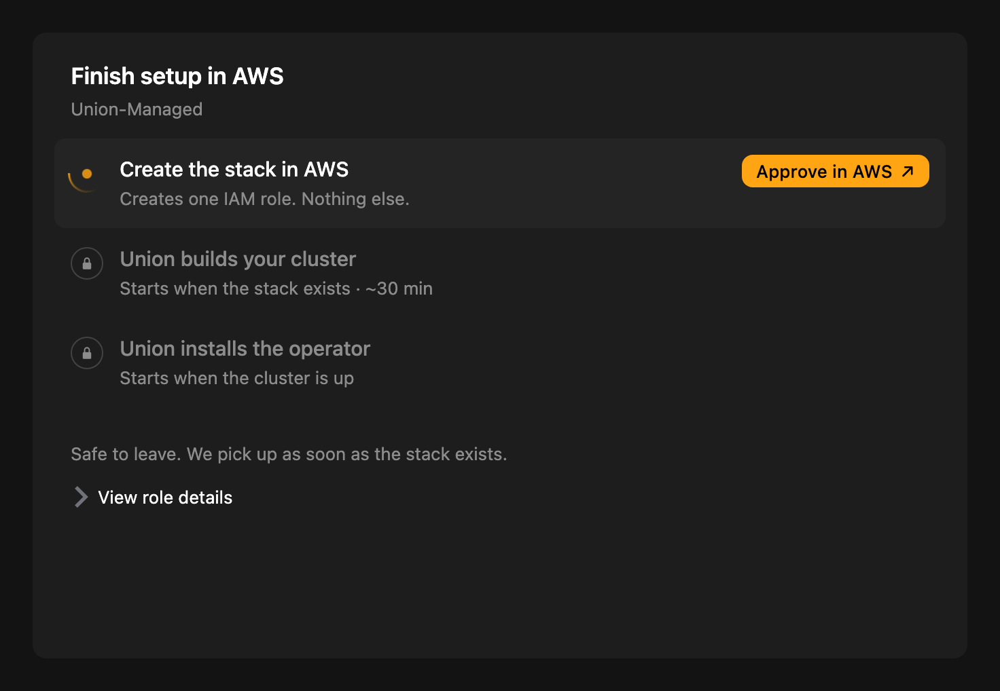

# Data plane setup on AWS

The **Add a cluster** wizard in the Union.ai console creates a Union-Managed data plane in your AWS account.
You launch one CloudFormation stack, which creates the IAM role Union.ai uses.
Union.ai then builds the VPC, an EKS cluster and its node pools, an S3 metadata bucket, and an ECR repository, and installs the data plane.

To create a cluster you need permission to manage clusters in your Union.ai organization, and permission to create a CloudFormation stack that creates IAM resources in your AWS account.

1. In the Union.ai console, select **Connect your cluster** on the home page or in the sidebar, or go to **Settings → Clusters** and select **New Cluster**. The **Add a cluster** wizard opens (**Add your first cluster** if your organization has no clusters yet).
2. On **Deployment**, keep **Union-Managed** selected and select **Continue**.

   

3. On **Cloud account**, select **AWS** and enter the 12-digit ID of the AWS account the cluster runs in. Select **Continue**.

   

4. On **Size & region**, enter a **Cluster name** and choose a **Region**. The console offers `us-east-2` (Ohio).
5. Answer **What will you mostly run?** and **How much will you run?**. The wizard recommends a size from your answers. Select any size to override it. See [Cluster sizes](#cluster-sizes). Select **Continue**.

   

6. On **Review & launch**, check the summary and use **Edit** to change a section. Select the checkbox that agrees to usage-based billing, then select **Create cluster**. The console opens the cluster's page. Nothing is created in your AWS account yet.
7. On the cluster's page, select **Approve in AWS**. CloudFormation opens with the stack filled in. Check that you're signed in to the AWS account you entered, acknowledge that the stack creates IAM resources, and create the stack.

   

Once the stack exists, Union.ai builds the cluster in about 30 minutes.
The cluster's page shows progress until the cluster is ready. You can leave the page and come back to it.
If you open another page in the console while the cluster builds, a short notification with **View progress** takes you back.
**Clusters** in the sidebar shows **Deploying** while the cluster builds. If the build stops, it shows **Failed** until you open the cluster's page.
When the build ends, a notification with **View cluster** (ready) or **View details** (stopped) opens the cluster's page. It stays until you close it.
These notifications and the sidebar status appear only in the browser where you opened the cluster's page during the build.

## Cluster sizes

The size sets how far the cluster's CPU and GPU node pools can grow. You can't change it after launch.

| Size     | CPU capacity     | GPU capacity | GPU types                                         |
| -------- | ---------------- | ------------ | ------------------------------------------------- |
| Basic    | Up to 80 vCPU    | Up to 4 GPUs  | A10G (`g5`)                                       |
| Standard | Up to 400 vCPU   | Up to 16 GPUs | L4 (`g6`), A10G (`g5`)                            |
| Advanced | Up to 2,000 vCPU | Up to 64 GPUs | L4 (`g6`), A10G (`g5`), A100 (`p4d`), H100 (`p5`) |

GPU nodes start from zero and run only pods that request a GPU.

The **Size & region** step shows an estimate of the AWS cost for each size. AWS bills the infrastructure to your AWS account.

## If provisioning stops

The cluster's page names the problem and what to do. Select **Try again** to relaunch provisioning with the same cluster name, AWS account, and region.

- If the stack isn't created within 24 hours, provisioning stops. Select **Approve in AWS** to launch the stack, then select **Try again**.
- If the role is missing permissions, select **Approve in AWS** to update the stack with the latest template, then select **Try again**.
