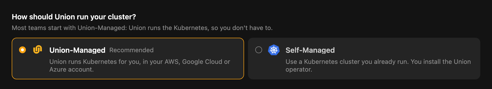
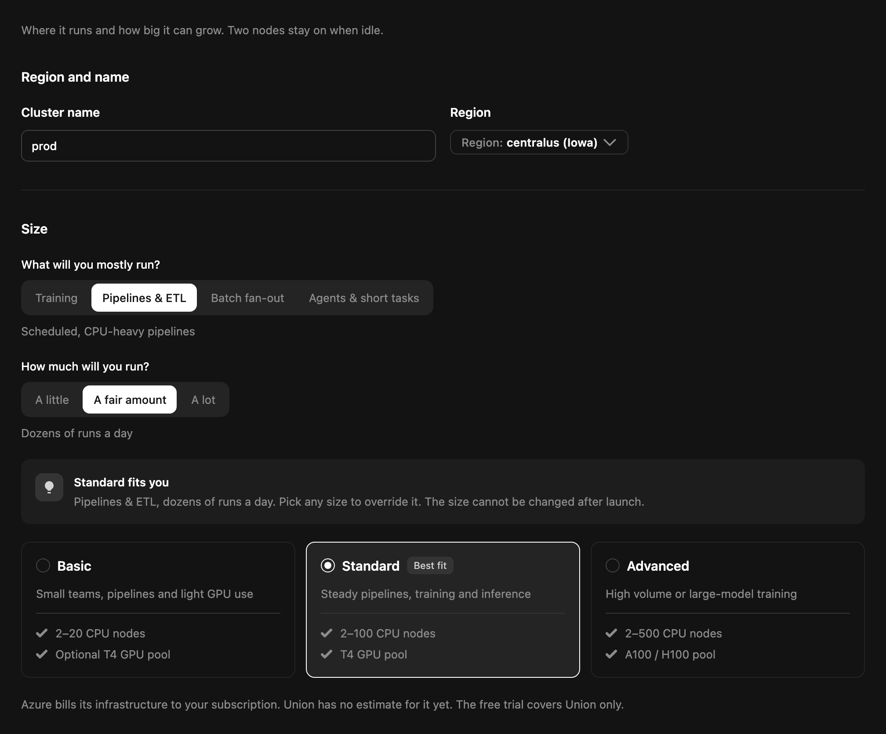

# Data plane setup on Azure

To set up your data plane on Azure, you must allow Union.ai to provision and maintain compute resources under your Azure subscription.

If **Connect your cluster** in the Union.ai console opens the **Add a cluster** wizard (**Add your first cluster** if your organization has no clusters yet), and you can continue with **Azure** on its **Cloud account** step, set up the data plane yourself in the console.
Otherwise, set it up with the Union.ai team, starting at [Selecting Azure tenant and subscription](#selecting-azure-tenant-and-subscription).
For setup with the Union.ai team, you provision an Azure app registration with sufficient permissions to an Azure subscription.

## Set up in the Union.ai console

The wizard creates a Union-Managed data plane in your Azure subscription.
You run one setup script in the subscription. It creates a resource group for the cluster, the identities the cluster uses, and their role assignments, then prints one line that you paste back into the console.
Union.ai then builds the virtual network, an AKS cluster and its node pools, storage, a key vault, and a container registry in that resource group, and installs the data plane.
Union.ai builds as an identity that is a Contributor on that resource group only and can't grant roles.

To create a cluster you need permission to manage clusters in your Union.ai organization.
In Azure, you need Contributor on the subscription and the right to assign roles. You don't need Owner.

1. In the Union.ai console, select **Connect your cluster** on the home page or in the sidebar, or go to **Settings → Clusters** and select **New Cluster**. The **Add a cluster** wizard opens.
2. On **Deployment**, keep **Union Managed** selected and select **Continue**.

   

3. On **Cloud account**, select **Azure** and enter the **Azure subscription ID**: the ID of the subscription the cluster runs in, not its name. It's shown under **Subscriptions** in the Azure portal. Select **Continue**.

   

4. On **Size & region**, enter a **Cluster name** and choose a **Region**. The console offers `centralus` (Iowa) and `eastus2` (Virginia).
5. Answer **What will you mostly run?** and **How much will you run?**. The wizard recommends a size from your answers. Select any size to override it. See [Cluster sizes](#cluster-sizes). Select **Continue**.

   

6. On **Review & launch**, check the summary and use **Edit** to change a section. Select the checkbox that agrees to usage-based billing, then select **Create cluster**. The console opens the cluster's page. Nothing is created in your subscription yet.
7. On the cluster's page, select **Approve in Cloud Shell**. The console copies the setup script and opens Azure Cloud Shell in a new tab. Choose **Bash**, paste the script, and run it. Any terminal where the Azure CLI (`az`) is signed in works too. The script is safe to run again.

   

8. The script ends with a line that starts with `{"tenantId"`. Copy the whole line, paste it into **Line printed by the setup script** on the cluster's page, and select **Submit**. You can't change the line after you submit it.

Once you submit the line, Union.ai builds the cluster in about 15 minutes.
The cluster's page shows progress until the cluster is ready. You can leave the page and come back to it.
If you open another page in the console while the cluster builds, a short notification with **View progress** takes you back.
**Clusters** in the sidebar shows **Deploying** while the cluster builds. If the build stops, it shows **Failed** until you open the cluster's page.
When the build ends, a notification with **View cluster** (ready) or **View details** (stopped) opens the cluster's page. It stays until you close it.
These notifications and the sidebar status appear only in the browser where you opened the cluster's page during the build.

### Cluster sizes

The size sets how far the cluster's CPU and GPU node pools can grow. You can't change it after launch.

| Size     | CPU nodes (`Standard_D4s_v5`) | GPU node pools                                                  |
| -------- | ----------------------------- | --------------------------------------------------------------- |
| Basic    | 2 to 20                       | T4: up to 4 nodes                                               |
| Standard | 2 to 100                      | T4: up to 16 nodes                                              |
| Advanced | 2 to 500                      | T4: up to 16 nodes; A100: up to 16 nodes; H100: up to 16 nodes |

Each GPU node has one GPU, and GPU node pools start from zero nodes.
A pod that requests a GPU without naming a type gets a T4. A100 and H100 nodes run only pods that request those types.
A GPU node pool is created only if your subscription can use its VM size in the cluster's region.

The console shows no estimate of the Azure cost. Azure bills the infrastructure to your subscription.

### If provisioning stops

The cluster's page names the problem and what to do. Select **Try again** to relaunch provisioning with the same cluster name, Azure subscription, and region.

- If the line isn't submitted within 24 hours, provisioning stops. Run the setup script, paste the line it prints on the cluster's page, then select **Try again**.
- If the cluster's identities are missing role assignments, run the setup script again, then select **Try again**.

## Selecting Azure tenant and subscription

- Select the tenant ID for your organization. Refer to [Microsoft Entra ID service page](https://portal.azure.com/#view/Microsoft_AAD_IAM/ActiveDirectoryMenuBlade/~/Overview) from the Azure portal.
- We highly recommend creating a new subscription for Union.ai-specific services. This helps isolate permissions, service quotas, and costs for Union.ai managed Azure resources.
  - Ensure the subscription is tied to an active billing account.
- Provide the Tenant and Subscription ID to Union.ai.

## Create a Microsoft Entra application registration

Union.ai requires permissions to manage Azure and Microsoft Entra resources to create a dataplane. This step involves
creating a Union.ai specific App and granting it sufficient permission to manage the dataplane.

### Create a Microsoft Entra ID application for Union.ai access

Union.ai manages Azure resources through a [Microsoft Entra ID Application](https://learn.microsoft.com/en-us/entra/identity-platform/quickstart-register-app) via [Workload Identity Federation](https://learn.microsoft.com/en-us/entra/workload-id/workload-identity-federation-create-trust?pivots=identity-wif-apps-methods-azp).

1. Navigate to the [Application Registrations](https://entra.microsoft.com/#view/Microsoft_AAD_RegisteredApps/ApplicationsListBlade/quickStartType~/null/sourceType/Microsoft_AAD_IAM) page.
2. Create a new registration.
3. Create a new application. The name is your choice, but we recommend `union`. Leave it at the "Single Tenant" account type and do not add any registration URIs.
4. Navigate to your target [Azure Subscription](https://portal.azure.com/#view/Microsoft_Azure_Billing/SubscriptionsBladeV2).
5. Within the Subscription page select Access Control (IAM). Select Add Role Assignment and add the following roles scoped against the subscription:

- Contributor
- Role Based Access Control Administrator

6. Provide the Application Client ID to Union.ai.
7. Go the application registration page for the app you created.
8. Select "Certificates & secrets."
9. Select the "Federated Credentials" tab, then select "Add credential", and choose "Other issuer".
10. Set "Issuer" to `https://cognito-identity.amazonaws.com`
11. Set "Subject identifier" to `us-east-2:6f9a6050-887a-c4cc-0625-120a4805bc34`
12. "Name" is your choice, but we recommend `union-access`
13. Set "Audience" to `us-east-2:ad71bce5-161b-4430-85a5-7ea84a941e6a`

### Create Microsoft Entra ID applications for Union.ai cost allocation

Union.ai requires new roles and applications to support Union's cost allocation feature.
This can be done by providing the `union` application additional permissions or you can choose to create the roles and applications yourself.

#### Let Union.ai create the cost allocation roles

- Assign `User Access Administrator` role to the `union` application against the subscription. This enables Union.ai role creation.
- Assign `Application Administrator` role to the `union` application within Microsoft Entra ID. This allows Union to create applications.

#### Create cost allocation roles and applications manually

Union.ai requires a role and service principal for the internal OpenCost subsystem.

Create the OpenCost role for retrieving pricing data (name and subscription can be changed):

```bash
az role definition create --role-definition '{
  "Name": "UnionOpenCostRole",
  "Description": "Role used by OpenCost pod",
  "Actions": [
    "Microsoft.Compute/virtualMachines/vmSizes/read",
    "Microsoft.Resources/subscriptions/locations/read",
    "Microsoft.Resources/providers/read",
    "Microsoft.ContainerService/containerServices/read",
    "Microsoft.Commerce/RateCard/read"
  ],
  "NotActions": [],
  "AssignableScopes": [
    "/subscriptions/YOUR_SUBSCRIPTION_ID"
  ]
}'
```

Create the OpenCost service principal. This creates an application registration, service principal, client secret, and role assignment:

```bash
az ad sp create-for-rbac \
  --name "UnionOpenCost" \
  --role "UnionOpenCostRole" \
  --scopes "/subscriptions/YOUR_SUBSCRIPTION_ID" \
  --years 2
```

Share the output of the above `az ad sp create-for-rbac` command with Union.ai.

## (Recommended) create a Microsoft Entra group for cluster administration

We recommend [creating a Microsoft Entra group](https://learn.microsoft.com/en-us/training/modules/create-users-and-groups-in-azure-active-directory/) for AKS cluster admin access.
AKS Cluster admin access is commonly provided to individuals that need direct (e.g. `kubectl`) access to the cluster.

Provide the group `Object ID` to Union.ai.

## (Optional) setting up and managing your own VNet

If you decide to manage your own VNet instead of leaving it to Union.ai, you will need to set it up yourself.

### Required Union.ai VNet permissions

Union.ai requires permissions to read Azure network resources and assign the `Network Contributor` role to the underlying Union.ai Kubernetes cluster.

[Create a role assignment](https://learn.microsoft.com/en-us/azure/role-based-access-control/role-assignments-portal) to allow Union.ai to read VNet resources and assign roles. These permissions should be scoped to the target Virtual Network (VNet). Follow these steps to set up the required access:

1. Navigate to the Azure portal and locate the target VNet.
2. In the VNet's access control (IAM) section, create a new role assignment.
3. For the 'Assigned to' field, select the Union.ai application's service principal.
4. For the 'Role' field, you have two options:
   - Simplest approach: Assign the built-in Azure roles `Reader` and `User Access Administrator`.
   - Advanced approach: Create a custom role with the following specific permissions:
     - `Microsoft.Network/*/read`
     - `Microsoft.Authorization/roleAssignments/write`
     - `Microsoft.Authorization/roleAssignments/delete`
     - `Microsoft.Authorization/roleAssignments/read`
     - `Microsoft.Authorization/roleDefinitions/read`
5. Ensure the 'Scope' is set to the target VNet.
6. Complete the role assignment process.

This configuration will provide the Union.ai application with the necessary permissions to interact with and manage resources within the specified VNet.

> [!NOTE] Creating Azure role assignments
>
> For more detailed instructions on creating role assignments, refer to the
> [official Azure documentation](https://learn.microsoft.com/en-us/azure/role-based-access-control/role-assignments-portal).

### Required VNet properties

We recommend using a VNet within the same Azure tenant as your Union.ai data plane. It should be configured with the following characteristics:

- A single subnet with an address prefix with `/19` CIDR mask. This is used for Kubernetes nodes.
- One to five subnets with an address prefix with `/14` to `/18` CIDR mask. This is used for Kubernetes pods. `/14` is preferable to mitigate IP exhaustion. It is common to start with one subnet for initial clusters and add more subnets as workloads scale.
- An non-allocated (i.e., no subnet) `/19` CIDR range that will be retained for service CIDRs.
- Within the CIDR range, choose a single IP address that will be used for internal DNS. This IP address should not be the first address within the CIDR range.
- (Recommended): Enable [virtual network service endpoints](https://learn.microsoft.com/en-us/azure/virtual-network/virtual-network-service-endpoints-overview) `Microsoft.Storage`, `Microsoft.ContainerRegistry`, and `Microsoft.KeyVault`.
- (Recommended) Create a [NAT gateway for virtual network](https://learn.microsoft.com/en-us/azure/nat-gateway/quickstart-create-nat-gateway-portal) egress traffic. This allows scaling out public IP addresses and limit potential external rate limiting scenarios.

Once your VPC is set up, provide the following to Union.ai:

- The Virtual Network's subscription ID.
- The Virtual Network's name.
- The Virtual Network's resource group name.
- The Virtual Network's subnet name used for Kubernetes nodes.
- The Virtual Network's subnet names used for Kubernetes pods.
- The CIDR range intended to use for Kubernetes services.
- The IP address to be used for internal DNS.

### Example VPC CIDR block allocation

- `10.0.0.0/8` for the VPC CIDR block.
- `10.0.96.0/19` for the Kubernetes node specific subnet.
- `10.4.0.0/14` for the initial Kubernetes pods specific subnet.
  - `10.8.0.0/14`, `10.12.0.0/14`, `10.16.0.0/14`, `10.20.0.0/14` for any future Kubernetes pod specific subnets.
- `10.0.0.0/19` unallocated for Kubernetes services.
- `10.0.0.10` for internal DNS.

## Union.ai maintenance windows

Union.ai configures a four-hour maintenance window for Kubernetes version upgrades and node OS image upgrades. It runs monthly on the first Sunday, starting at 10:00 UTC (03:00 at UTC-07:00), and the time is the same in every Azure region.

> [!NOTE] Setting up tasks for fault tolerance
> Task pods running during this window can be interrupted. Use
> [retries](../../user-guide/tasks/task-configuration/retries-and-timeouts) so an interrupted task runs again, and
> [intra-task checkpoints](../../user-guide/tasks/task-programming/intra-task-checkpoints) so it doesn't start over.
