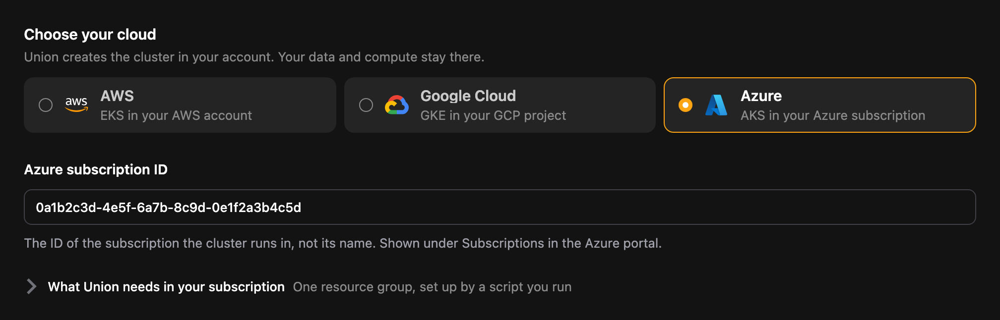
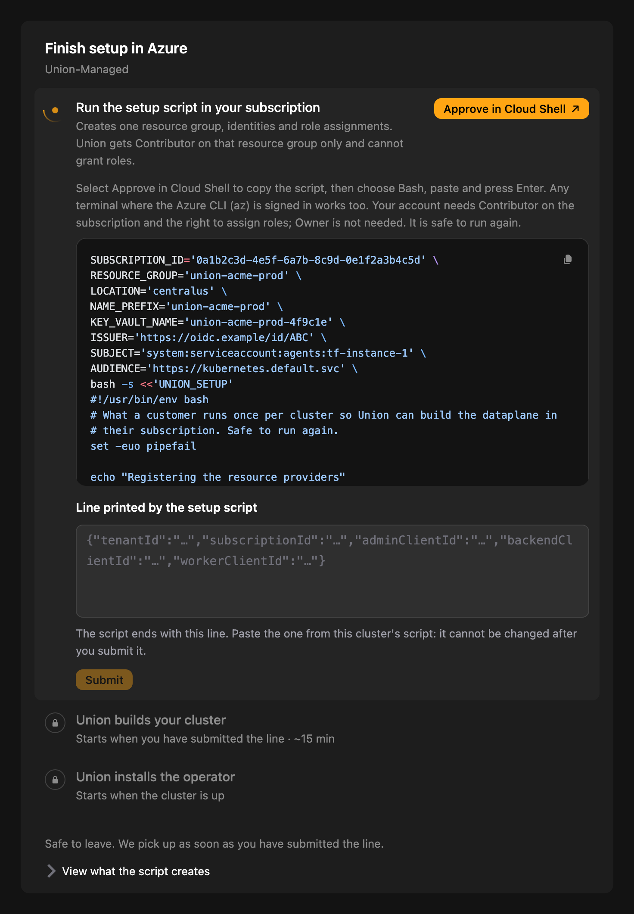

# Data plane setup on Azure

The **Add a cluster** wizard in the Union.ai console creates a Union-Managed data plane in your Azure subscription.
You run one setup script in the subscription. It creates a resource group for the cluster, the identities the cluster uses, and their role assignments, then prints one line that you paste back into the console.
Union.ai then builds the virtual network, an AKS cluster and its node pools, storage, a key vault, and a container registry in that resource group, and installs the data plane.
Union.ai builds as an identity that is a Contributor on that resource group only and can't grant roles.

To create a cluster you need permission to manage clusters in your Union.ai organization.
In Azure, you need Contributor on the subscription and the right to assign roles. You don't need Owner.

1. In the Union.ai console, select **Connect your cluster** on the home page or in the sidebar, or go to **Settings → Clusters** and select **New Cluster**. The **Add a cluster** wizard opens (**Add your first cluster** if your organization has no clusters yet).
2. On **Deployment**, keep **Union-Managed** selected and select **Continue**.

   

3. On **Cloud account**, select **Azure** and enter the **Azure subscription ID**: the ID of the subscription the cluster runs in, not its name. It's shown under **Subscriptions** in the Azure portal. Select **Continue**.

   

4. On **Size & region**, enter a **Cluster name** and choose a **Region**. The console offers `centralus` (Iowa) and `eastus2` (Virginia).
5. Answer **What will you mostly run?** and **How much will you run?**. The wizard recommends a size from your answers. Select any size to override it. See [Cluster sizes](#cluster-sizes). Select **Continue**.

   

6. On **Review & launch**, check the summary and use **Edit** to change a section. Select the checkbox that agrees to usage-based billing, then select **Create cluster**. The console opens the cluster's page. Nothing is created in your subscription yet.
7. On the cluster's page, select **Approve in Cloud Shell**. The console copies the setup script and opens Azure Cloud Shell in a new tab. Choose **Bash**, paste the script, and run it. Any terminal where the Azure CLI (`az`) is signed in works too. The script is safe to run again.

   

8. The script ends with a line that starts with `{"tenantId"`. Copy the whole line, paste it into **Line printed by the setup script** on the cluster's page, and select **Submit**. You can't change the line after you submit it.

Once you submit the line, Union.ai builds the cluster in about 15 minutes.
The cluster's page shows progress until the cluster is ready. You can leave the page and come back to it.
If you open another page in the console while the cluster builds, a short notification with **View progress** takes you back.
**Clusters** in the sidebar shows **Deploying** while the cluster builds. If the build stops, it shows **Failed** until you open the cluster's page.
When the build ends, a notification with **View cluster** (ready) or **View details** (stopped) opens the cluster's page. It stays until you close it.
These notifications and the sidebar status appear only in the browser where you opened the cluster's page during the build.

## Cluster sizes

The size sets how far the cluster's CPU and GPU node pools can grow. You can't change it after launch.

| Size     | CPU nodes (`Standard_D4s_v5`) | GPU node pools                                                  |
| -------- | ----------------------------- | --------------------------------------------------------------- |
| Basic    | 2 to 20                       | T4: up to 4 nodes                                               |
| Standard | 2 to 100                      | T4: up to 16 nodes                                              |
| Advanced | 2 to 500                      | T4: up to 16 nodes; A100: up to 16 nodes; H100: up to 16 nodes |

Each GPU node has one GPU, and GPU node pools start from zero nodes.
A pod that requests a GPU without naming a type gets a T4. A100 and H100 nodes run only pods that request those types.
A GPU node pool is created only if your subscription can use its VM size in the cluster's region.

The console shows no estimate of the Azure cost. Azure bills the infrastructure to your subscription.

## If provisioning stops

The cluster's page names the problem and what to do. Select **Try again** to relaunch provisioning with the same cluster name, Azure subscription, and region.

- If the line isn't submitted within 24 hours, provisioning stops. Run the setup script, paste the line it prints on the cluster's page, then select **Try again**.
- If the cluster's identities are missing role assignments, run the setup script again, then select **Try again**.
