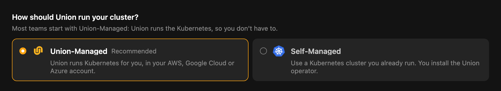
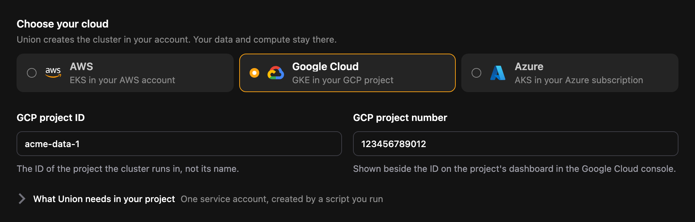
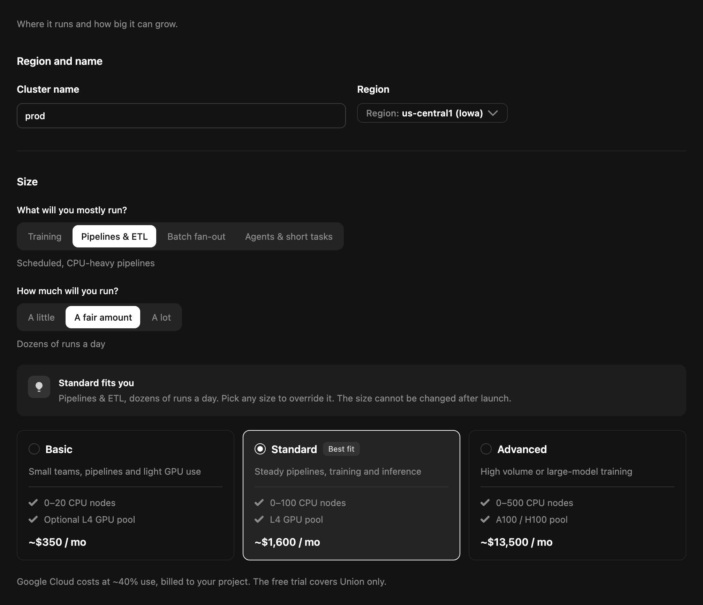
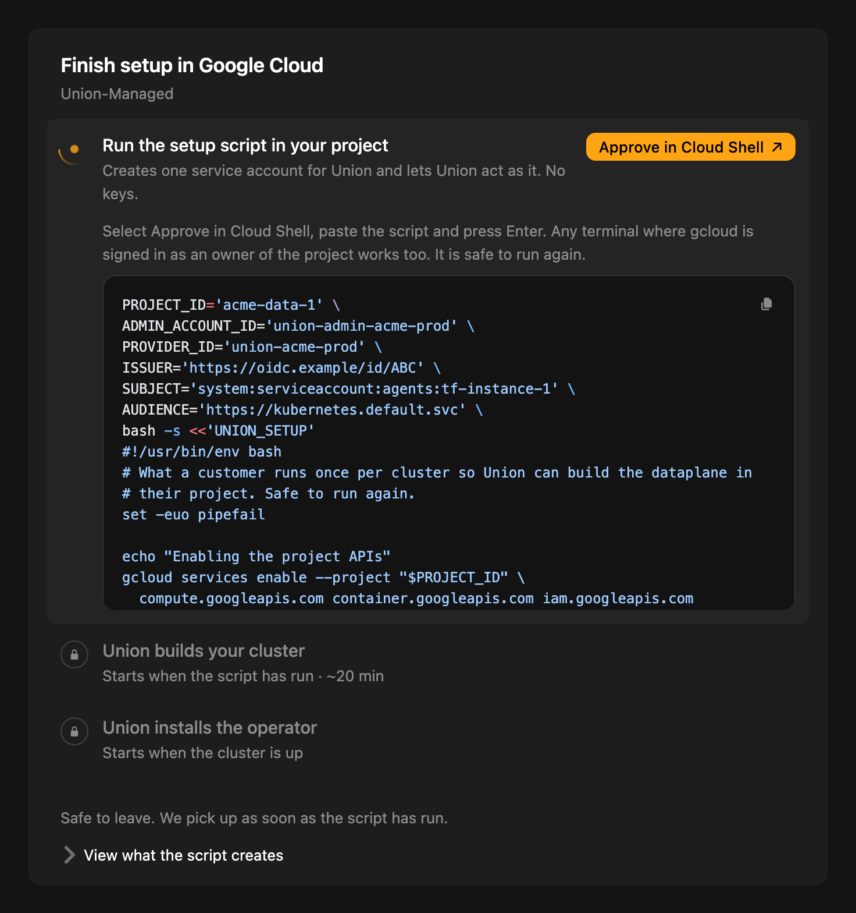

# Data plane setup on GCP

The **Add a cluster** wizard in the Union.ai console creates a Union-Managed data plane in your GCP project.
You run one setup script in the project. It enables the project APIs the data plane needs, creates an admin service account for the cluster, and lets Union.ai act as that service account through workload identity federation, without a key.
Union.ai then builds the VPC network, a GKE cluster and its node pools, a Cloud Storage metadata bucket, an Artifact Registry repository, and the data plane's service accounts, and installs the data plane.

To create a cluster you need permission to manage clusters in your Union.ai organization, and to be an owner of the GCP project.
The project must have a billing account linked: the setup script enables the Compute Engine and GKE APIs, which Google Cloud allows only in a project with billing. Check it on the project's [billing page](https://console.cloud.google.com/billing/linkedaccount) in the Google Cloud console.

1. In the Union.ai console, select **Connect your cluster** on the home page or in the sidebar, or go to **Settings → Clusters** and select **New Cluster**. The **Add a cluster** wizard opens (**Add your first cluster** if your organization has no clusters yet).
2. On **Deployment**, keep **Union-Managed** selected and select **Continue**.

   

3. On **Cloud account**, select **Google Cloud** and enter the **GCP project ID** and **GCP project number**. The project number is shown beside the ID on the project's dashboard in the Google Cloud console. Select **Continue**.

   

4. On **Size & region**, enter a **Cluster name** and choose a **Region**. The console offers `us-central1` (Iowa).
5. Answer **What will you mostly run?** and **How much will you run?**. The wizard recommends a size from your answers. Select any size to override it. See [Cluster sizes](#cluster-sizes). Select **Continue**.

   

6. On **Review & launch**, check the summary and use **Edit** to change a section. Select the checkbox that agrees to usage-based billing, then select **Create cluster**. The console opens the cluster's page. Nothing is created in your project yet.
7. On the cluster's page, copy the setup script and select **Approve in Cloud Shell**. Cloud Shell opens on your project in a new tab. Paste the script and run it. Any terminal where `gcloud` is signed in as an owner of the project works too. The script is safe to run again.

   

Once the script has run, Union.ai builds the cluster in about 20 minutes.
The cluster's page shows progress until the cluster is ready. You can leave the page and come back to it.
If you open another page in the console while the cluster builds, a short notification with **View progress** takes you back.
**Clusters** in the sidebar shows **Deploying** while the cluster builds. If the build stops, it shows **Failed** until you open the cluster's page.
When the build ends, a notification with **View cluster** (ready) or **View details** (stopped) opens the cluster's page. It stays until you close it.
These notifications and the sidebar status appear only in the browser where you opened the cluster's page during the build.

## Cluster sizes

The size sets how far the cluster's CPU and GPU node pools can grow. You can't change it after launch.

| Size     | CPU nodes (`e2-standard-4`) | GPU node pools                                                        |
| -------- | --------------------------- | --------------------------------------------------------------------- |
| Basic    | Up to 20                    | L4: up to 4 nodes                                                     |
| Standard | Up to 100                   | L4: up to 16 nodes                                                    |
| Advanced | Up to 500                   | L4: up to 16 nodes; A100: up to 16 nodes; H100: up to 2 nodes of 8 GPUs |

GPU node pools start from zero nodes. A pod that requests a GPU without naming a type gets an L4. A100 and H100 nodes run only pods that request those types.

The **Size & region** step shows an estimate of the Google Cloud cost for each size. Google Cloud bills the infrastructure to your project.

## If provisioning stops

The cluster's page names the problem and what to do. Select **Try again** to relaunch provisioning with the same cluster name, GCP project, and region.

- If the setup script isn't run within 24 hours, provisioning stops. Run the script from the cluster's page, then select **Try again**.
- If Union.ai's admin service account is missing permissions, run the script again, then select **Try again**.
