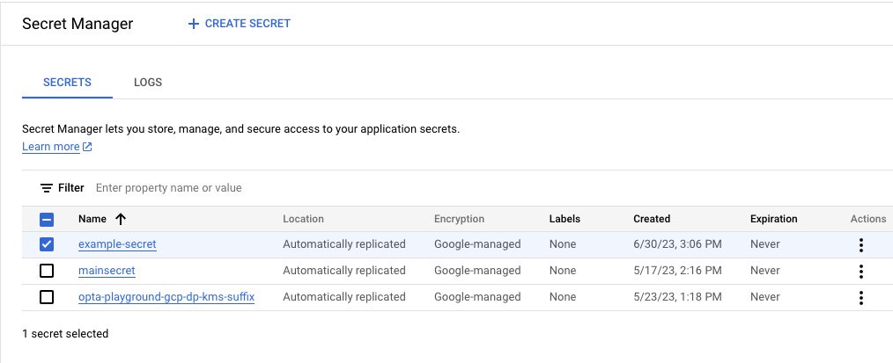
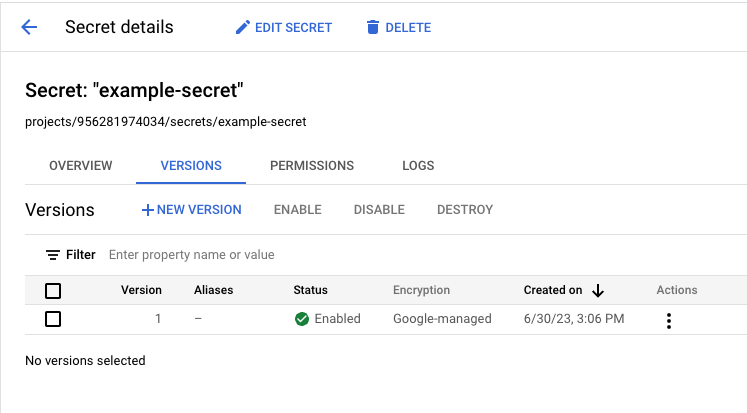

# Enabling Google Secret Manager

> [!NOTE]
> This documentation exists for customers who must use Google Secret Manager for organizational reasons. For everyone else, we strongly recommend using the
> [Union.ai secrets manager](../../../user-guide/tasks/task-configuration/secrets) to manage secrets rather than Google Secret Manager.

The `<UserFlyteGSA>` can access secrets in Secret Manager in the same GCP project as the data plane by default.

To access a secret stored in Secret Manager in a GCP project _other than the one that holds your data plane_ requires one additional step:
Granting the `<UserFlyteGSA>` (see [Enabling GCP resources](./_index)) access to top the secret in the other projects.

> [!WARNING]
> Flyte 2 tasks cannot request a Secret Manager secret.
> The data plane fetches a Secret Manager secret only when the task's request names both the secret and a secret version, and `flyte.Secret` has no field for a secret version.
> Use the [Union.ai secrets manager](../../../user-guide/tasks/task-configuration/secrets) instead.

## Create your secrets

Create your secrets in **Secret Manager** (see the [Secret Manager documentation](https://cloud.google.com/secret-manager/docs) for details):

* Go to **Security > Secret Manager**.
* Select **CREATE SECRET** at the top of the page.
* Fill in the **Name**, **Value,** and (optionally) the other parameters.
* Select **CREATE SECRET** at the bottom of the page.

Your secret should now be on the secrets list:

Above we see a secret named `example-secret`.
Clicking on it will bring us to the **Secret details** page:

The secret has three important identifiers:

* The **GCP secret name**, in this case `example-secret`.
* The **GCP secret path**, in this case `projects/956281974034/secrets/example-secret`.
* The **GCP secret version**, in this case `1`.

## Cross-project secrets

If your secret is stored in the Secret Manager of a project other than the one containing your data plane, grant the `<UserFlyteGSA>` permission to access it:

* Find the **email identifier** of the `<UserFlyteGSA>` in your data plane GCP project (see [Enabling GCP resources](./_index) for details).
* Go to **Security > Secret Manager** in the GCP project that contains your secret.
* Select the secret that you want to access and select **GRANT ACCESS**.
* In the subsequent panel, under **Add principals**, paste in the email identifier of the `<UserFlyteGSA>` that you found above.
* Under **Assign roles** add at least the role **Secret Manager Secret Accessor**.
* Save the changes.

At this point, the `<UserFlyteGSA>` has access to the secret in the other project.
