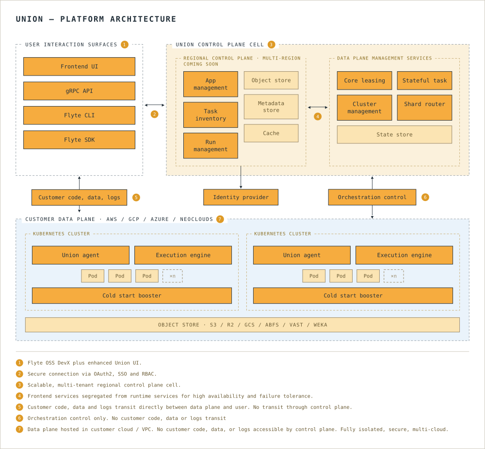

# Platform architecture

The Union.ai architecture consists of two components, referred to as planes: the control plane and the data plane.
Both deployment models, [self-managed](./selfmanaged/_index) and [BYOC](./byoc/_index), share this split. They differ in who provisions and operates the data plane.
For the security model behind the split, see [Architecture](../security/architecture/_index) in the Security section.

## Control plane

The control plane:

* Runs within the Union.ai AWS account.
* Provides the user interface through which users can access authentication, authorization, observation, and management functions.
* Is responsible for placing executions onto data plane clusters and performing other cluster control and management functions.

## Data plane

All your workflow and task executions run in the data plane: a Kubernetes cluster in your own cloud account or on your own infrastructure, in the region you choose.
A resident Union.ai operator connects it to the control plane with minimal required permissions (see [Union.ai operator](#unionai-operator)).

### Data plane nodes

The nodes in your data plane cluster have different responsibilities. Union.ai distinguishes between the nodes that run its platform services and the worker nodes that run your workloads.

Platform-service nodes, called default nodes in BYOC, guarantee the basic operation of the data plane and are always running. Services that run on them include worker-node autoscaling, monitoring, and the Union.ai operator.

Worker nodes execute your workloads, and you have full control over their configuration:

* **BYOC**: see [worker node groups](./byoc/configuring-your-data-plane#worker-node-groups).
* **Self-managed**: see [Node pools](./selfmanaged/configuration/node-pools), which recommends separate node pools for Union.ai services and worker pods.

When worker nodes are not in use, they scale down to the configured minimum. In BYOC, the default minimum is zero.

## Union.ai operator

The **Union.ai operator** is a dedicated service, resident in your data plane, that acts as the primary channel through which the control plane and your data plane interact. It is designed to perform its functions with only the very minimum set of required permissions.

### How your data plane is provisioned and maintained

**BYOC.** Your data plane is created by the control plane, not by the operator. When you onboard, the control plane uses infrastructure-as-code, applied against your cloud account, to provision the Kubernetes cluster (for example, an EKS cluster on AWS) along with the supporting cloud resources the platform requires, such as IAM roles and the object-storage buckets that hold your workflow data and metadata. Once that cluster is up, Union.ai deploys the operator onto it.
The control plane periodically re-runs this same provisioning process to apply infrastructure changes to your cluster as part of ongoing deployment and maintenance, for example adding instance types, adjusting node-group sizes, or updating the versions of platform components, so that upgrades and configuration changes are handled for you.

**Self-managed.** You provision the Kubernetes cluster and its supporting cloud resources yourself, and you own and operate them. How the data plane, operator included, gets into the cluster depends on your provider:

* On AWS, GCP, and Azure, you [connect your cluster](./selfmanaged/connect-a-cluster) from the Union.ai UI. You install an agent, the agent connects out to Union.ai, and Union.ai installs the data plane through it. The agent manages the `dataplane` Helm chart and its values. See [What Union.ai installs in your cluster](./selfmanaged/whats-installed).
* On other providers, and for AWS, GCP, or Azure deployments that were set up with Helm, you [deploy the data plane](./selfmanaged/deploy/_index) with the `dataplane` Helm chart yourself and [upgrade it](./selfmanaged/upgrade) when a new chart version is released.

### What the operator does

Once installed, the operator is the resident data-plane component that keeps your cluster in sync with the control plane. It is the primary way the two systems interact. Working with only the minimum permissions they require, the operator and the services installed alongside it:

* **Runs your executions.** The control plane assigns executions to your data plane; the operator picks up those operations and carries them out, creating and tearing down the Kubernetes pods that run your tasks and applications.
* **Reports cluster state.** It sends heartbeat, status, health, and resource-usage information back to the control plane, so the control plane can observe and schedule work without needing direct access to your cluster.
* **Maintains platform services.** It manages the data plane's supporting services — including the secure tunnel used for connectivity, API-key provisioning, image building, secret watching, and compute reconciliation.
* **Moves your data.** It runs the data-plane `dataproxy` service, which issues the presigned URLs that let clients read and write your workflow data directly to and from the object store in your data plane (see [Execution data](#execution-data)), so that data never transits the control plane.

In BYOC, the operator also allows Union.ai's support engineers to access system-level logs and to apply changes at your request. In a self-managed deployment, Union.ai support has no access to your cluster. In neither model does the operator provide direct access to your secrets or data.

In addition, communication is always initiated by the Union.ai operator in the data plane toward the Union.ai control plane, not the other way around.
This further enhances the security of your data plane.

Union.ai is SOC-2 Type 2 certified. A copy of the audit report is available upon request.

## Registry data

Registry data is composed of:

* Names of workflows, tasks, launch plans, and artifacts
* Input and output types for workflows and tasks
* Execution status, start time, end time, and duration of workflows and tasks
* Version information for workflows, tasks, launchplans, and artifacts
* Artifact definitions

This type of data is stored in the control plane and is used to manage the execution of your workflows.
This does not include any workflow or task code, nor any data that is processed by your workflows or tasks.

## Execution data

Execution data is composed of:

* Event data
* Workflow inputs
* Workflow outputs
* Data passed between tasks (task inputs and outputs)

This data is divided into two categories: _raw data_ and _literal data_.

### Raw data

Raw data is composed of:

* Files and directories
* Dataframes
* Models
* Python-pickled values larger than 10 KB (10,240 bytes) as measured by `sys.getsizeof`. This counts only the outer object, not the data it references, so a small object holding a lot of data is still inlined (see below).

These are passed by reference between tasks and are always stored in an object store in your data plane.
They are fetched directly from the data-plane object store via presigned URLs issued by the data-plane `dataproxy` service; the bytes never pass through the control plane.

### Literal data

* Primitive execution inputs (int, string... etc.)
* JSON-serializable dataclasses
* Python-pickled values of 10 KB or less as measured by `sys.getsizeof` (the inlined pickle itself can be larger)

These small values are passed by value rather than as a reference to a separately offloaded object. Like raw data, they are stored in the object store in your data plane (inlined within the run's `inputs.pb`/`outputs.pb` payload) and the control plane stores only a URI pointer to them.

For the developer-facing map of which specific records live in the control plane database versus the data plane bucket, including what "metadata" means in different contexts, see [Where your data lives](../user-guide/get-started/core-concepts/where-data-lives).

## Data privacy

All runtime execution data, both raw and literal inputs and outputs, is stored in the object store in your data plane, never in the control plane. The control plane holds orchestration metadata only: task definitions (which include default input values, environment variables, and SQL statements), run state, and error messages (which may include data from Python tracebacks).
