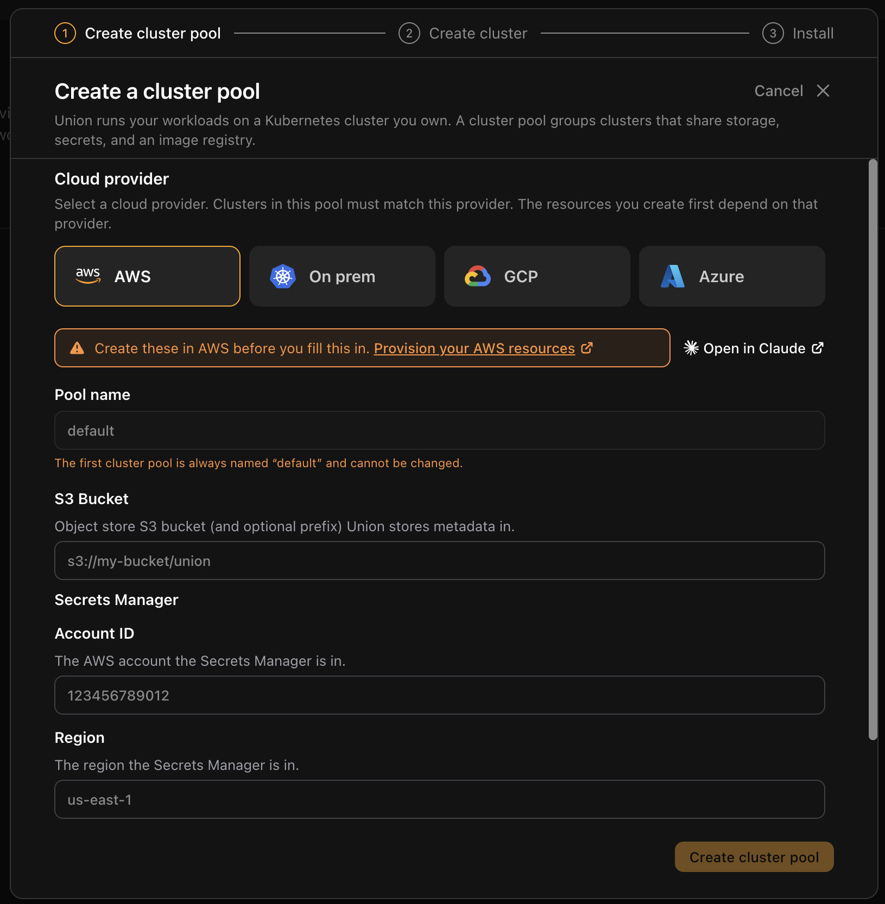
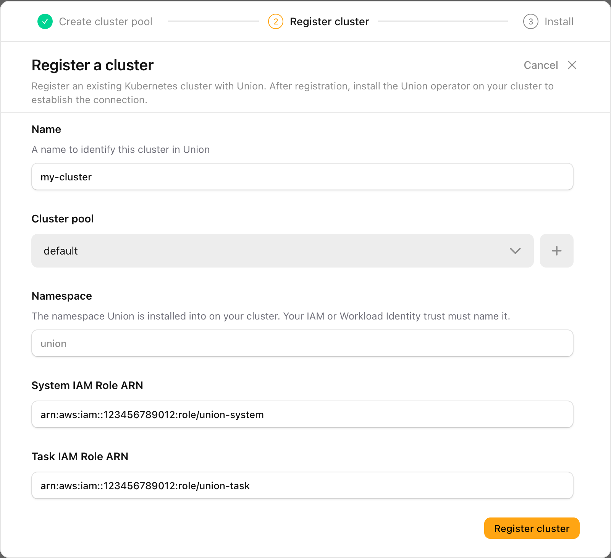
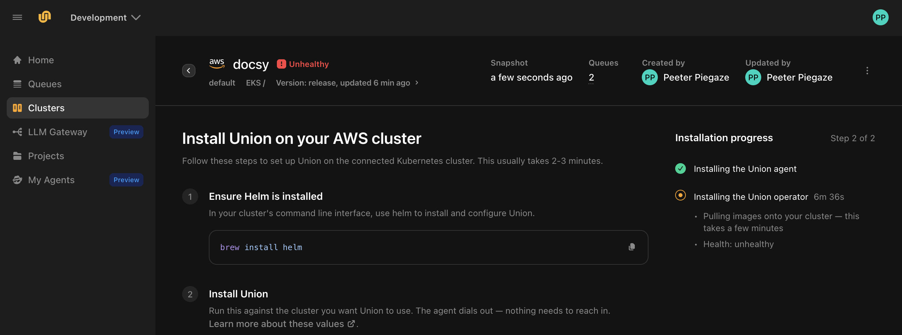
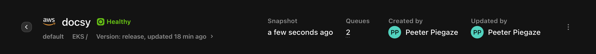

# Connect your cluster

You have an organization and the cloud resources your data plane runs on. Now connect your cluster to Union.ai, and Union.ai installs the data plane into it. Your code, data and credentials stay in your cloud account.

**Nothing dials in.** You install an agent into your cluster, and the agent connects out to Union.ai. You do not open a port, expose an endpoint, or hand over cluster credentials.

The steps are the same on AWS, GCP, and Azure: create a cluster pool, register the cluster, and install the agent. Only the values you enter in the two forms differ, so those two steps have a tab for each provider.

## What you'll need

- The values printed at the end of the provisioning page for your provider: [AWS](./aws/_index#8-collect-the-values-for-connecting-your-cluster), [GCP](./gcp/_index#8-collect-the-values-for-connecting-your-cluster), or [Azure](./azure/_index#10-check-the-resources-and-collect-the-values). If you are using resources you already had, check that they meet the requirements on that page, and collect the same values for them.
- [Helm](https://helm.sh/docs/intro/install/) installed, and `kubectl` access to the cluster from the shell where you provisioned it.

## What this installs

You install the agent, in the `dataplane-agent` namespace, and Union.ai installs the data plane through it. Your cloud provider bills you for the resources the data plane runs on even while it is idle. See [What Union.ai installs in your cluster](./whats-installed) for the components, their permissions and the cost on each provider.

## 1. Create the cluster pool

A cluster pool groups clusters that share an object store, a secret store and an image registry. A new organization has none, so you create one first.

1. In the Union.ai UI, select **Connect your cluster**, on the home page or in the sidebar.
2. The dialog tells you there is no cluster pool yet. Select **Create cluster pool**.
3. Select your cloud provider, and fill in its form as shown below. Your first pool is always named `default`, so the **Pool name** field is already filled in.
4. Select **Create cluster pool**.





| Field | Value |
|---|---|
| **S3 Bucket** | The metadata bucket URI, for example `s3://my-team-union-selfserve-metadata` |
| **Account ID** | The 12-digit ID of the AWS account that holds Secrets Manager |
| **Region** | The AWS Region the cluster and Secrets Manager are in |
| **Image registry** | The ECR repository's address, in the form `<account-id>.dkr.ecr.<region>.amazonaws.com/<repository-name>` |



No secret needs to exist in Secrets Manager yet. The data plane creates and manages runtime secrets in that account and Region as it needs them.






| Field | Value |
|---|---|
| **GCS bucket** | The bucket URI, `gs://` followed by the bucket name, with no path after it |
| **Project ID** | The project that holds Secret Manager. If you followed [Provision your GCP resources](./gcp/_index), it is the same project as the cluster's. |
| **Image registry** | The repository address, in the form `<region>-docker.pkg.dev/<project-id>/<repository>` |






| Field | Value |
|---|---|
| **Storage container** | The container's Data Lake Storage URI, in the form `abfs://metadata@<storage-account>.dfs.core.windows.net`, with no path after it |
| **Key Vault URI** | The vault's URI, in the form `https://<vault-name>.vault.azure.net/` |
| **Image registry** | The registry's login server, in the form `<registry-name>.azurecr.io`. You do not need a repository path: Union.ai adds its own. |





## 2. Register the cluster

When the pool is created, the dialog moves straight on to **Register a cluster**, with your new pool already selected. Fill in the form for your provider:





| Field | Value |
|---|---|
| **Name** | A name for the cluster in Union.ai, for example `my-cluster`. You cannot change it once the cluster is registered. |
| **Cluster pool** | Already set to `default`, the pool you just created. |
| **Namespace** | Leave it empty to use `union`. The IAM roles from [Provision your AWS resources](./aws/_index) trust any namespace, so the default works with them. |
| **System IAM Role ARN** | The system IAM role ARN |
| **Task IAM Role ARN** | The task IAM role ARN |








| Field | Value |
|---|---|
| **Name** | A name for the cluster in Union.ai, for example `my-cluster`. You cannot change it once the cluster is registered. |
| **Cluster pool** | Already set to `default`, the pool you just created. |
| **Namespace** | Leave it empty to use `union`. The Workload Identity binding from [Provision your GCP resources](./gcp/_index#7-bind-the-cluster-to-the-service-accounts) covers every namespace in the cluster. If you bound only specific service accounts instead, enter the namespace you bound them in. |
| **Project ID** | The project the GKE cluster runs in |
| **Region** | The cluster's region, for example `us-central1`, not a zone |
| **System service account email** | The system service account's email |
| **Task service account email** | The task service account's email |






| Field | Value |
|---|---|
| **Name** | A name for the cluster in Union.ai, for example `my-cluster`. You cannot change it once the cluster is registered. |
| **Cluster pool** | Already set to `default`, the pool you just created. |
| **Namespace** | Exactly the namespace you chose in [Provision your Azure resources](./azure/_index#1-sign-in-and-choose-names). If you kept `union`, you can also leave the field empty. |
| **Subscription ID** | The subscription the AKS cluster is in |
| **Tenant ID** | The Microsoft Entra ID tenant the subscription belongs to |
| **Resource group** | The resource group the AKS cluster is in. Union.ai uses it to link to your task logs in the Azure portal. |
| **System client ID** | The system identity's client ID, not its principal ID |
| **Task client ID** | The task identity's client ID, not its principal ID |
| **Log Analytics workspace ID (optional)** | The workspace's resource ID, which starts with `/subscriptions/`. Without it, the Union.ai UI shows task logs only while the pods exist. |





Select **Register cluster**. Union.ai registers the cluster and takes you to its page, where you install the agent. Registering does not put anything on your cluster by itself.

## 3. Install the agent

The cluster's page, **Install Union on your AWS cluster** (or GCP, or Azure), shows an install command generated for this cluster. Copy it with **Copy install command**, and run it in the shell where `kubectl` can reach the cluster. The agent installs itself and connects out to Union.ai.



The command writes a `values.yaml` for your cluster, then installs the agent from it with Helm. In outline, with the generated values left out, it looks like this:

```bash
cat <<'UNION_DP_AGENT_VALUES' > values.yaml
# ...the values the UI generated for your cluster...
UNION_DP_AGENT_VALUES

helm upgrade --install dp-agent oci://ghcr.io/omnistrate/dataplane-agent-chart \
  --version <chart-version> \
  --namespace dataplane-agent --create-namespace --values values.yaml \
  --set nameOverride=dp-agent --timeout 10m0s --wait
```

This outline is only to show you what the command does, and you cannot run it as shown. Use **Copy install command** to get the real command from the UI, with the values and chart version for your cluster.

> [!WARNING] The values are a credential
> The `values.yaml` block contains the agent's client certificate and private key. Treat it like any other secret: do not paste it into a ticket, a chat message, or a shared document, and delete the file once the agent is installed.

## 4. Wait for the data plane

The **Installation progress** panel on the cluster's page tracks two phases:

| Phase | What is happening |
|-------|-------------------|
| **Installing the Union agent** | The agent starts in your cluster and connects out to Union.ai. The panel shows the connection status. |
| **Installing the Union operator** | Union.ai installs the data plane through that connection. The panel shows the cluster's health. |

Only the first phase needs you. Once the agent connects, Union.ai installs the data plane itself, so there is nothing more to run. The second phase takes a few minutes on a new cluster, mostly spent pulling images. You can leave the page while it runs and come back to it later. Until it finishes, the cluster shows as **Unhealthy** at the top of the page. That is expected during the install.

If you check progress with `kubectl`, the agent runs in the `dataplane-agent` namespace, and the data plane installs into the namespace you entered when you registered the cluster, or `union` if you left it empty.

When the install finishes, the panel reads **Complete**, and the cluster shows as **Healthy** next to its name:



On Azure, also check that the data plane's service accounts carry the right client IDs. In the shell where you provisioned the resources, run:

```bash
kubectl -n "$UNION_DATAPLANE_NAMESPACE" get sa union-system union \
  -o jsonpath='{range .items[*]}{.metadata.name}{"\t"}{.metadata.annotations.azure\.workload\.identity/client-id}{"\n"}{end}'
```

`union-system` must show `AZURE_SYSTEM_CLIENT_ID`, and `union` must show `AZURE_TASK_CLIENT_ID`. If the namespace has no such service accounts, the data plane was installed into a different namespace from the one the federated credentials trust.

## 5. Run a workload on the cluster

With a connected cluster, run the `hello.py` workflow from [Run your first workflow locally](../sign-up/run-locally) again, this time without `--tracked`. The same code now runs on your cluster instead of on your own machine:

```bash
flyte run hello.py main
```

The run appears under **Runs** in your project, not under **Tracked Runs**, which is for runs that execute on your own machine. See [Run modes](../../user-guide/get-started/run-modes/_index) for how the two differ.

## Next steps

That completes the setup. Union.ai now runs your workloads on your own infrastructure.

To learn how to build workflows with Union.ai, continue with [Get started](../../user-guide/get-started/_index) in the user guide.
