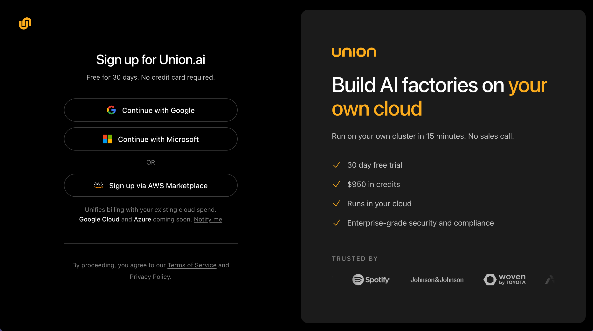
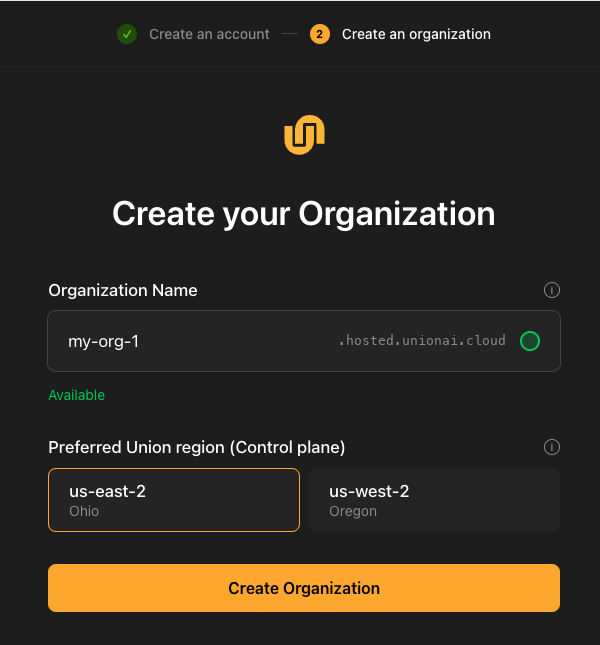
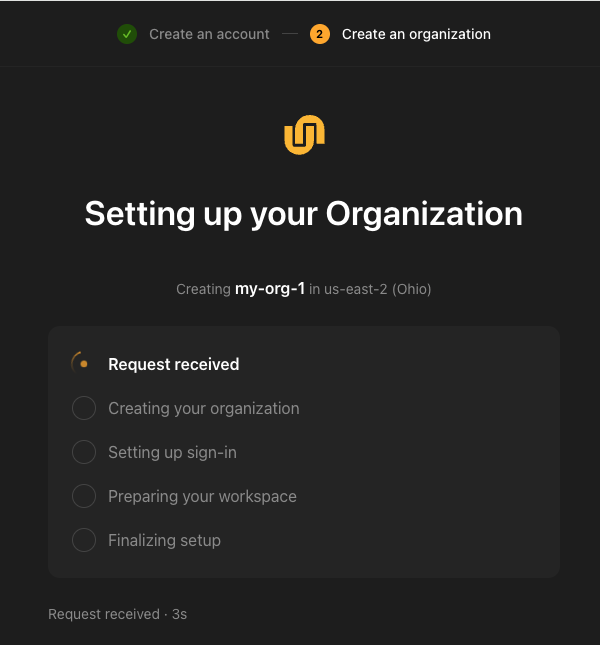
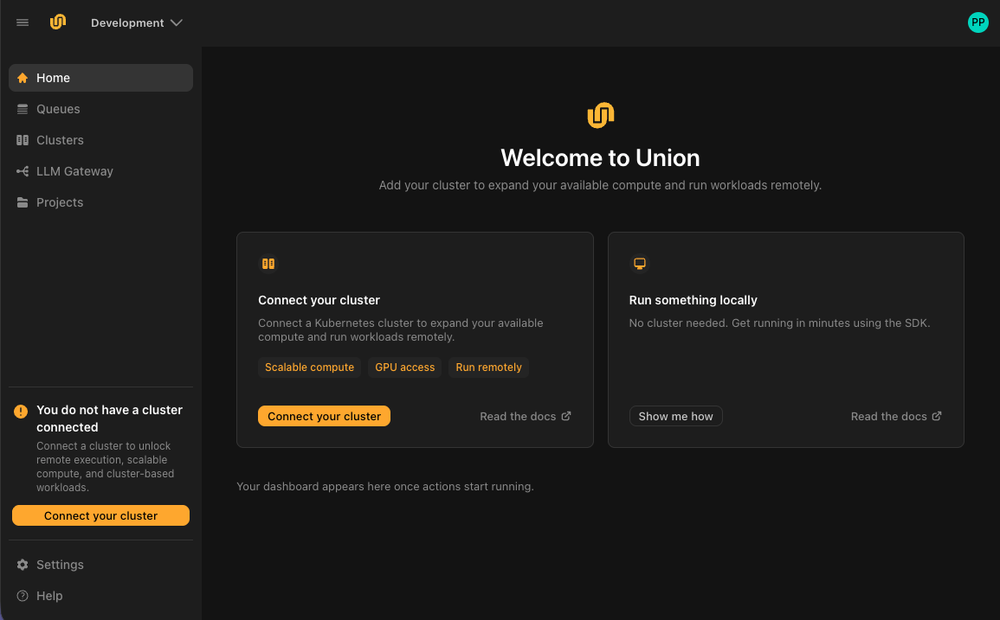

# Create your account and organization

Here you create your account and an organization. Your organization is your workspace in Union.ai. It holds your projects, workflows, resources and team members, and everything you do afterward happens inside it.

Once it exists, you can [run a workflow on your own machine](./run-locally) and follow it in the Union.ai UI, so you can see how Union.ai works before connecting any infrastructure.

## What you'll need

A Google or Microsoft account for work. Union.ai sign-up is currently only available through these identity providers.

## Create your account

Go to [signup.hosted.unionai.cloud](https://signup.hosted.unionai.cloud) and select **Continue with Google** or **Continue with Microsoft**. Choose the account you want to use for Union.ai.

> [!NOTE] Paying through AWS Marketplace?
> If you want the charges on your AWS bill, select **Sign up via AWS Marketplace** on the sign-up page and [subscribe there](./aws-marketplace) first; you return to this step after you complete the subscription. That works wherever your cluster runs: how you pay is separate from where your data plane lives. Otherwise, sign up directly. Either way, your organization starts with a 30-day free trial.

## Create your organization

The organization is the top-level workspace in Union.ai. It is where your projects, workflows, resources, and team members live.

1. **Organization name.** This becomes your organization's web address, so it must be unique across Union.ai, and it cannot be changed later. Use lowercase letters, digits, and hyphens. As you type, Union.ai checks whether the name is available.

   

2. **Preferred Union region.** This is where your control plane runs. The control plane is the Union.ai service that manages your workflows, metadata, and user interface. You should choose the region closest to where you plan to install your data plane.

3. Select **Create Organization**.

Union.ai sets up your organization in about thirty seconds. You'll see each step complete: receiving the request, creating the organization, setting up sign-in, preparing your workspace, and finalizing.

## Open your organization

When setup finishes, Union.ai takes you to your organization's home page. Your organization's address, in the form `<your-org>.hosted.unionai.cloud`, is in your browser's address bar. You'll need it when you [set up the CLI](./run-locally#set-up-the-cli).

## Choose how to start

The home page offers two ways to start: **Run something locally** and **Connect your cluster**.

The local route works straight away, and you can connect a cluster at any time.

## Next steps

- **[Run your first workflow locally](./run-locally).** Run a workflow on your own machine and follow it in the Union.ai UI, with no cluster. It covers the same steps as the in-app guide behind **Show me how** on the **Run something locally** card.
- **Or go straight to your own infrastructure.** Provision your cloud resources on [AWS](../selfmanaged/aws/_index), [GCP](../selfmanaged/gcp/_index), or [Azure](../selfmanaged/azure/_index), which is optional if you already have resources that meet the requirements, then [connect your cluster](../selfmanaged/connect-a-cluster).
