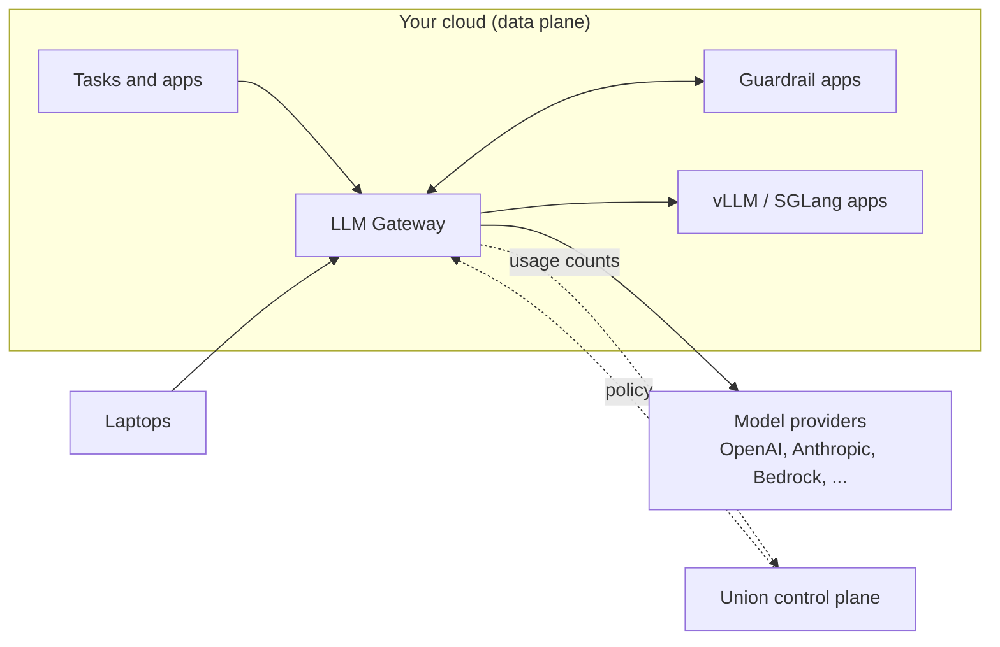

# LLM Gateway

Say five teams build on LLMs. Each one has its own OpenAI key in a secret, nobody knows which key is behind last month's invoice, an Anthropic outage takes down two production apps, and a prompt containing a customer's Social Security number went to a third-party model last week.

The Union LLM Gateway fixes this by putting one OpenAI-compatible endpoint in front of every model provider you use. Every task, app, and laptop calls the gateway instead of calling providers directly, and the gateway applies your policy to every call.

## Why use a gateway

**One provider key, many virtual keys.**
You store each provider's API key once, as a Union secret. Teams, apps, and developers get *virtual keys* (`sk-un-...`) instead. Each virtual key has its own budget, rate limit, and list of allowed models. When a key reaches its budget the gateway rejects further calls, so a runaway agent loop costs what you allowed and no more. Revoking a virtual key never means rotating the provider key that everyone else depends on.

**Fallbacks when a provider fails.**
A request can name fallback models, for example `anthropic/claude-haiku-4-5` behind `openai/gpt-4.1-mini`. If the primary provider errors, is down, or rejects the call for that key, the gateway tries the next model in the list. Your application keeps answering through a provider outage.

**Guardrails before and after every call.**
A *pre-call* guardrail sees each prompt before it reaches a model and can block it, or answer it from your own cache. A *post-call* guardrail sees each answer before it reaches the caller and can withhold it. Guardrails are global: they apply to every key on the gateway, so no team can forget to add them. You write them as small Union apps, in Python with `GuardrailAppEnvironment` or in any language that speaks HTTP.

## One endpoint for everything

The gateway is a single endpoint for all of your LLM traffic:

- **Tasks and apps** in every Union cluster call it with a virtual key stored as a secret. See [Use from tasks and apps](./use-from-tasks-and-apps).
- **Laptops** call it too, so notebooks, coding assistants, and scripts get the same budgets and guardrails as production. You can expose the endpoint publicly, or keep it behind Union sign-in and reach it with `flyte proxy app`. See [Use from your laptop](./use-from-laptop).
- **Self-hosted models** served with vLLM or SGLang on Union sit behind the same endpoint as hosted providers, so callers switch between them by changing a model name.

Spend, token counts, latency, and blocked requests for every key show up in one place: **Settings → LLM Gateway** in the Union console.

## Runs in your cloud

The gateway runs in your data plane, on your compute, as a Union app.

- **Prompts and answers never reach Union's control plane.** Traffic goes from your callers to the gateway to the provider, and nowhere else. The control plane sends the gateway its policy (providers, keys, budgets, guardrails) and receives usage records: which key, which model, how many tokens, what it cost, how long it took. A usage record never contains a prompt or an answer.
- **Provider credentials stay in your data plane.** Provider API keys are Union secrets mounted on the gateway. The policy refers to them by environment variable name and never carries the value.
- **Zero trust.** Every call presents a virtual key. The gateway reaches guardrail apps and self-hosted models over cluster-local addresses, not through ingress. The gateway pulls its policy from the control plane, and the control plane never connects in to the gateway. See [Zero Trust security](../security/_index).
- **Built for proxying.** The gateway is a lightweight proxy written in Go. It enforces budgets and rate limits in memory, without a round trip to the control plane, so enforcement keeps working when the control plane is unreachable. It scales out with request rate.

## In this section

**[Deploy the gateway](./deploy-gateway)**
Choose a cluster, size the gateway, and decide who can reach it.

**[Providers](./providers)**
Add hosted providers such as OpenAI and Anthropic, and self-hosted models served on Union.

**[Virtual keys](./virtual-keys)**
Issue keys with budgets, rate limits, model allowlists, and fallbacks.

**[Use from tasks and apps](./use-from-tasks-and-apps)**
Call the gateway from code running on Union.

**[Use from your laptop](./use-from-laptop)**
Reach the gateway from any local tool, with or without exposing it publicly.

**[Guardrails](./guardrails/_index)**
Check every prompt and every answer with your own code.


