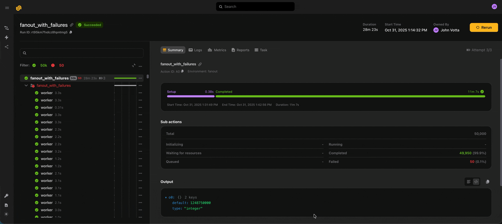
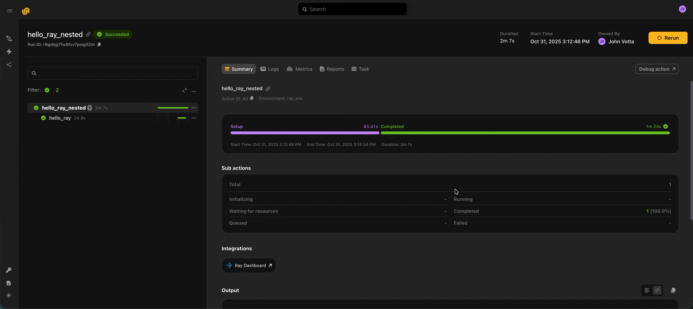
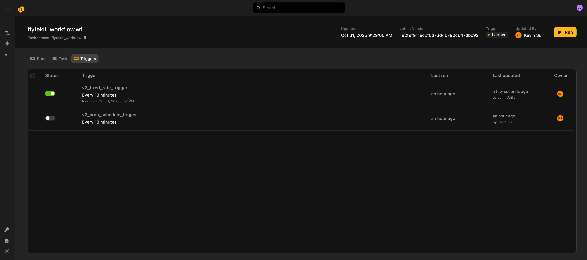
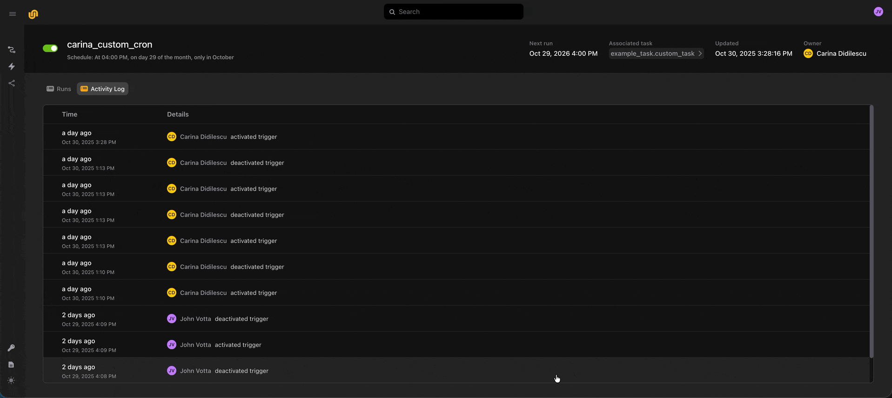
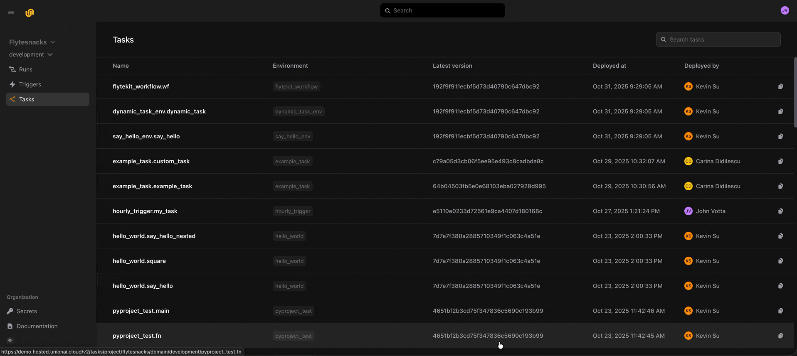

# October 2025

## :infinity: Larger Fanouts

You can now run up to 50,000 actions within a run and up to 1,000 actions concurrently.

To help you observe that many actions, the UI has new group and sub-action views. They show summary statistics for the actions spawned within a group or action.

Use these summary views, along with the action status filter, to spot-check long-running or failed actions.



## :computer: Remote Debugging for Ray Head Nodes

Sometimes you want to inspect the remote execution directly instead of reproducing an error locally. The debug button lets you do that.

When you click **Debug action** on an action in a run, Union spins up that action's environment, code, and input data, and attaches a live VS Code debugger.

Previously, this worked only with plain Python tasks. Now you can debug multi-node distributed computations on Ray directly.



## :zap: Triggers and Audit History

[Triggers](../user-guide/triggers/_index) let you templatize and set schedules for your workflows, similar to Launch Plans in Flyte 1.0.

```python
from datetime import datetime

import flyte

env = flyte.TaskEnvironment(name="trigger_example")

@env.task(triggers=flyte.Trigger.hourly("trigger_time"))  # Every hour
def example_task(trigger_time: datetime, x: int = 1) -> str:
    return f"Task executed at {trigger_time.isoformat()} with x={x}"
```

After you deploy, you can see all the triggers associated with a task:



Union also keeps an audit history of every deploy, activation, and deactivation event, so you can see who has changed an automation.



## :arrow_up: Deployed Tasks and Input Passing

For any deployed task, you can see its runs, task spec, and triggers, and launch it from the UI.

The launch forms now use JSON Schema syntax, so you can copy and paste the inputs from a previous run into a new run of any task.


