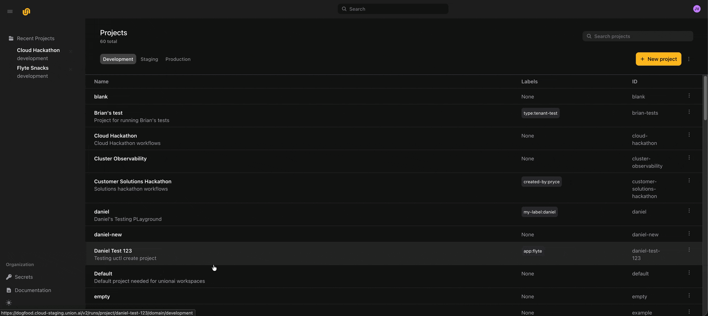

# November 2025

## :fast_forward: Grouped Runs
We redesigned the Runs page to better support large numbers of runs. Historically, large projects produced so many runs that flat listings became difficult to navigate. The new design groups Runs by their root task - leveraging the fact that while there may be millions of runs, there are typically only dozens or hundreds of deployed tasks. This grouped view, combined with enhanced filtering (by status, owner, duration, and more coming soon), makes it dramatically faster and easier to locate the exact runs users are looking for, even in the largest deployments.


## :globe_with_meridians: Apps (beta)

You can now deploy apps in Union 2.0. Apps let you host ML models, Streamlit dashboards, FastAPI services, and other interactive applications alongside your workflows. Simply define your app, deploy it, and Union will handle the infrastructure, routing, and lifecycle management. You can even call apps from your tasks to build end-to-end workflows that combine batch processing with real-time serving.

To create an app, import `flyte` and use either `FastAPIAppEnvironment` for FastAPI applications or the generic `AppEnvironment` for other frameworks. Here's a simple FastAPI example:

```python
from fastapi import FastAPI
import flyte
from flyte.app.extras import FastAPIAppEnvironment

app = FastAPI()
env = FastAPIAppEnvironment(
    name="my-api",
    app=app,
    image=flyte.Image.from_debian_base(python_version=(3, 12))
        .with_pip_packages("fastapi", "uvicorn"),
    resources=flyte.Resources(cpu=1, memory="512Mi"),
    requires_auth=False,
)

@env.app.get("/greeting/{name}")
async def greeting(name: str) -> str:
    return f"Hello, {name}!"

if __name__ == "__main__":
    flyte.init_from_config()
    flyte.deploy(env) # Deploy and serve your app
```

For Streamlit apps, use the generic `AppEnvironment` with a command:

```python
app_env = flyte.app.AppEnvironment(
    name="streamlit-hello-v2",
    image=flyte.Image.from_debian_base(python_version=(3, 12)).with_pip_packages("streamlit==1.41.1"),
    command="streamlit hello --server.port 8080",
    resources=flyte.Resources(cpu="1", memory="1Gi"),
)
```

You can call apps from tasks by using `depends_on` and making HTTP requests to the app's endpoint. Please refer to the example in the [SDK repo](https://github.com/flyteorg/flyte-sdk/blob/main/examples/apps/call_apps_in_tasks/app.py). Similarly, you can call apps from other apps (see this [example](https://github.com/flyteorg/flyte-sdk/blob/main/examples/apps/app_calling_app/app.py)).

## :label: Custom context

You can now pass configuration and metadata implicitly through your entire task execution hierarchy using custom context. This is ideal for cross-cutting concerns like tracing IDs, experiment metadata, environment information, or logging correlation keys: data that needs to be available everywhere but isn't logically part of your task's computation.

Custom context is a string key-value map that automatically flows from parent to child tasks without adding parameters to every function signature. Set it once at the run level with `with_runcontext()`, or override values within tasks using the `flyte.custom_context()` context manager:

```python
import flyte

env = flyte.TaskEnvironment("custom-context-example")

@env.task
async def leaf_task() -> str:
    # Reads run-level context
    print("leaf sees:", flyte.ctx().custom_context)
    return flyte.ctx().custom_context.get("trace_id")

@env.task
async def root() -> str:
    return await leaf_task()

if __name__ == "__main__":
    flyte.init_from_config()
    # Base context for the entire run
    run = flyte.with_runcontext(custom_context={"trace_id": "root-abc", "experiment": "v1"}).run(root)
    print(run.url)
```

## :lock: Secrets UI

Now you can view and create secrets directly from the UI. Secrets are stored securely in your configured secrets manager and injected into your task environments at runtime.



## Image builds now run in the same project-domain
The image build task is now executed within the same project and domain as the user task, rather than in system-production. This change improves isolation and is a key step toward supporting multi-dataplane clusters.

## Support for secret mounts in Poetry and UV projects
We added support for mounting secrets into both Poetry and UV-based projects. This enables secure access to private dependencies or credentials during image build.

```python
import pathlib

import flyte

env = flyte.TaskEnvironment(
    name="uv_project_lib",
    resources=flyte.Resources(memory="1000Mi"),
    image=(
        flyte.Image.from_debian_base().with_uv_project(
            pyproject_file=pathlib.Path(__file__).parent / "pyproject.toml",
            pre=True,
            secret_mounts="my_secret",
        )
    ),
)
```
