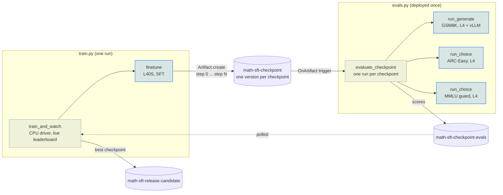
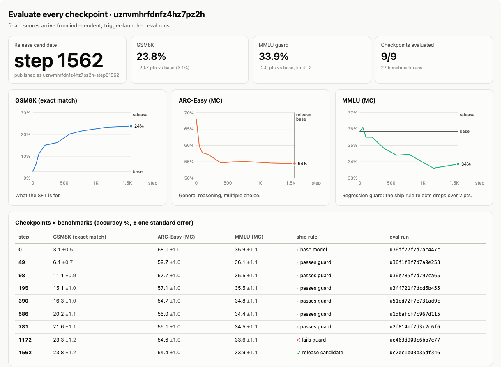
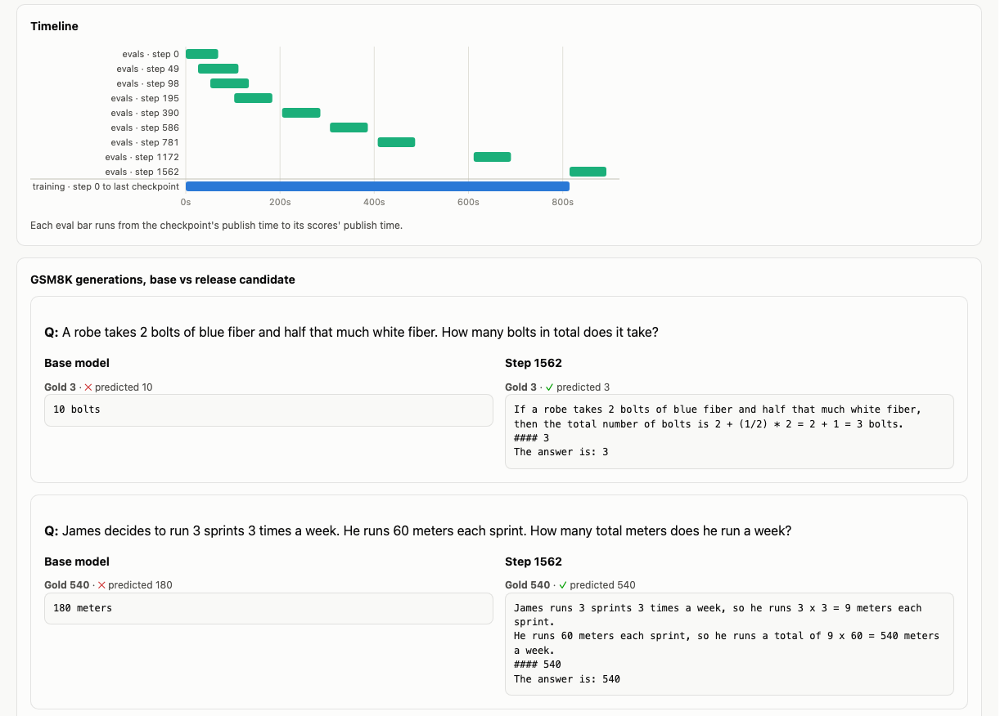

# Evaluate every checkpoint

> [!NOTE]
> Code available [on GitHub](https://github.com/unionai/unionai-examples/tree/main/v2/tutorials/checkpoint_evals).

A training run saves checkpoints. Picking the one to ship takes evaluations. Post-training and
evals teams at frontier labs run a benchmark suite on every checkpoint a job saves, while the
job keeps training. The scores decide which checkpoint becomes the release candidate. They also
catch a regression, such as a skill the new data is wearing away, while there is still time
to stop the run. [OLMo](https://arxiv.org/abs/2402.00838) evaluates during training and again
offline on saved checkpoints, with a standard suite
([OLMES](https://arxiv.org/abs/2406.08446)) so that scores from different runs are comparable.
[DataDecide](https://arxiv.org/abs/2504.11393) shows why the early checkpoints are worth
scoring too: rankings at intermediate checkpoints predict the final ranking well, so evals on
small, early checkpoints can decide what to train at scale.

At scale this is an infrastructure problem more than a benchmark problem:

- **Training must not wait for evals.** An eval suite is hours of GPU time on a large model. If
  the trainer runs evals itself, it either stalls or runs a smaller suite than you want.
- **Evals must not depend on the trainer.** The eval team changes benchmarks, prompts, and
  scorers on its own schedule. It should not have to edit, or even know about, the training job.
- **Old checkpoints get new benchmarks.** When a benchmark is added, the team wants it on every
  checkpoint it already has, without paying again for the scores that have not changed.
- **Scores must be reproducible.** The same checkpoint and the same benchmark version should
  give the same number. Greedy decoding with batched inference is less deterministic than it
  looks; see [Defeating nondeterminism in LLM inference](https://thinkingmachines.ai/blog/defeating-nondeterminism-in-llm-inference/).

This tutorial builds that system at small scale. A trainer fine-tunes
[SmolLM2-360M](https://huggingface.co/HuggingFaceTB/SmolLM2-360M) on math word problems and publishes
each checkpoint as a new version of an artifact. A separately deployed evaluator has an
artifact trigger on that artifact, so every new checkpoint starts its own eval run, which fans
out three benchmarks in parallel. A report on the trainer's side draws learning curves as the
scores arrive and promotes the best checkpoint as a release candidate.

## How it fits together



The trainer and the evaluator meet only in the artifact service. The trainer never calls the
evaluator, and the evaluator never imports the trainer's code; `train.py` deploys the evaluator
before it starts only so that a first run works with one command.

| Need | Construct |
| --- | --- |
| Publish a checkpoint mid-training, without stopping | `flyte.remote.Artifact.create` from inside the training task, partitioned by run and step |
| Start an eval run for every new checkpoint | `flyte.Trigger` with `flyte.OnArtifact`, deployed once with `flyte.deploy` |
| Hand the checkpoint and its step to the eval run | `flyte.TriggeredArtifact` and `flyte.TriggeredPartition` in the trigger's inputs |
| Score benchmarks in parallel | One task per benchmark, each on its own GPU, run with `asyncio.gather` |
| Never score the same checkpoint and benchmark version twice | `flyte.Cache` with an explicit version; the benchmark version is a task input |
| Learning curves while training runs | `report=True` on the driver, redrawn as score artifacts arrive |
| Ship a checkpoint | A release-candidate artifact with a model card and lineage to the checkpoint |

## Getting started

You need a cluster with one NVIDIA L40S for training and NVIDIA L4s for evals. Each eval run
uses three L4s, and early checkpoints arrive faster than an eval run finishes, so up to about
nine L4s are busy at once. Any GPU with 24 GB or more works; change `train_env` in `train.py`
(shown below) and the environments in `evals.py`.

```bash
git clone https://github.com/unionai/unionai-examples
cd unionai-examples/v2/tutorials/checkpoint_evals
python train.py
```



`train.py` deploys the evaluator first, because its trigger has to be active before the first
checkpoint is published. You can also deploy it on its own with `python evals.py`, or with
`flyte deploy evals.py eval_env`. The first run builds two images. The GPU image, with vLLM,
transformers and datasets, takes a while to build; later runs reuse it. `--smoke` trains on 1,600 problems, publishes step 0 and two checkpoints,
and scores 40 problems per benchmark, which takes about three minutes once the images exist.
Forty problems are too few for the ship rule, so a smoke run usually ends without a release
candidate.

## The shared contract

The two sides agree on artifact names and a benchmark registry. Every benchmark has a version.
Bumping one benchmark's version re-scores only that benchmark on every checkpoint, and the
others stay cached.





The ship rule is part of the contract too: the release candidate is the checkpoint with the
best GSM8K score whose MMLU score is at most two points below the base model's. MMLU here is a
regression guard. It measures general knowledge, with the math subjects left out, which math
fine-tuning can wear away.

## The trainer publishes checkpoints

The trainer has two environments: one L40S for training, and a small CPU driver that waits on
it and draws the leaderboard.



`finetune` is a plain PyTorch loop: full fine-tuning in bf16 autocast, AdamW, a short warmup
and a cosine decay, and the loss on the answer tokens only. The training data is the
GSM8K-derived part of [MetaMathQA](https://huggingface.co/datasets/meta-math/MetaMathQA), in the
same `Question: ... Answer:` format the evals use. SmolLM2-360M is small enough to fine-tune
in minutes, and weak enough at math that the learning curve has room to move. Checkpoints are spaced closer early on,
where the curves move fastest, and step 0 is the base model, so the base model goes through
exactly the same eval path as every checkpoint.



The training loop runs in a thread (`asyncio.to_thread`). When it saves a checkpoint, it hands
the upload to the task's event loop with `asyncio.run_coroutine_threadsafe` and goes straight
on to the next step. `publish_checkpoint` uploads the directory and creates a new version of
the checkpoint artifact. The partitions carry the training run, the step, and the profile.



`Artifact.create` publishes from anywhere: a task, a notebook, or another system's job. The
more common way to publish an artifact is to return `flyte.artifacts.new(...)` from a task,
which the evaluator does with its scores. A checkpoint is not a task output, though. It
appears in the middle of a task, and the eval for it should start right away.

## The evaluator runs on every new version

The evaluator has three environments: a small CPU driver, an L4 for generative evals with
vLLM, and an L4 for multiple-choice evals with transformers. The two L4 environments use the
same image as the trainer.



The trigger watches the checkpoint artifact. `flyte.TriggeredArtifact` binds the new version's
value, a `flyte.io.Dir`, to the `checkpoint` input. `flyte.TriggeredPartition` binds partition
values to the other inputs. `flyte.OnArtifact` can also filter on partition values, for example
`flyte.OnArtifact(CHECKPOINT_ARTIFACT, profile="full")` to skip smoke runs.



`evaluate_checkpoint` fans the suite out, one task per benchmark, and publishes the merged
scores as a version of the results artifact, with the same partitions as the checkpoint.



Each benchmark task is cached. Its inputs are the checkpoint, the benchmark name, the
benchmark version, and the sample size, and the cache version is fixed in code. So the cache
key is (checkpoint, benchmark, benchmark version), and changing a report or the driver does
not throw finished scores away.



## The benchmarks

Each benchmark is a fixed, seeded slice of a public test split.



GSM8K is generative. vLLM decodes greedily, and the score is exact match on the final number.
The extractor takes the number after "The answer is", the phrase MetaMathQA answers end with,
and falls back to the last number in the output, so the base model is not penalized for
formatting it was never taught.





ARC-Easy and MMLU are multiple choice, scored in the cloze form: the model reads the question,
and the option whose own text has the highest log-likelihood per character wins. Small models
answer near chance when they must pick a letter, so [OLMES](https://arxiv.org/abs/2406.08446)
scores them this way.



## The trainer's leaderboard

The driver starts `finetune` as a background asyncio task. Every 30 seconds it lists the
results artifact for its own training run, redraws the report, and stops once every published
checkpoint has scores. Then it applies the ship rule and promotes the winner.







Promotion publishes the winning checkpoint's directory again, under the release-candidate name,
with a model card and the checkpoint version as its parent. Anything downstream, such as a
serving app or a longer eval suite, can load
`flyte.remote.Artifact.get("math-sft-release-candidate")` without knowing which run or step
produced it.



## Results

A run with the defaults fine-tuned SmolLM2-360M on 50,000 MetaMathQA problems: 1,562 optimizer
steps in 13.6 minutes on one L40S. The trainer published step 0 and eight checkpoints, and the
trigger started nine eval runs, each scoring 1,319 GSM8K problems, all 2,376 ARC-Easy questions,
and 2,000 MMLU questions on three L4s. Each eval run took about 80 seconds. The first
checkpoints came 25 to 50 seconds apart, so their eval runs overlapped each other and training;
from step 390 on, checkpoints were 100 to 200 seconds apart and each eval run finished before
the next checkpoint was saved. The last scores landed within two minutes of the end of
training, and the whole run took 19 minutes.

| Step | GSM8K | ARC-Easy | MMLU (guard) | Ship rule |
| --- | --- | --- | --- | --- |
| 0 (base) | 3.1 | 68.1 | 35.9 | base model |
| 49 | 6.1 | 59.7 | 36.1 | passes |
| 98 | 11.1 | 57.7 | 35.5 | passes |
| 195 | 15.1 | 57.2 | 35.5 | passes |
| 390 | 16.3 | 54.7 | 34.8 | passes |
| 586 | 20.2 | 55.0 | 34.4 | passes |
| 781 | 21.6 | 55.1 | 34.5 | passes |
| 1172 | 23.3 | 54.6 | 33.6 | fails |
| 1562 | 23.8 | 54.4 | 33.9 | release candidate |

Accuracy in percent. One standard error is about 1.2 points on GSM8K and 1.1 on MMLU.



GSM8K goes from 3% to 24%. Most of the gain comes early: more than half of it by step 195, an
eighth of the way through. The base model mostly answers with a bare number; the fine-tuned one works
the problem step by step and ends with "The answer is", the MetaMathQA format.



MMLU drifts down by about two points, which is exactly the guard's limit. Step 1172 fails the
guard at 33.6, and step 1562 passes at 33.85, so the last checkpoint became the release
candidate. In an earlier run with the same settings, both of the last two checkpoints scored
just under the limit and the ship rule picked step 781 instead. The limit is 2 points, and one
standard error of a single MMLU score is 1.1 points, but what the rule compares is the
difference between two scores on the same 2,000 questions. A fixed threshold on that difference
decides on noise near the boundary. A paired test, such as McNemar's test on the per-question
right and wrong answers of the base model and the checkpoint, tells whether a drop is real;
a larger guard set narrows the noise.

ARC-Easy is the surprise: it falls 13 points, most of it in the first 49 steps. The ship rule
does not look at it, so this regression would ship.

## Add a benchmark to every checkpoint

Was the ARC-Easy drop real? Its prompt, `Question: ...` followed by `Answer:`, is exactly the
SFT prompt, so a fine-tuned model may expect a worked solution there rather than a short answer.
`benchmarks.py` has a second ARC prompt, `ARC_PROMPTS["2"]`, ending in `The answer is:`, the
phrase that precedes the final answer in the training data. The benchmark version selects the
prompt, and bumping a benchmark's version re-scores it on every checkpoint. To run the
experiment, make two changes to `BENCHMARKS` in `config.py`: bump ARC-Easy to version `"2"`,
and register ARC-Challenge with the same prompt.

```python
    "arc_easy": {"kind": "choice", "version": "2", "limit": 0, "label": "ARC-Easy (MC)", "role": "reasoning"},
    "arc_challenge": {"kind": "choice", "version": "2", "limit": 0, "label": "ARC-Challenge (MC)",
                      "role": "reasoning"},
```

`--backfill` re-runs the suite on every checkpoint of a training run, with extra benchmarks
added. It passes the checkpoint artifacts as run inputs.



```bash
python evals.py --backfill <train_run> arc_challenge
python train.py --leaderboard <train_run>
```

The backfill started nine eval runs. In each one, GSM8K and MMLU came back from the cache in a
tenth of a second, and only ARC-Easy v2 and ARC-Challenge ran, about 30 and 50 seconds on an L4.
The leaderboard keeps only the newest scores for each checkpoint, so the table below combines
the leaderboard from before the backfill (ARC-Easy v1) with the one after it:

| Step | ARC-Easy v1 | ARC-Easy v2 | ARC-Challenge |
| --- | --- | --- | --- |
| 0 (base) | 68.1 | 69.7 | 37.5 |
| 49 | 59.7 | 64.4 | 37.5 |
| 195 | 57.2 | 59.5 | 36.1 |
| 781 | 55.1 | 58.7 | 35.8 |
| 1562 | 54.4 | 56.4 | 35.6 |

The new prompt slows the drop in the first steps, but ARC-Easy still loses 13 points by the
end. The drop survives a second prompt format. ARC-Challenge, where the base model scores
37.5% against 25% for chance, moves by two points. The next ship rule should guard ARC-Easy
too. With that rule, no checkpoint of this run ships, and the fix belongs in the training data,
for example by mixing general text back into the math SFT.

## At real scale

- **Bigger checkpoints.** A 70B checkpoint does not fit one GPU. Point `generate_env` at a
  multi-GPU node and set vLLM's `tensor_parallel_size`, or serve the checkpoint once as an app
  and point every benchmark task at it.
- **A real suite.** Production suites have dozens of tasks, each with its own prompt format and
  scorer, often from a harness such as [OLMES](https://github.com/allenai/olmes) or
  lm-evaluation-harness. Each one becomes a cached task in the fan-out, with its own version.
- **Pretraining runs.** A trainer that writes thousands of checkpoints can publish every Nth one,
  or publish them all and filter the trigger on a partition such as `eval_tier="full"`.
- **Gate the run.** The driver already sees the guard scores while training runs. It can abort
  the training run, or page someone, when a guard drops past its limit.

## Related

- [Publish artifacts](../../../user-guide/artifacts/publish-artifacts)
- [Artifact triggers](../../../user-guide/triggers/artifact-triggers)
- [Partition triggers](../../../user-guide/triggers/partition-triggers)
- [Caching](../../../user-guide/tasks/task-configuration/caching)
- [Reports](../../../user-guide/tasks/task-programming/reports)
