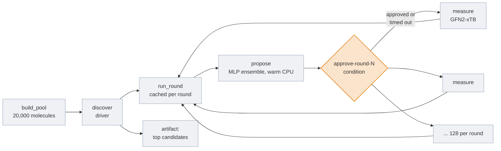
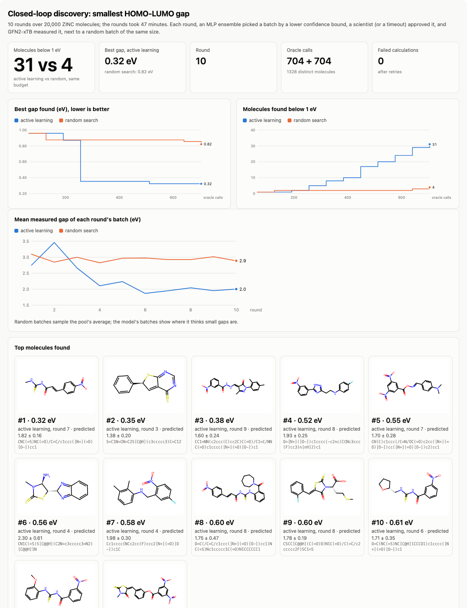
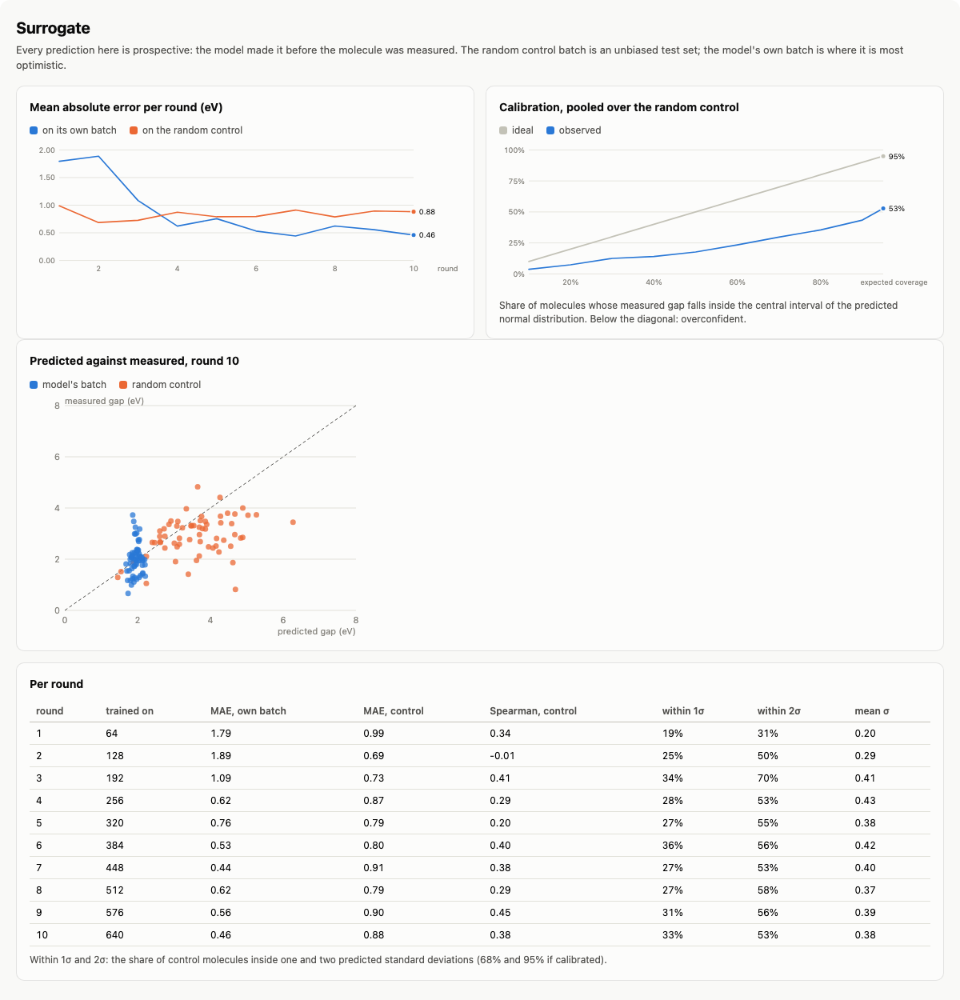

# Closed-loop molecular discovery

> [!NOTE]
> Code available [on GitHub](https://github.com/unionai/unionai-examples/tree/main/v2/tutorials/closed_loop_discovery).

AI-for-science labs no longer screen a library once and stop. They run a loop: a model proposes
candidates, a simulation or a robotic lab measures the most promising ones, the measurements
retrain the model, and the next batch is better. [Lila Sciences](https://www.lila.ai/news/scaling-autonomous-science-to-build-scientific-superintelligence)
builds whole "AI Science Factories" around this loop. [A-Lab](https://www.nature.com/articles/s41586-023-06734-w)
ran it for 17 days on inorganic materials, with robots doing the synthesis. EvolutionaryScale's
[esmGFP](https://www.evolutionaryscale.ai/blog/esm3) came out of a model that generated thousands
of candidate proteins, of which a small fraction were made and tested in the lab. And for molecules,
[pool-based active learning](https://pubs.rsc.org/en/content/articlelanding/2021/sc/d0sc06805e)
finds most of the top hits of a virtual screen after measuring a few percent of the library.

The loop is simple to describe and awkward to run. The measurement is the expensive part, so it
has to fan out over many machines and must never be paid for twice. Measurements fail: a
calculation does not converge, a robot drops a plate. The loop runs for hours or days, so a
crash in round 7 should not throw away rounds 1 to 6. And a person usually signs off on what
goes to the lab, because lab time is the scarce resource, which means the loop has to stop and
wait for an answer without stalling when nobody is around.

This tutorial runs the loop on Union at a scale that finishes in under an hour. By the end
you will have:

- a pool of 20,000 drug-like molecules from ZINC250k, and an *oracle* that computes each one's
  HOMO-LUMO gap with GFN2-xTB, a semi-empirical quantum chemistry method;
- a surrogate model with uncertainty, an ensemble of MLPs on molecular fingerprints, retrained
  every round, and an acquisition function that picks a diverse batch of 64;
- a human approval step before every batch, with a timeout so an unattended run keeps going;
- a random search with the same oracle budget, run alongside, so you can see what the model is worth;
- the best molecules published as a dataset artifact with a card.

## The task

The objective is to find the molecules with the smallest HOMO-LUMO gap, the energy between the
highest occupied and lowest unoccupied molecular orbitals. A small gap is a first screen for
organic semiconductors and dyes. Small gaps are rare in a drug-like library: the median
molecule in the pool has a gap near 3 eV, and fewer than 1 molecule in 100 has a gap below 1 eV.

The oracle is real compute, not a table lookup. For each molecule it embeds 8 3D conformers with
RDKit, relaxes them with a force field, optimizes the best 3 with GFN2-xTB, and reads the
orbital energies of the lowest-energy structure. That takes a few seconds per molecule and can
fail in several ways, which is what makes it a fair stand-in for a lab.



## What Union adds

| Need | Construct |
| --- | --- |
| Measure 128 molecules a round without a pod per molecule | A reusable environment, `flyte.ReusePolicy(replicas=(2, 12))` |
| Never measure a molecule twice, in this run or any later one | `flyte.Cache("auto", salt=ORACLE_VERSION)` on the per-molecule `measure` task |
| Keep the surrogate's imports and data warm between rounds | A one-replica reusable environment for `propose` |
| Let a scientist approve each batch | `flyte.new_condition`, with a timeout that auto-approves |
| Resume a crashed loop from the last finished round | Each round is a cached task whose output is the whole loop state |
| See the loop's progress while it runs | A live report, with tabs for the surrogate, the batches, and the oracle |
| Keep the result | `flyte.artifacts` with a dataset card |

## Getting started

You need a Union cluster. The pool is downloaded from a public URL inside the run, and every
package comes from PyPI.

```bash
git clone https://github.com/unionai/unionai-examples
cd unionai-examples/v2/tutorials/closed_loop_discovery
python discovery.py            # 10 rounds of 64 over 20,000 molecules, about 45 minutes
python discovery.py --smoke    # 2 rounds of 16 over 2,000 molecules, about 6 minutes
```

The 45 minutes assume someone approves each batch within a few seconds of it being proposed.
Each round waits up to 3 minutes (`approval_timeout_s=180`) for an answer, so an unattended run
adds about 30 minutes of waiting. To run without the gate, launch with `approval_timeout_s=0`:

```python
flyte.run(discover, approval_timeout_s=0)
```

To approve a batch from Python, look the condition up by its name:

```python
import flyte
from flyte.remote import Condition

flyte.init_from_config()
Condition.get("approve-round-3", run_name="<run name>").signal(True)
```

From the CLI, a condition is signaled by its action name, a generated ID. `flyte get condition`
lists the conditions of a run with their action names:

```bash
flyte get condition <run-name>
flyte signal condition <run-name> <action-name> true
```

## The image and environments

One image serves every task: RDKit for molecules, `tblite` and ASE for GFN2-xTB, scikit-learn
for the surrogate, and `unionai-reuse`, which reusable environments need. The oracle runs on a
pool of 2-CPU replicas that grows to 12 while a round is in flight. Each call measures one
molecule, so a slow molecule holds up one slot, not a batch. The surrogate gets a single warm
replica with 4 CPUs.



## The pool

The pool is a random sample of ZINC250k. GFN2-xTB in the gas phase gives ions and zwitterions
gaps that are far too small, so the pool keeps neutral molecules: it neutralizes what it can,
and drops any charged atom that is not part of a nitro group. The fingerprints are computed
once here and shipped with the pool, so the surrogate never recomputes them.



## The oracle

`measure_gap` is plain Python with no Flyte in it. Each attempt embeds conformers, relaxes
them, optimizes the best ones with GFN2-xTB, checks that no bond broke during the
optimization, and reads the orbital energies. A failed attempt is retried with random-coordinate
embedding and a higher electronic temperature, which helps a stubborn SCF converge.



The task around it is short. The calculation runs in a thread so the replica stays responsive.
A molecule that fails every attempt comes back as a `Measurement` with `ok=False` and the
reasons, so it counts against the budget like a failed experiment and never fails the round.
Task-level `retries=2` are for the infrastructure: a replica that is preempted mid-calculation.
The task's cache keys every result on the SMILES string, and the result records the run that
computed it, so the report can count how many measurements came from earlier runs. `"auto"`
caching hashes the task's own source, not the modules it imports, so a change to `oracle.py`
would go unnoticed. The cache is salted with `ORACLE_VERSION` from `oracle.py`; bump it when you
change the protocol and every molecule is measured again. `propose` is salted the same way with
`SURROGATE_VERSION` from `surrogate.py`.



## The surrogate and the acquisition function

The surrogate is a bootstrap ensemble of 8 MLPs on 2048-bit Morgan fingerprints. Each member
sees a resample of the measured molecules, so the members disagree where data is thin, and that
spread is the model's uncertainty. Each round, every molecule in the pool gets a lower confidence
bound on its gap, `mean - beta * std`, and the batch is filled greedily from the best bound
down, skipping molecules too similar to one already picked.



`propose` retrains the ensemble on every successful measurement so far and scores the whole
pool. It also predicts the random control batch, which gives an unbiased, prospective test of
the model every round.



## The approval gate

Before a batch goes to the oracle, the loop asks for approval. `flyte.new_condition` registers a
condition on the run with a Markdown prompt that summarizes the batch: what the model predicts,
how wrong it was last round, and the top 10 molecules. The run waits until someone signals the
condition, from the UI, the CLI, or the API. A rejected batch is skipped, and its molecules are
never proposed again.

A loop that runs overnight must not stall on a question nobody is awake to answer, so the
condition has a timeout. If it expires, `wait()` raises `ConditionTimedoutError` and the batch is
approved automatically. Set `approval_timeout_s=0` to turn the gate off.



## One round, durably

A round picks the random control batch, asks for a proposal, waits for approval, and measures
both batches at once on the oracle pool. Round 0 is the seed library, random molecules shared by
both arms, because the model needs data before it can propose anything.

The loop state is a few dataclasses: a `Pick` is one proposed molecule with its prediction, a
`Proposal` is one round's two batches, a `RoundLog` is what happened in a round, and `LoopState`
is every round so far plus the molecules a scientist vetoed.



`run_round` takes the loop state and returns the next one, and it is cached. If the driver
crashes in round 7, its retry calls `run_round` for rounds 0 to 6 with the same inputs, gets the
cached states back in seconds, and carries on. A finished round, approval included, is never run
or asked about twice.

That cuts both ways. The approval decision is part of the cached output, so a later run with the
same inputs replays every round, and every past approval, without asking anyone. That is what you
want when a driver crashes, and not what you want when you start a new campaign on the same pool.
`run_round` takes a `campaign` name as an input for that reason: launch with a new one, for
example `flyte.run(discover, campaign="zinc-small-gap-2")`, and every round is proposed, approved,
and recorded afresh, while molecules measured before still come from the oracle's cache.



## The driver

The driver builds the pool, runs the rounds, and refreshes the report after each one. At the end
it writes the final report and its tabs, and publishes the 50 smallest-gap molecules as a CSV
with a card.



## Results

A run with the defaults took 48 minutes: 10 rounds after the seed library, 64 molecules per arm
per round, 704 oracle calls per arm, and 1,328 distinct molecules in all (16 molecules were picked
by both arms in the same round and computed once). Each GFN2-xTB measurement took 10 seconds
at the median and 58 seconds at the most. 22 of the measurements were cache hits from an earlier
smoke run, which happened to sample the same molecules, and were never recomputed.

| | Active learning | Random search |
| --- | --- | --- |
| Oracle calls | 704 | 704 |
| Molecules found below 1 eV | 31 | 4 |
| Smallest gap found | 0.32 eV | 0.82 eV |
| Mean gap of a batch, rounds 4 to 10 | about 2.0 eV | about 2.9 eV |

Both arms start from the same seed library, which held one molecule below 1 eV. Random search
found 3 more in 640 calls, the rate you would expect when fewer than 1 molecule in 100 qualifies.
Active learning found 30 more with the same budget. Its first two batches were no better than
random, and the second was worse, with a mean gap of 3.5 eV: trained on 128 molecules, the model's
uncertainty dominated the bound and it explored. From round 4 on, every batch averaged about 2 eV,
and the count of small-gap molecules climbed in almost every round.



The Surrogate tab is the honest part of the report. On the random control, which the model never
chose, its error stayed between 0.7 and 0.9 eV and its rank correlation between 0.2 and 0.45: it
is a poor predictor of the gap of an average molecule. On its own batches, its error fell from
1.8 eV to under 0.5 eV, because those batches are where it has learned the most. That is enough to
rank the small-gap tail, which is all the loop needs. The ensemble is overconfident: at round 10,
33% of control molecules fell inside one predicted standard deviation and 53% inside two, against
68% and 95% for a calibrated model. Bootstrap ensembles of small networks are known to do this. If
you need calibrated uncertainty, rescale the standard deviation with the control's residuals each
round; the control set gives you the data for it for free.



The best molecule, an (E)-3-(4-nitrophenyl)acryloyl thiourea, was found in round 7. The model
predicted 1.82 ± 0.16 eV for it, well inside the batch but far from the 0.32 eV it measured. Most of
the top 12 are nitroaromatics with an electron donor on the other side of a conjugated path. These
are real push-pull chromophores, and GFN2-xTB also underestimates their gaps, so they are what
you would send to a DFT calculation next, not a final answer.

No calculation in the run failed, and none needed a retry. Failures are rare for neutral
drug-like molecules at this level of theory. In local testing, one small-gap molecule broke a bond
during the xTB optimization on its first two attempts and was measured on the third, with random
coordinates and a higher electronic temperature. The handling is there for the molecules and
oracles where failures are common.

### The approval gate in practice

Every round opened a condition named `approve-round-N` on the run, which pauses the round and
shows the Markdown prompt in the UI's signal form. Round 1 was approved with the
`signal_condition` tool of the Flyte MCP server, and the others with `Condition.signal(True)` from a
script, 20 to 30 seconds after they opened. Round 7 was left alone: its condition timed out after
180 seconds, the driver caught `ConditionTimedoutError`, and the round went ahead as auto-approved.
The Oracle tab records each decision and how long it waited.

### Resuming a finished loop

Launching the same command again produced a new run that finished in 16 seconds. Every
`run_round` call was a cache hit, so none of the 11 rounds ran again, no condition was opened,
and the driver rebuilt the report and republished the artifact from the cached states. A driver
that crashes partway through resumes the same way, from the last round that finished. Because
the run used the same `campaign`, it also reused all 10 approvals from the first run.

The 50 smallest-gap molecules are published as the `closed-loop-top-candidates` artifact, a CSV
with the measured orbital energies, which arm found each molecule, and what the model predicted
before it was measured. Its card has the same charts and the top molecules.

### What we changed along the way

- **The pool.** The first pool kept ZINC's charged molecules. In the gas phase, GFN2-xTB gives
  zwitterions such as amino acids gaps near 0.1 eV, and those artifacts filled the top of the
  ranking. The pool now neutralizes molecules and keeps only nitro groups as charged atoms.
- **The oracle.** A single-point calculation on a force-field geometry takes 20 milliseconds, which
  is a table lookup in all but name. Conformer search and an xTB geometry optimization made each
  measurement 10 seconds of real compute, and made the gaps depend on a converged structure.
- **The drawings.** RDKit's drawing code loads `libXrender` and `libexpat`, which the slim Debian
  base image leaves out. Without them the report fell back to SMILES strings. The image now installs
  them with `with_apt_packages`.

## At real scale

- **A real oracle.** Swap `measure_gap` for a DFT calculation, a docking run, or a call to a lab
  scheduler. A DFT oracle needs bigger replicas and longer timeouts; nothing else in the loop changes.
- **A bigger library.** Enamine REAL has billions of molecules. Score the pool in shards with a
  fan-out of `propose` tasks, and keep the fingerprints in a `flyte.io.DataFrame`.
- **A better surrogate.** Replace the MLP ensemble with a graph neural network ensemble on a GPU.
  `propose` is the only task that changes.
- **Multi-fidelity.** Send cheap GFN2-xTB results through the loop, and let the approval gate
  forward the best few to DFT, the way a lab triages before synthesis.

## Related

- [Conditions](../../../user-guide/tasks/task-programming/conditions)
- [Reusable containers](../../../user-guide/tasks/task-configuration/reusable-containers)
- [Caching](../../../user-guide/tasks/task-configuration/caching)
- [Reports](../../../user-guide/tasks/task-programming/reports)
- [Publish artifacts](../../../user-guide/artifacts/publish-artifacts)
