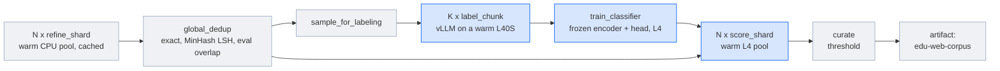
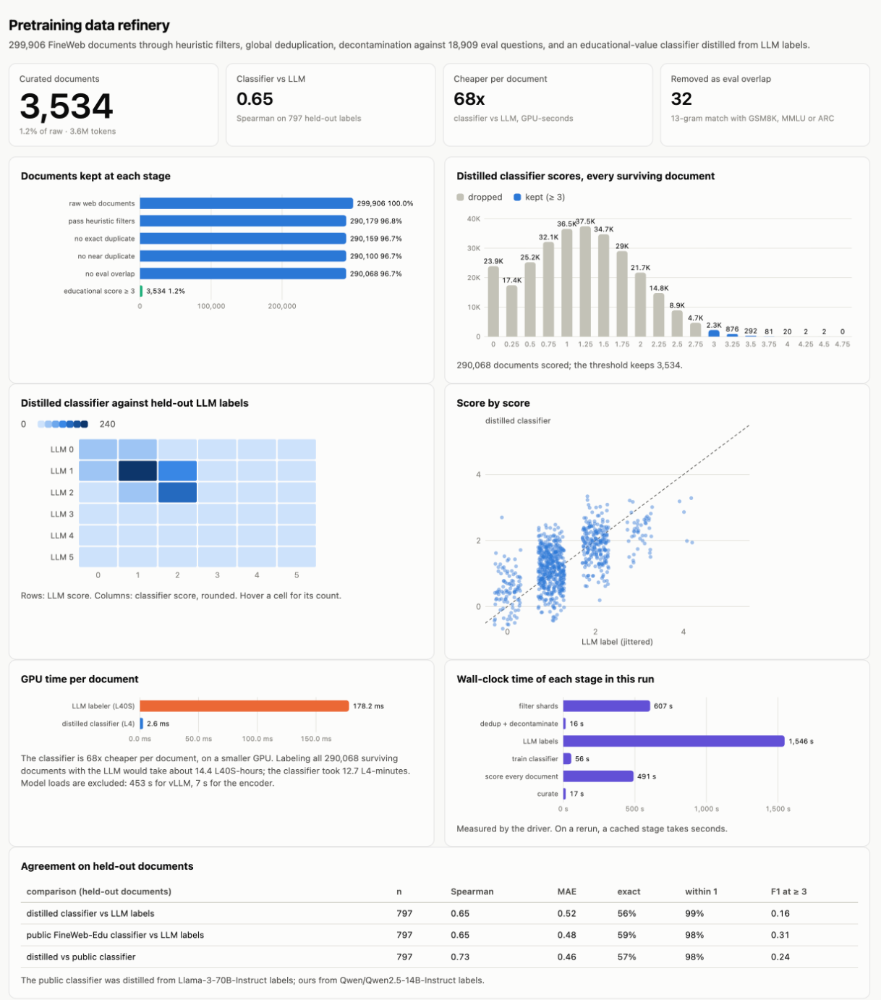
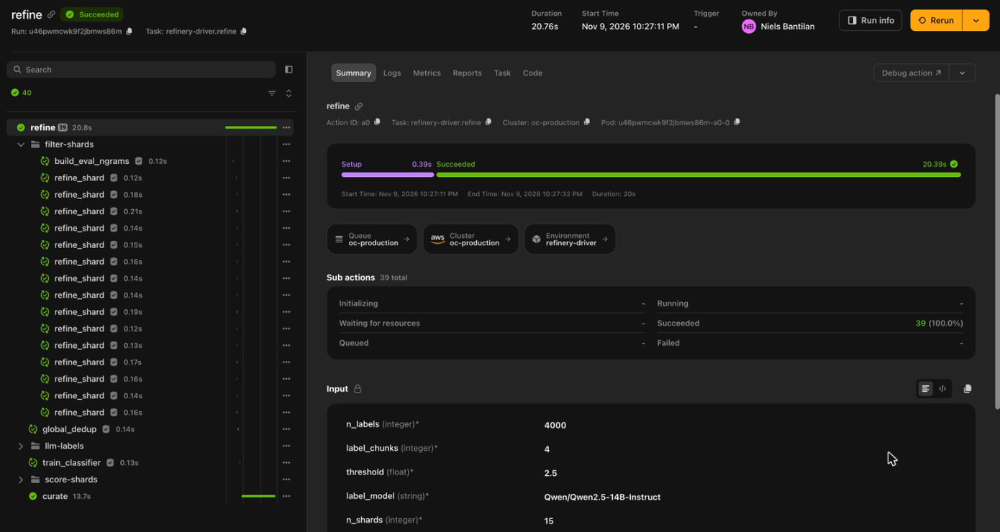

# Refine a pretraining corpus

> [!NOTE]
> Code available [on GitHub](https://github.com/unionai/unionai-examples/tree/main/v2/tutorials/pretraining_data_refinery).

Most of the work that goes into a language model happens before training starts, on the data.
The data teams at LLM labs take raw web crawl, tens of billions of pages, and decide which of
them the model will read. Public pipelines show the shape of this work.
[FineWeb](https://arxiv.org/abs/2406.17557) extracts text from Common Crawl, filters it with
heuristic rules, and removes near-duplicates. Its educational subset, FineWeb-Edu, then had
Llama-3-70B-Instruct score about 450,000 pages for educational value, trained a small
[classifier](https://huggingface.co/HuggingFaceFW/fineweb-edu-classifier) on those scores, and
used the classifier to filter 15 trillion tokens down to 1.3 trillion.
[Essential-Web](https://arxiv.org/abs/2506.14111) labels 24 trillion tokens with a taxonomy
the same way, with a 0.5B model distilled from a 32B one.
[Zyda-2](https://arxiv.org/abs/2411.06068) deduplicates across source datasets and filters by
quality, and [OLMo 3](https://arxiv.org/abs/2512.13961) decontaminates its training data
against its evaluation suite.

The pattern is the same everywhere: cheap rules on every document, a global step that needs
to see every shard at once, an expensive LLM on a small sample, and a cheap model that carries
the LLM's judgment to the rest. At scale it is hard because each stage wants different
hardware, a full pass is expensive, and the thresholds change: you want to rerun the last step
without paying for the first ones again.

This tutorial runs that pipeline, scaled down to 300,000 FineWeb documents:

- heuristic filters, exact hashes, and MinHash signatures on a warm pool of CPU workers, one
  cached task per shard;
- a global step that removes exact and near duplicates across shards, and documents that
  overlap the GSM8K, MMLU, or ARC test sets;
- an open LLM, Qwen2.5-14B-Instruct under vLLM on a warm L40S, that scores 4,000 sampled
  documents on the FineWeb-Edu rubric;
- a classifier distilled from those labels, trained and run on L4 GPUs, that scores every
  surviving document;
- measurements of how well the classifier agrees with the LLM and with the public FineWeb-Edu
  classifier, and what each costs per document;
- the curated corpus, published as an artifact with a dataset card, and a report.

## The pipeline



| Need | Construct |
| --- | --- |
| Filter hundreds of shards in parallel without a pod per shard | A reusable CPU environment, `flyte.ReusePolicy(replicas=(2, 8))`, and `asyncio.gather` over the shards |
| Change a threshold without redoing the expensive stages | `cache="auto"` on every stage; the filter settings are a task input, and a version string salts the cache of the stages that use the labeler and classifier modules |
| Keep an LLM loaded between labeling calls | A reusable GPU environment with one L40S replica that keeps the vLLM server running |
| Run a small encoder on a cheaper GPU | A second GPU environment on L4s |
| Pass shards between stages | `flyte.io.File` for Parquet shards, `flyte.io.DataFrame` for the result |
| Publish the result with its provenance | `flyte.artifacts` with a dataset card |
| See what each stage did | A report with the funnel, rejected examples, and the classifier's agreement |

## Getting started

You need a Union.ai cluster with L40S and L4 GPUs. The data and models are public, so no Hugging
Face token is needed.

```bash
git clone https://github.com/unionai/unionai-examples
cd unionai-examples/v2/tutorials/pretraining_data_refinery
uv run refinery.py                     # 15 shards of 20,000 documents, 4,000 LLM labels
uv run refinery.py --smoke             # 2 shards of 2,000 documents, 300 labels
uv run refinery.py --threshold 2.5     # same corpus, new threshold
```

## Images and environments

The CPU stages need Arrow, xxhash for stable token hashes, and SciPy for connected components.
The GPU stages share one image with vLLM, which also brings PyTorch and Transformers for the
classifier.



Each stage gets the hardware it needs. The labeler holds one L40S and keeps it: the vLLM
server starts on the first call and every later call finds it warm. The classifier is a
110M-parameter encoder, so it runs on L4s, up to two at a time while it scores shards.



The stages hand each other small dataclasses. The documents themselves travel as Parquet
files (`flyte.io.File`), so a dataclass carries only a reference, counts, and a few examples
for the report:



## Heuristic filters, per shard

The input is `HuggingFaceFW/fineweb`, `sample-10BT`, read straight from the Hugging Face Hub as
Parquet row groups. Each shard is 20 row groups, about 20,000 documents, and the shards are
spread over 14 of the sample's 15 files. The sample is drawn from every snapshot, so each shard
mixes documents from several Common Crawl snapshots, typically 8 in a 20,000-document slice.

The filters are the document-level rules from Gopher, C4, and FineWeb, with their published
thresholds. They are a dataclass, and the dataclass is an input of every shard task, so
changing a threshold gives every shard a new cache key. The cache does not see edits to the
code in `filters.py`, because `cache="auto"` hashes only the task's own source: when you change
a rule, bump `FILTERS_VERSION`, the default of the dataclass's `version` field.





A document that passes gets the signatures the global steps need: a hash of its normalized
text for exact duplicates, and a MinHash signature over word 5-grams cut into 14 bands of 8
for near duplicates, as in FineWeb.



The shard task also checks every document against the eval sets. `build_eval_ngrams` hashes
every 13-gram of every GSM8K, MMLU, and ARC test question followed by its answer options (GSM8K
has none), the same way the shard task hashes documents.





The task is cached on its inputs: the shard's location, the filter settings, and the eval
n-grams. A rerun with the same settings skips it.

## Global deduplication and decontamination

Deduplication has to see every shard at once. `global_dedup` reads the ID, URL, and hash
columns of every shard, drops exact duplicates, and then treats two documents as near
duplicates when they share any band key. Candidate pairs become edges of a graph, each
connected component is one cluster, and each cluster keeps its first document. Documents that
survive both and overlap an eval set are removed last. For the report's examples it then reads
every shard again, this time with the text column, and keeps the text of a few duplicate pairs.



## Labeling with an LLM

The labeler uses the prompt FineWeb-Edu used with Llama-3-70B-Instruct: an additive 0-5
rubric for educational value at primary and grade school level, a short justification, and
a final `Educational score: N`.



vLLM runs as an OpenAI-compatible server inside the reusable container. The first call on the
replica starts it; a later call with the same model finds it running.





The driver splits the 4,000-document sample into four chunks and launches them together. With
one warm replica they queue on it: the first call loads the model, and the rest find it loaded.
With more replicas they label in parallel. Each chunk is a cached task, so a rerun never pays
for labels it already has, and a failure costs only the chunk that failed: a retry relabels
that one chunk, not the sample. `cache="auto"` hashes the task's own source, not the modules it
calls, so the task salts its cache with `labeler.VERSION`: change the prompt, bump the version,
and the labels are recomputed.



## Distilling the labels into a classifier

The classifier follows the FineWeb-Edu classifier's recipe: the
[`snowflake-arctic-embed-m`](https://huggingface.co/Snowflake/snowflake-arctic-embed-m) encoder
stays frozen, and only a small head on its `[CLS]` vector learns to predict the LLM's score.
Because the encoder is frozen, each document is encoded once and the head trains in seconds.
Web text is mostly scores 0 to 2, so the loss weights each document by the inverse frequency of
its score; without that, the head learns to predict "about 1" for everything.





`train_classifier` holds out 20% of the labeled documents by a hash of their ID, trains the
head on the rest, and scores the held-out documents with both the new classifier and the
public FineWeb-Edu classifier, so the report can compare all three.





Then every surviving document is scored, one cached task per shard on the L4 pool:



## Curating and publishing

`curate` joins the scores to the surviving documents and keeps those at or above the
threshold. It is the only stage whose inputs include the threshold.



The driver runs the stages, updates the report as each one finishes, and publishes the result
as the `edu-web-corpus` artifact. The card records the funnel, every filter threshold, the
labeler, and the classifier's agreement, so anyone who loads the dataset can see how it was
made.



## Results

A run with the defaults read 299,906 FineWeb documents in 15 shards. From an empty cache, the
shard stage took 10 minutes and the global step 16 seconds. Labeling 4,000 documents with
Qwen2.5-14B-Instruct took 3 minutes per chunk of 1,000 on one L40S, plus 8 minutes to download
and load the model on the first call. Training the head took under a minute, and scoring every
surviving document took 8 minutes on the L4 pool. The run took 46 minutes on a shared cluster,
and the stage times in the report include waiting for nodes: the four labeling calls queue on
the single L40S replica, so the labeling stage took 26 minutes from start to end.

| Stage | Documents kept | Share of raw |
| --- | --- | --- |
| Raw FineWeb documents | 299,906 | 100% |
| Pass the heuristic filters | 290,179 | 96.8% |
| No exact duplicate | 290,159 | 96.7% |
| No near duplicate | 290,100 | 96.7% |
| No eval overlap | 290,068 | 96.7% |
| Educational score of at least 3 | 3,534 | 1.2% (3.6M tokens) |
| Educational score of at least 2.5 | 17,194 | 5.7% (17.6M tokens) |



The early stages remove little because FineWeb already ran the same kind of pipeline:
Trafilatura extraction, language identification, Gopher and C4 filters, and MinHash
deduplication within each Common Crawl snapshot. The rules that still fire most often are
Gopher's repeated 5-grams (2,682 documents) and its minimum length (1,827). Many of the 79
duplicates are the same URL crawled in two snapshots, which FineWeb deduplicated within a
snapshot but not across them; the rest are templated pages. On raw crawl, the heuristic and deduplication stages remove far more; on
FineWeb, as in FineWeb-Edu, the quality classifier does most of the filtering.

The report lists the 32 documents removed as eval overlap. The ones it shows match MMLU
questions that quote a famous public text, such as the Declaration of Independence, a Patrick Henry speech, or
the boilerplate of a US statute. A 13-gram match finds exactly these documents, and whether to
drop them is a policy decision: they contain the source passage, not the question or its answer.

### Why distill

| | GPU time per document | GPU |
| --- | --- | --- |
| LLM labeler, Qwen2.5-14B-Instruct | 178 ms | L40S |
| Distilled classifier | 2.6 ms | L4 |

The classifier is 68 times cheaper per document, on a smaller GPU. Labeling all 290,068
surviving documents with the LLM would have taken about 14 L40S-hours; the classifier took 13
L4-minutes. At FineWeb's scale of billions of documents, only the classifier is affordable.

What it costs in agreement, on 797 held-out documents that the LLM labeled. The decision that
matters for curation is the binary one, keep or drop at a score of 3, so F1 at that threshold
comes first:

| Comparison | F1 at a score of 3 | Spearman | Within 1 point |
| --- | --- | --- | --- |
| Distilled classifier against the LLM labels | 0.16 | 0.65 | 99% |
| Public FineWeb-Edu classifier against the LLM labels | 0.31 | 0.65 | 98% |
| Distilled classifier against the public classifier | 0.24 | 0.73 | 98% |

At the threshold, the distilled head is clearly worse than the public classifier, which was
trained on 450,000 labels from a 70B model; on ranking, the two are level. Read these numbers
with two caveats. The held-out labels come from the distilled head's own teacher, so they
measure how well it learned the 14B model, not how good the 14B model is. And both classifiers
put a head on the same frozen `arctic-embed-m` encoder, which inflates their agreement with
each other (0.73). Only 50 held-out documents have an LLM score of 3 or more, so the F1 values
are noisy too.

The distilled scores are also compressed toward the middle: the head rarely predicts above
3.5, so at FineWeb-Edu's threshold of 3 it keeps 1.2% of the corpus, while the LLM gave 5.2% of
its sample a 3 or more. A threshold of 2.5 keeps 5.7%.

### Changing the threshold

Rerunning with `--threshold 2.5` took 21 seconds. Of the 39 tasks, all but `curate` were cache
hits: every shard, the global step, the labels, the classifier, and every score. Only `curate`
ran, and the artifact got a new version with 17,194 documents.



### Check the labeler before you distill

A distilled classifier is only as good as its labels, and its agreement with its own teacher
hides that. Check the teacher against an independent reference, here the public classifier,
before you distill it. A smaller labeler, such as Qwen2.5-3B-Instruct (`--label-model`), is
about four times faster per document but much more lenient: it gives about half of the sample
a 3 or more, against 5% for the 14B model, and the public classifier agrees with its labels at
an F1 below 0.1 at the threshold. A classifier distilled from those labels keeps several times
more of the corpus, and its agreement with its teacher looks just as good.

Unweighted MSE has the opposite problem. Web text is mostly scores 0 to 2, so a head trained
with a plain MSE ranks well but predicts almost everything between 0 and 2.5, and a threshold
of 3 keeps only a few dozen documents. The inverse-frequency weights in `train_head` spread the
predictions out at a small cost in rank correlation.

## At real scale

- **More data.** The shard task is the unit of work. Point `shard_specs` at more files and
  raise the pool's `replicas`. The global step holds the hash columns of every document in
  memory, and its report examples reread every shard's text, so drop those examples or read
  them from only the shards they come from. Past a few hundred million documents, run
  deduplication as a distributed join instead.
- **More labels, a stronger labeler.** FineWeb-Edu used 450,000 labels from a 70B model. Raise
  `n_labels` and `label_chunks`, and give `label_env` more replicas: the driver launches every
  chunk at once, so each replica takes its own. Every chunk is cached, so a long labeling job
  survives a failure.
- **A raw crawl.** Replace the FineWeb reader with text extracted from Common Crawl WARC files
  and add a language identification stage. The heuristic and deduplication stages then do much
  more of the filtering.
- **Other labels.** Swap the prompt for a taxonomy, as Essential-Web did, and train one head per
  category on the same frozen embeddings.

## Related

- [Reusable containers](../../../user-guide/tasks/task-configuration/reusable-containers)
- [Caching](../../../user-guide/tasks/task-configuration/caching)
- [Fan-out](../../../user-guide/tasks/task-programming/fanout)
- [Reports](../../../user-guide/tasks/task-programming/reports)
- [Publish artifacts](../../../user-guide/artifacts/publish-artifacts)
