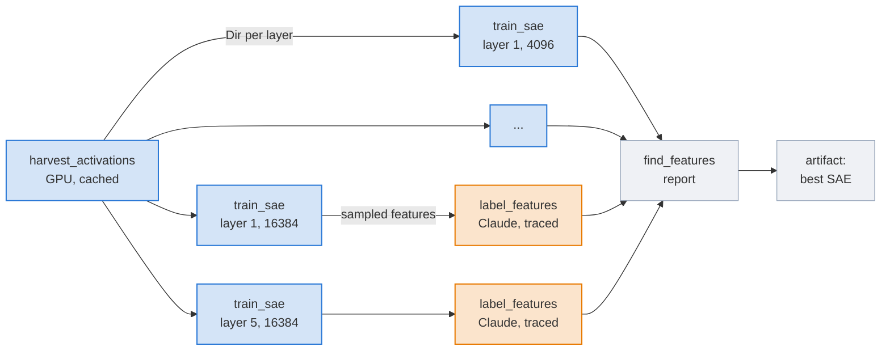
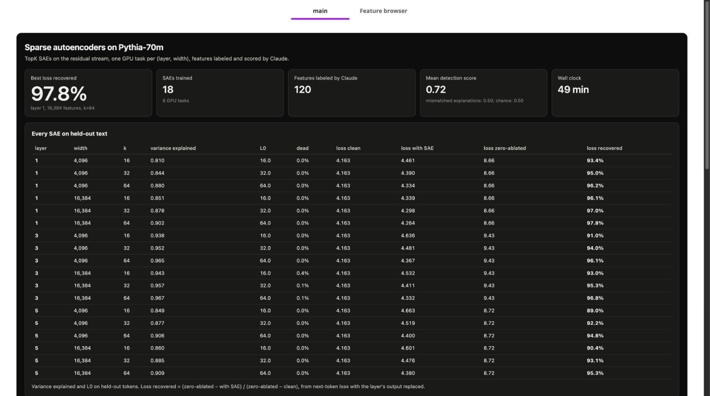
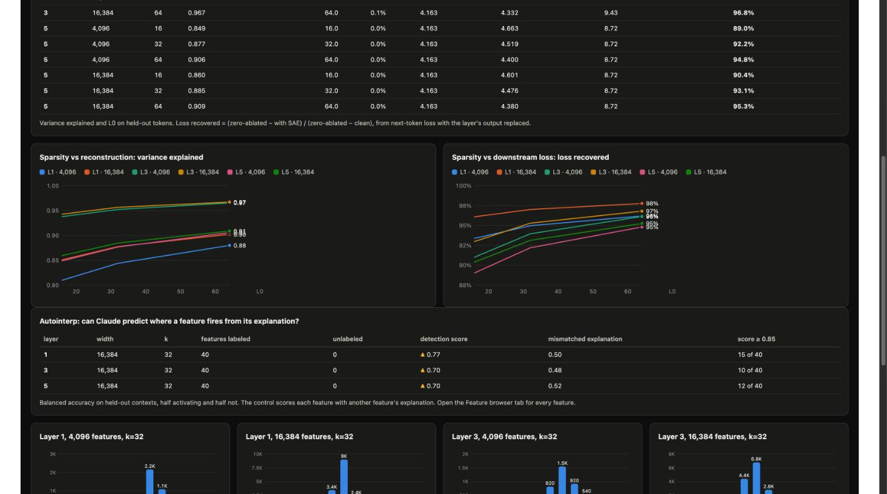
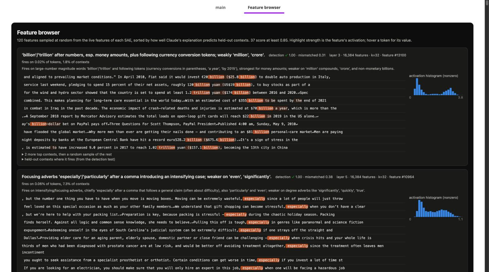

# Find features in a language model with sparse autoencoders

> [!NOTE]
> Code available [on GitHub](https://github.com/unionai/unionai-examples/tree/main/v2/tutorials/sparse_autoencoders).

A language model's neurons rarely mean one thing each. In a one-layer transformer, Anthropic
found a single neuron that fires on academic citations, English dialogue, HTTP requests, and
Korean text ([Towards Monosemanticity](https://transformer-circuits.pub/2023/monosemantic-features/index.html)),
because the model packs more concepts into its activations than it has dimensions. Interpretability teams undo this packing with a
*sparse autoencoder* (SAE): a wide, one-layer autoencoder trained to rewrite each activation
vector as a sparse sum of learned directions. Each direction is a *feature*, and many of them
turn out to mean one thing a person can name.

Anthropic used SAEs to find millions of such features in Claude 3 Sonnet
([Scaling Monosemanticity](https://transformer-circuits.pub/2024/scaling-monosemanticity/index.html)),
OpenAI trained a 16-million-feature SAE on GPT-4 and popularized the TopK SAE this tutorial uses
([Gao et al., 2024](https://arxiv.org/abs/2406.04093)), and Google DeepMind released SAEs for
every layer of Gemma 2 ([Gemma Scope](https://arxiv.org/abs/2408.05147)). The work has the
same shape at every lab:

- **Harvest** activations from a model over a large text corpus, at the layers you care about.
- **Train** one SAE per layer and per size, a grid of GPU jobs that read the same activations.
- **Evaluate** every SAE on how much of the activation it reconstructs, how sparse it is, how
  many of its features never fire, and how much worse the model gets with the SAE spliced in.
- **Label** features automatically with an LLM, and score the labels, since nobody can read
  millions of features by hand ([Bills et al., 2023](https://openaipublic.blob.core.windows.net/neuron-explainer/paper/index.html);
  [Paulo et al., 2024](https://arxiv.org/abs/2410.13928)).

At scale, the harvest is the expensive part. It is many terabytes of activations, and you do
not want to recompute it each time someone tries another SAE width. The grid is wide: one SAE
per (layer, width, sparsity). And the labeling is hundreds of thousands of LLM calls that you
do not want to pay for twice when a job retries.

This tutorial runs the whole loop on Pythia-70m, a small open model, with
[Claude](https://www.anthropic.com/claude) as the labeler: `claude-opus-5-5` at low effort,
about 360 calls for a run with the defaults. By the end you will have:

- a cached activation harvest, stored as one directory of shards per layer;
- a grid of TopK SAEs, one GPU task per (layer, width), each training three sparsities at once;
- variance explained, L0, dead features, and loss recovered for every SAE;
- Claude's explanation of a random sample of the features that fire often enough to test, each
  scored on held-out text;
- a feature browser in the run's report, sorted so the most convincing features come first;
- the most interpretable SAE published as an artifact with a model card.



## What Union.ai adds

| Need | Construct |
| --- | --- |
| Compute the activations once, and keep them | `cache="auto"` on the harvest task, which returns a `flyte.io.Dir` per layer |
| Train a grid of SAEs at once | One GPU task per (layer, width), launched together with `asyncio.gather` |
| Add a width without redoing the rest | Caching on every task, salted with a version for each helper module: a re-run only trains the new grid cells |
| Never pay twice for the same Claude call | `@flyte.trace` on each call, so a retried task replays the recorded answer |
| Watch training, then read the features | A live report per trainer, and a feature browser tab in the driver's report |
| Hand the result to other teams | `flyte.artifacts` with a model card |

## Getting started

You need a Union.ai cluster with NVIDIA L4 GPUs (or any CUDA GPU with 24 GB of memory), and an
Anthropic API key stored as a secret. The code reads a secret named `anthropic-api-key`. To use
a secret with another name, set `ANTHROPIC_SECRET` when you launch.

```bash
flyte create secret anthropic-api-key   # paste the key when prompted
git clone https://github.com/unionai/unionai-examples
cd unionai-examples/v2/tutorials/sparse_autoencoders
uv run find_features.py            # 3 layers x 2 widths, 8M tokens
uv run find_features.py --smoke    # 1 layer x 1 width, 0.5M tokens
```

The data and the model are openly licensed: the
[FineWeb](https://huggingface.co/datasets/HuggingFaceFW/fineweb) sample is ODC-By 1.0, and
[Pythia-70m-deduped](https://huggingface.co/EleutherAI/pythia-70m-deduped) is Apache 2.0.

## The image and environments

One image serves every task: PyTorch, Transformers and Datasets for the model, and the
Anthropic SDK for the labeler. The harvest and the trainers each take one GPU. Autointerp is
API calls, so it runs on CPU, and its environment is the only one that holds the API key.

`include=["sae.py"]` puts `sae.py` in the code bundle. The tasks import it inside their bodies,
so it does not appear among `find_features.py`'s top-level imports, which is how the bundle
finds `autointerp.py` and `reports.py`.



## Harvest the activations once

The harvest streams [FineWeb](https://huggingface.co/datasets/HuggingFaceFW/fineweb) and takes
the first 128 tokens of each document at least 128 tokens long as one context. A forward hook on each chosen layer of
Pythia-70m-deduped records the residual stream, the output of that transformer block, for every
token. The activations are saved as float16 shards, one directory per layer, so each trainer
downloads only the layer it trains on. The token ids are saved too, so that every feature can
later be shown in the text it fired on.



The environment sets `cache="auto"`, so the harvest's output is stored under a key made from its
inputs and the task function's own code. Any later run with the same layers, token count,
dataset, and model gets the same `Dir`s back without starting a GPU.

`cache="auto"` hashes only the body of the task function, not the modules, helper functions, or
module-level constants it uses. So everything a cached result depends on is either a task input
or in a salt:

- The model to study is the harvest's `model` input, and every later task reads it from the
  harvest.
- The Claude model is `label_features`' `claude_model` input. Pass `claude_model` to
  `find_features` to label with another model; the activations and SAEs stay cached.
- `train_sae` does its work in `sae.py`, and `label_features` in `autointerp.py` and the Claude
  helpers below, so each of those tasks salts its cache with a version string:
  `flyte.Cache("auto", salt=SAE_VERSION)` and `flyte.Cache("auto", salt=autointerp.VERSION)`.
  Bump the version when you change that code, or a re-run returns results computed with the old
  code.

## The TopK sparse autoencoder

The SAE encodes an activation into a code as wide as the number of features, keeps the k
largest entries, and decodes back with one unit-norm direction per feature. Choosing k sets
the sparsity directly, where older SAEs tuned an L1 penalty to reach it.



Training follows Gao et al.: Adam with a learning rate that scales as one over the square root
of the width, the decoder bias started at the median activation, and an auxiliary loss that asks
the dead features to explain what the live ones missed, so fewer features stay dead. Each trainer
trains one SAE per k on the same batches, so the three SAEs share one download, one copy of the
activations in GPU memory, and one GPU.



## Train and evaluate the grid

`train_sae` is one GPU task per (layer, width). It loads its layer onto the GPU, trains, and
streams the training curves into its own report. Then it evaluates every SAE on held-out contexts
and, for the width that gets labeled, samples features for Claude.



Reconstruction alone can mislead: an SAE can reconstruct the large, unimportant directions of an
activation well and miss the small ones the model relies on. So the evaluation also splices the
reconstruction back into the model and measures next-token loss. *Loss recovered* compares that
loss with the clean model's and with the model whose layer output is zeroed: 100% means the SAE
loses nothing the model needs, 0% means it is no better than nothing.



## Label the features with Claude

`feature_examples` samples features at random among those that fire in at least 56 contexts
(enough to fill every example set below) and stay silent in at least 16, so very rare and very
dense features are left out of the sample. For each one it collects what Claude explains the
feature from: the 12 contexts where it fires hardest, and 8 more drawn at random from the contexts
where it fires clearly, at a quarter of its peak or more. If a feature has too few clear firings,
the 8 come from its next-strongest contexts instead, and the prompt says so. It also builds a
held-out test set: 8 other clear firings, and 8 random contexts where the feature does not fire
at all. Every excerpt is the same length, so length gives nothing away.



Claude sees those contexts with the activating tokens marked and writes an explanation. A
second call gets only that explanation and the shuffled test set, and lists the contexts it
predicts the feature fires in. Both calls ask for structured output, so a finished answer is
always valid JSON.



The score is balanced accuracy, so 0.5 is chance whatever the mix:



An answer can still fail to finish: Claude may refuse, or run out of `max_tokens`, which also
counts any thinking. `ask_claude` checks `stop_reason` before it reads the answer, and
`label_features` records a feature whose calls fail as unlabeled, so one bad answer never fails
the task. The report counts unlabeled features per SAE.

Each call is a `flyte.trace`. Its input and output are recorded in the run, so if the task fails
partway through and retries, the calls that already finished replay from the record instead of
going back to the API.



`label_features` runs every explanation, then scores each one twice: once on its own feature's
test set, and once with another feature's explanation. The second score is a control. A good
explanation should beat a fluent but wrong one by a wide margin.



## The driver

The driver harvests (or reuses the cached harvest), trains the whole grid at once, labels the
sampled features of each layer in parallel, writes the report, and publishes the SAE whose
features Claude explained best.



The report's second tab is the feature browser. It sorts every labeled feature by its detection
score, so the reader meets the convincing features first, and the weak ones at the end:



The model card goes with the weights:



## Results

A run with the defaults trains 18 SAEs (3 layers, 2 widths, 3 values of k) on 8 million tokens
of FineWeb. From an empty cache, the harvest ran for 3 minutes on one L4. Then the six trainers
ran at once: about 3.5 minutes for each 4,096-feature trainer, and 12 to 13 minutes for each
16,384-feature trainer. The 360 Claude calls of autointerp took about a minute. The run took 49
minutes on a shared cluster, 28 of them spent waiting for a GPU for the harvest.



Every SAE recovers most of the model's loss. With the 16,384-feature SAE at k = 32 spliced in:

| Layer | Variance explained | Dead features | Loss clean | Loss with SAE | Loss zero-ablated | Loss recovered |
| --- | --- | --- | --- | --- | --- | --- |
| 1 | 0.878 | 0.0% | 4.163 | 4.298 | 8.66 | 97.0% |
| 3 | 0.957 | 0.1% | 4.163 | 4.411 | 9.43 | 95.3% |
| 5 | 0.885 | 0.0% | 4.163 | 4.476 | 8.72 | 93.1% |

The sparsity plots show the trade-off the SAE literature reports. More active features per
token (a larger k) reconstruct better, and so do more features in the dictionary at the same
k. Later layers are harder: at layer 5, even the best SAE loses 5% of the loss. Variance
explained alone would rank the layers differently, since layer 3 has the highest variance
explained and only the middle loss recovered. That is why the evaluation splices the SAE into the
model. Almost no feature is dead, which is what the AuxK loss is designed to do.



Claude explained 40 features from each layer's 16,384-feature SAE, 120 in all, sampled at random
among those that fire in at least 56 contexts:

| Layer | Mean detection score | Mismatched explanation | Features scoring 0.85 or more |
| --- | --- | --- | --- |
| 1 | 0.77 | 0.50 | 15 of 40 |
| 3 | 0.70 | 0.48 | 10 of 40 |
| 5 | 0.70 | 0.52 | 12 of 40 |

The mean is 0.72 over all 120, against 0.50 for the control, and every call returned a finished
answer, so no feature was left unlabeled. The control stays at chance, so the score measures the
explanation, not the test. Among the 12 features that score 1.0 are the ones a reader believes
at a glance: "billion" and "trillion" after numbers in money amounts, "especially" after a comma,
"Learn" opening a call to action, "use" as a noun, "covered", the plural "systems", the word
"iPhone", and sentence-initial "These". Close behind, at 0.94, are "Jackson", "details", "out
of" and the phrase after it, and "PDF" as a link label. Eight of the 12 come from layer 1, where
more features are single words, which are easy to predict; the later layers have more features
about syntax and position, which are harder to explain in a sentence. The ones at the bottom of
the browser are mostly fragments of split words and diffuse features that fire on function
words, which is also what the papers find.



The SAE whose features scored best, layer 1 with 16,384 features at k = 32, is published as the
`pythia-70m-topk-sae` artifact, with a card that shows its metrics and its five most
interpretable sampled features.

### Show Claude more than the strongest contexts

A feature's strongest contexts are not the whole feature. The iPhone feature's top contexts are
all the word "iPhone", but the held-out test also samples its weaker firings, on other words. An
explanation written from the top contexts alone reads well and fails that test. So
`explain_prompt` shows Claude the 12 strongest contexts and 8 sampled from the rest of the
feature's clear firings, as [Paulo et al.](https://arxiv.org/abs/2410.13928) recommend, and the
explanation can name a weaker meaning. Every excerpt is also the same length, so that length
cannot hint at the answer. If you change what Claude sees, bump `autointerp.VERSION` and compare
the mean detection score before and after on the same SAEs: the cached SAEs make that a
labeling-only rerun.

## Add a width without redoing the rest

Every task is cached, so a run that changes one input only redoes the work that depends on it.
Add a third width:

```bash
uv run find_features.py --widths 4096 16384 32768
```

On the run above, the harvest and the six existing trainers came back from the cache in under a
second each, and so did the three autointerp tasks, since their inputs had not changed. Only the
three 32,768-feature trainers ran, 20 to 25 minutes each on one L4, and the run took 25
minutes. The driver still writes a fresh report with all 27 SAEs in it.

The new width was not worth it at this data size:

| Layer | Loss recovered, 16,384 features | Loss recovered, 32,768 features |
| --- | --- | --- |
| 1 | 97.0% | 97.3% |
| 3 | 95.3% | 95.2% |
| 5 | 93.1% | 92.8% |

All at k = 32. Doubling the dictionary bought almost nothing here. Two things likely contribute.
The data is small: the scaling laws in Gao et al. call for more tokens as the width grows, and
8 million tokens may be too few for 32,768 features. And the training budget did not grow with
the width: every trainer runs the same 8,000 steps, while the learning rate shrinks as one over
the square root of the width, so the wider SAE also takes smaller steps for the same time. This
run does not separate the two. A larger harvest (a change to `n_tokens`, which makes a new cached
harvest) and a longer schedule for the wide SAEs are the next experiments.

## At real scale

- **The harvest is the dataset.** Gemma Scope trained on 4 to 16 billion tokens per SAE. At that
  size the activations do not fit on one disk, and most teams either stream them from object
  storage in shards, as this tutorial does at small scale, or recompute them on the fly next to
  the trainer. The cached `Dir` keeps the first option cheap to repeat.
- **The grid is the experiment.** Gemma Scope released more than 400 SAEs: every layer, several
  widths, several sparsities. Each is an independent GPU job reading the same harvest, which is
  the shape of `train_sae`.
- **Autointerp is the long tail.** Labeling every feature of a 16-million-feature SAE is many
  millions of LLM calls. Tracing the calls makes the labeling job restartable without paying
  twice, and the detection score lets you sort and filter features without reading them.

## Related

- [Caching](../../../user-guide/tasks/task-configuration/caching)
- [Traces](../../../user-guide/tasks/task-programming/traces)
- [Files and directories](../../../user-guide/tasks/task-programming/files-and-directories)
- [Reports](../../../user-guide/tasks/task-programming/reports)
- [Publish artifacts](../../../user-guide/artifacts/publish-artifacts)
