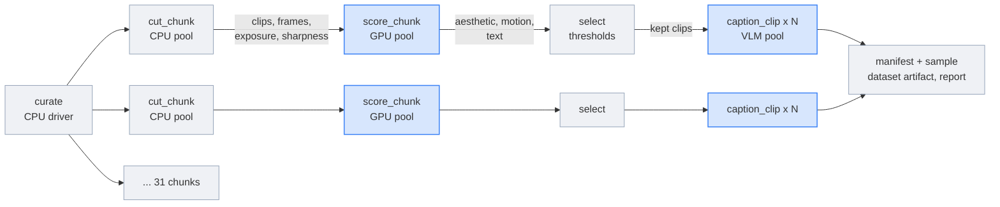
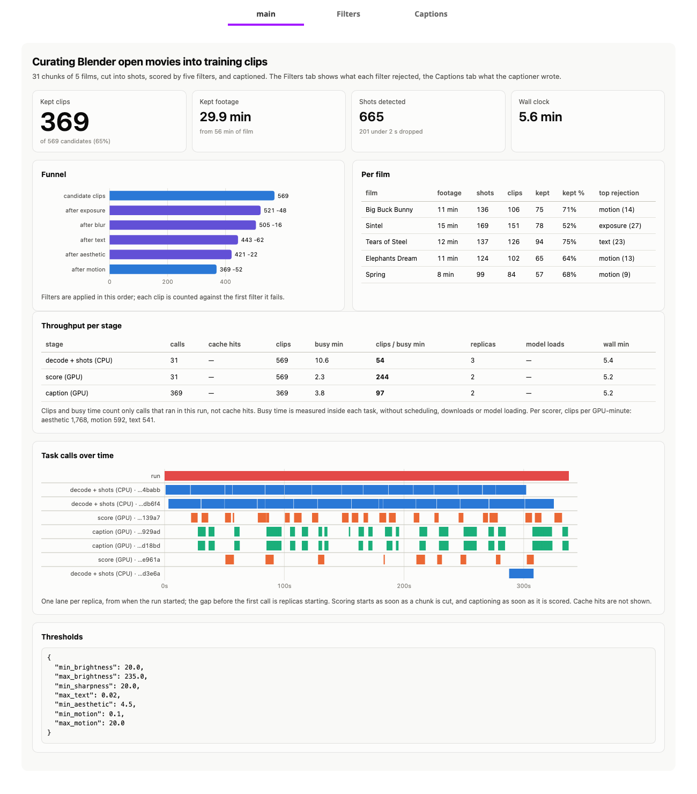
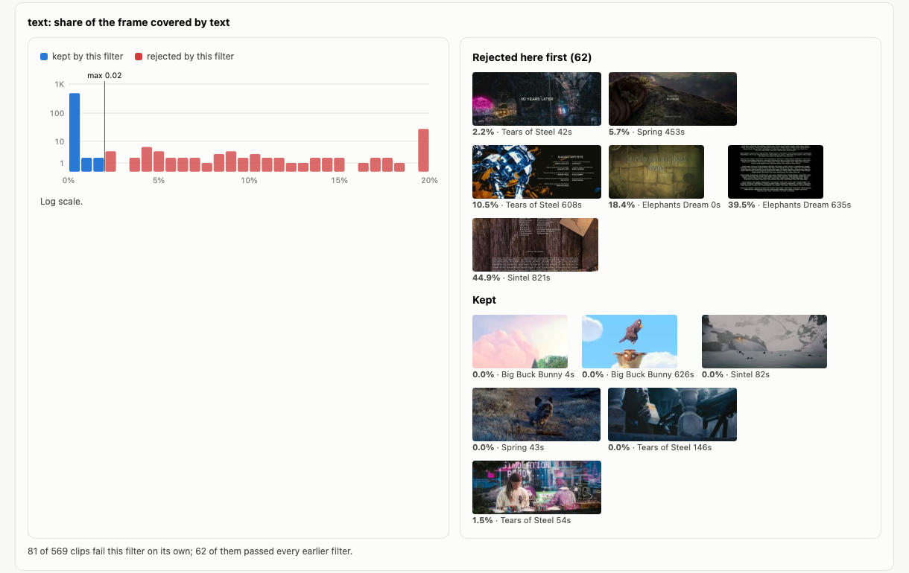
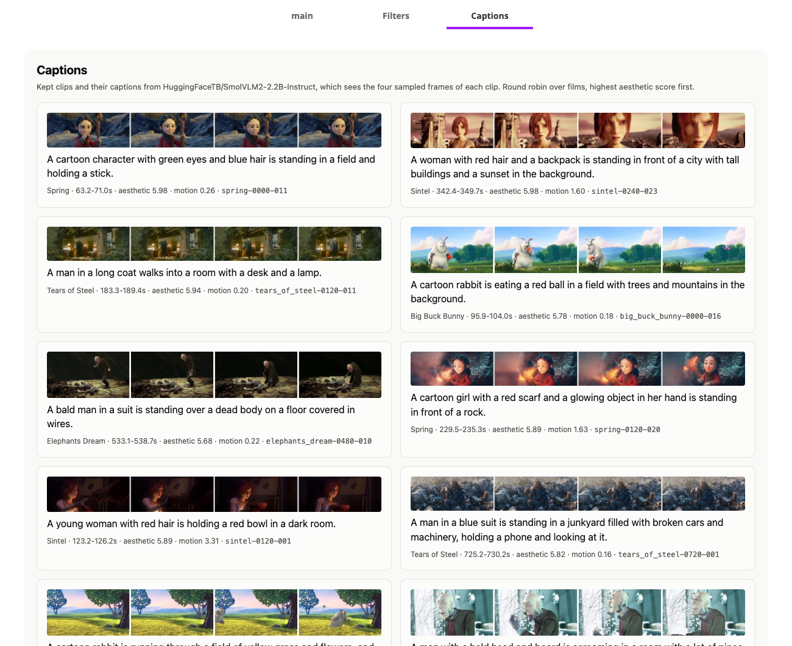
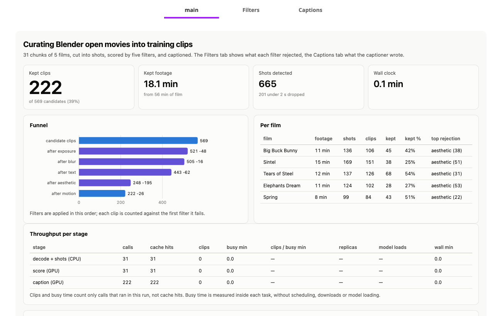

# Curate a video dataset for generative video

> [!NOTE]
> Code available [on GitHub](https://github.com/unionai/unionai-examples/tree/main/v2/tutorials/video_data_curation).

Text-to-video and world models are trained on short clips, a few seconds each, with a caption
that says what happens in them. Nobody films clips like that. Labs start from long footage
(films, stock video, gameplay, dashcams) and build the clips themselves: cut the footage at
shot boundaries, throw away the shots a model should not learn from (black frames, blur, title
cards, still images, ugly frames), and caption what is left. The published recipes all have
this shape. [Open-Sora 2.0](https://arxiv.org/abs/2503.09642) splits video with scene detection
and then filters on aesthetic, motion, blur and OCR scores before captioning
([its data tools](https://github.com/hpcaitech/Open-Sora/blob/main/tools/datasets/README.md));
[Stable Video Diffusion](https://arxiv.org/abs/2311.15127) showed that this kind of curation
measurably improves the trained model; [Panda-70M](https://arxiv.org/abs/2402.19479) captioned
70 million clips with vision-language models.

At that scale the hard part is the plumbing. Decoding and shot detection are CPU work. Each
scorer is a different GPU model, and loading CLIP, an optical-flow network and a text detector
for every few clips wastes more time than the scoring. Captioning is a third, larger model.
The filter thresholds are guesses until you have seen the score distributions, and changing
one must not mean decoding a petabyte of video again.

This tutorial builds that pipeline at small scale on five Blender open movies, 56 minutes of
footage:

- a pool of CPU workers decodes the films in two-minute chunks, finds the shots, and cuts 2 to
  10 second clips, all chunks at once;
- a pool of GPU workers scores every clip with CLIP and the LAION aesthetic head, RAFT optical
  flow, and the CRAFT text detector, each model loaded once per worker;
- a second GPU pool captions the kept clips with SmolVLM2;
- every stage is cached per chunk, and each caption per clip, so a new threshold reruns only
  the selection;
- the manifest and the kept clips are published as a dataset artifact with a card, next to a
  report with the funnel, contact sheets per filter, histograms, captions, and throughput per stage.

## How a chunk flows through the pipeline



The driver runs one coroutine per chunk, so a chunk moves to the GPU pool as soon as it is cut
and its clips are captioned as soon as they are scored. The three pools work at the same time
on different chunks.

| Need | Construct |
| --- | --- |
| Different hardware per stage | One `TaskEnvironment` per stage: CPU for decoding, L4 GPUs for scoring and captioning |
| Load each model once, not once per chunk | `flyte.ReusePolicy` on every pool; models live in module globals of the replica |
| Process every chunk at once, as soon as its input is ready | One `asyncio` coroutine per chunk, `asyncio.gather` over all of them |
| Change a threshold without decoding again | `cache` on every task: per chunk for cutting and scoring, per clip for captions |
| Pass clips and frames between stages | `flyte.io.Dir`, one per chunk |
| Hand the dataset to training | `flyte.artifacts` with a data card |
| See what each filter does | `report=True`, with Filters and Captions tabs |

## Getting started

You need a Union cluster with NVIDIA L4 GPUs (any CUDA GPU with 16 GB works; change
`score_env` and `caption_env` in `curate.py`). The tasks download the films and the models
over the internet.

```bash
git clone https://github.com/unionai/unionai-examples
cd unionai-examples/v2/tutorials/video_data_curation
python curate.py                          # all five films: 31 chunks, 56 minutes
python curate.py --smoke                  # 4 one-minute chunks from two films, no artifact
python curate.py --set min_aesthetic=5.0  # change a threshold; everything upstream is cached
```

## The footage

The five films are Blender Foundation open movies under Creative Commons Attribution
licenses: Big Buck Bunny, Sintel, Tears of Steel, Elephants Dream and Spring. Together they
have what a curation pipeline has to deal with: animation and live action, fast cuts and long
takes, dark scenes, title cards and scrolling credits.

Tears of Steel and Elephants Dream are read straight from download.blender.org. Blender serves
Big Buck Bunny and Sintel only as zip archives now, which can't be read partway, and Spring
isn't on that server, so those three come from their 720p transcodes on Wikimedia Commons.



The unit of work is a chunk of two minutes. That is small enough to decode in under a minute
and large enough to hold a few dozen shots:



## Cutting chunks into clips on the CPU

`ffmpeg` reads one chunk of a remote film with HTTP range requests, so a task downloads only
its own two minutes, and writes a 360p, 24 fps proxy. Every later step works on the proxy.



[PySceneDetect](https://www.scenedetect.com/)'s adaptive detector finds the cuts. Each shot
loses two frames at each end, so no clip starts on a transition. Shots under two seconds are
dropped and shots over ten are split into equal pieces, the same bounds Open-Sora uses.



From each clip the task saves four frames, at 12.5%, 37.5%, 62.5% and 87.5% of the way through,
and the frame two steps after each one. The single frames feed the aesthetic scorer, the text
detector and the captioner; the pairs feed optical flow. Brightness and sharpness (the variance
of the Laplacian) are cheap, so they are computed here, in the same pass over the proxy.



The task returns a `Dir` with the clips as MP4 files, their frames and thumbnails, and an
index, plus the same index as JSON for the driver:



## Scoring on warm GPUs

Three models score each clip. Loading all three takes longer than scoring a whole chunk with
them, so they are loaded on first use and kept in module globals. In a reusable environment the
Python process outlives the task call, and every later chunk on the same replica finds them
already on the GPU.



- **Aesthetic.** The [LAION aesthetic predictor](https://github.com/christophschuhmann/improved-aesthetic-predictor),
  a small MLP on CLIP ViT-L/14 image embeddings, gives each frame a score from 1 to 10. A clip's
  score is the mean over its four frames.
- **Motion.** [RAFT](https://pytorch.org/vision/stable/models/raft.html) computes dense optical
  flow between each frame pair. The mean flow magnitude, in pixels per frame, separates still
  shots from moving ones better than frame differencing, which also fires on lighting changes.
- **Text.** The CRAFT detector from [EasyOCR](https://github.com/JaidedAI/EasyOCR) finds text
  boxes; the score is the share of the frame they cover, the maximum over the four frames. Only
  detection runs: where the text is matters, not what it says.



The task downloads one chunk's `Dir` and runs the scorers in a thread, so the replica's event
loop stays responsive:



## Selecting clips

Every clip must pass five filters. The thresholds are a dataclass input to the driver, so each
run records the ones it used, and the selection is a plain function the driver applies after
scoring. Each rejected clip is charged to the first filter it fails, which is what the funnel
in the report counts.



## Captioning the kept clips

[SmolVLM2-2.2B-Instruct](https://huggingface.co/HuggingFaceTB/SmolVLM2-2.2B-Instruct) sees the
four frames of a clip as a sequence of images and writes one sentence about it. It runs in its
own pool, because it is a different model with a different lifetime from the scorers.



Captions are the one stage that runs per clip instead of per chunk. That is what makes them
cacheable under a moving threshold: tighten a threshold and every caption you need is already
in the cache; loosen it and only the newly admitted clips are captioned. Each caption replica
takes four calls at a time, so the next clip's frames download while the current one generates.



## The environments



Each stage gets the hardware it needs and its own warm pool. The CPU pool grows up to five
replicas while chunks are waiting. The scoring pool keeps two GPU replicas, and the captioning
pool grows from one to two.



Every task caches its results. With `cache="auto"`, the cache key covers the task's inputs and
the source of the task function, but not the helper modules it calls. A fix in `shots.py` or
`scoring.py` would otherwise keep serving results computed by the old code, so the cache is
salted with a hash of those modules:



## The driver

The driver starts one coroutine per chunk. Each one cuts, scores, selects and captions its
chunk, and redraws the live report when it finishes. Every task call is recorded with the time
it ran inside the task, so a cache hit, which comes back with an earlier run's timestamps, is
counted as a hit and not as work.



The dataset is a directory: a parquet manifest with one row per candidate clip (source, time
range, every score, every filter result, the keep flag and the caption), every kept clip as an
MP4 under `clips/`, frame strips for a sample of them, the thresholds, and the attribution the
CC BY licenses require. The driver copies the kept clips out of the `cut_chunk` outputs, so the
dataset doesn't depend on intermediate task outputs. The manifest still records each clip's
`cut_uri` in those outputs, for looking at the rejected ones.



## Results

A run with the defaults processed all five films, 56 minutes of footage, in 31 chunks.

| Stage | Clips |
| --- | --- |
| Shots detected | 665, of which 201 were shorter than 2 s |
| Candidate clips | 569 |
| Rejected for exposure | 48 |
| Rejected for blur | 16 |
| Rejected for on-screen text | 62 |
| Rejected for aesthetics | 22 |
| Rejected for motion | 52 |
| **Kept and captioned** | **369 (65%), 29.9 minutes** |

The films differ. Sintel kept the fewest clips (52%), mostly because its dark scenes fail the
exposure filter. Tears of Steel lost the most to the text filter, in its titles and
credits. Elephants Dream and Spring lost the most to the motion
filter, on long still shots.



Throughput per stage, measured inside the tasks:

| Stage | Pool | Clips per busy minute | Notes |
| --- | --- | --- | --- |
| Decode and shot detection | 3 CPU replicas, 4 cores each | 54 | about 21 s of work per two-minute chunk |
| Scoring | 2 L4 replicas | 244 | aesthetic 1,768, motion 592, text 541 clips per GPU-minute; models load once per replica, in about 10 s |
| Captioning | 2 L4 replicas | 97 | the 2.2B model loads once per replica, in about 23 s |

Decoding is the slowest stage per clip, and it has the most replicas. On the GPU, the text
detector and RAFT cost three times as much as CLIP; captioning costs more than all three
scorers together, which is why it runs only on the clips that pass.

With the images built and nodes available, the run took 5.8 minutes, including copying the
369 kept clips into the dataset. The CPU pool got three replicas that time, and decoding set
the pace. An earlier run on a cold cluster, before the copy step, took 8.8 minutes, most of it
waiting for the replicas to start; one that found five replicas warm took 3.9 minutes. A run
started within ten minutes of the previous one finds the replicas still warm.

### What each filter rejects

The Filters tab has a histogram for each score with its thresholds, and contact sheets of
clips the filter rejected next to clips it kept, spread over the score range. The text filter
catches title cards and credits, including the "10 years later" card in Tears of Steel, at as
little as 2% of the frame:



The Captions tab shows kept clips with their four frames and captions, round robin over the
films, highest aesthetic score first:



### Changing a threshold

The aesthetic filter barely mattered in the default run: the LAION scores of these films sit
between 4 and 6, and the aesthetic filter was the first to reject only 22 clips. Raising the threshold to 5.0 is one flag:

```bash
python curate.py --set min_aesthetic=5.0
```

That run took 13 seconds. All 31 cut and 31 score calls and all 222 caption calls were cache
hits; the driver only reapplied the thresholds, rebuilt the manifest and the report, copied the
kept clips, and published a new version of the artifact. The aesthetic filter now rejects 195
clips, and 222 remain. Lowering the threshold to 4.3 instead kept 383 clips and captioned only
the 14 that were new. That run took 54 seconds, most of it starting two caption replicas.



### What the first runs taught us

- **The 500M captioner was not good enough.** SmolVLM2-500M wrote three-sentence paragraphs and
  invented details: a man "talking to the camera" in a shot of rocket engines. The 2.2B model,
  asked for one sentence of what it can see, wrote captions like the ones above at 97 clips per
  GPU-minute on an L4.
- **The motion threshold was set by looking.** A first threshold of 0.3 pixels per frame
  rejected slow pans and characters talking in Big Buck Bunny, which score 0.1 to 0.3. Truly
  still shots score under 0.05. The default is now 0.1.
- **Timestamps have to come from inside the task.** Timing each call from the driver counted the
  time a call waited for a free replica as work, and showed every queued chunk as running from
  the start of the run.

## At real scale

The pipeline is the same at a million hours; the numbers around it change.

- **Shard by file, not by minute.** Real collections are millions of files; a chunk becomes a
  batch of files, and `flyte.map` or a bounded `asyncio.gather` keeps the fan-out under control.
- **Batch the models.** Here each chunk scores a few dozen clips. Scoring hundreds of frames per
  forward pass, and captioning with a batched server such as vLLM, raises GPU throughput by an
  order of magnitude.
- **Add the filters this sample doesn't need.** Deduplication by embedding, camera-motion
  classification, NSFW and watermark detection, and a quality classifier trained on human
  ratings all fit as more scorers in the GPU stage.
- **Write clips once.** This tutorial copies the kept clips into the dataset, which is cheap for
  370 clips. At scale, write each clip straight to its final, content-addressed location in the
  cut stage, and let the dataset be the manifest of paths.
- **Keep the thresholds out of the expensive stages.** Because selection runs after the cached
  scores, a data team can try a new mixture of thresholds on the whole collection in minutes.

## Credits

Big Buck Bunny (c) copyright 2008, Blender Foundation, peach.blender.org, CC BY 3.0. Sintel
(c) copyright Blender Foundation, durian.blender.org, CC BY 3.0. Tears of Steel (CC) Blender
Foundation, mango.blender.org, CC BY 3.0. Elephants Dream (c) copyright 2006, Blender
Foundation, Netherlands Media Art Institute, orange.blender.org, CC BY 2.5. Spring (CC)
Blender Foundation, studio.blender.org, CC BY 4.0. The frames on this page are from these films.

## Related

- [Reusable containers](../../../user-guide/tasks/task-configuration/reusable-containers)
- [Caching](../../../user-guide/tasks/task-configuration/caching)
- [Reports](../../../user-guide/tasks/task-programming/reports)
- [Publishing artifacts](../../../user-guide/artifacts/publish-artifacts)
