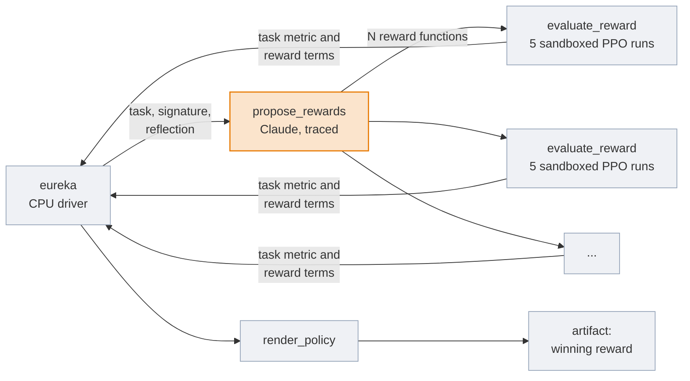
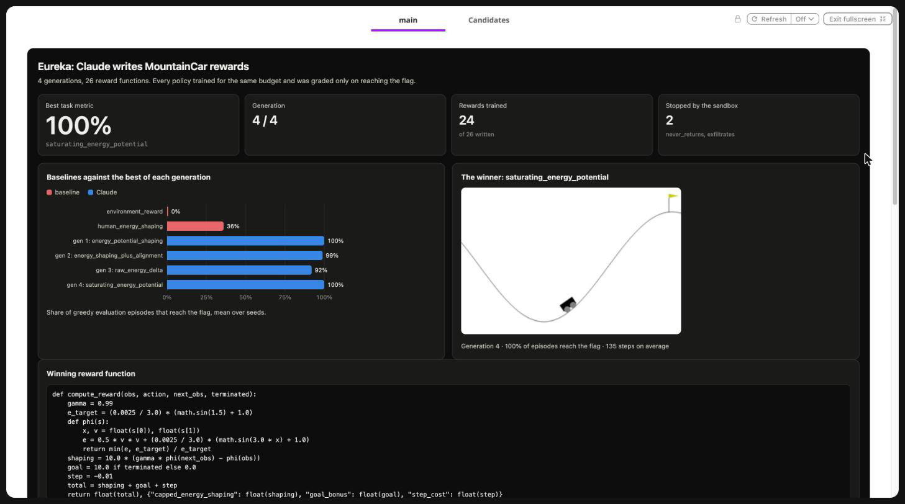
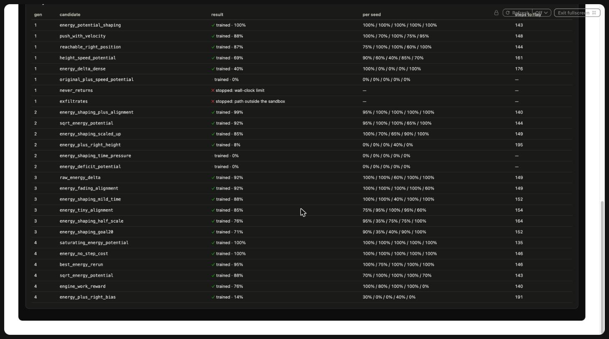
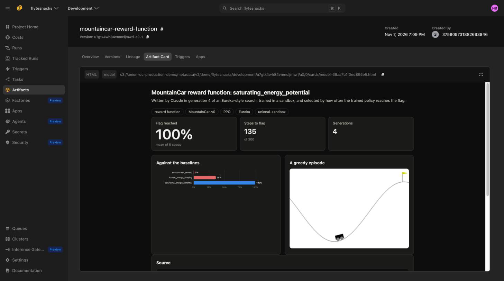

# Reward design with Claude and sandboxes

> [!NOTE]
> Code available [on GitHub](https://github.com/unionai/unionai-examples/tree/main/v2/tutorials/eureka_reward_design).

The reward function is the part of a reinforcement learning setup that people get wrong most
often, and they get it wrong by hand, one training run at a time. [Eureka](https://eureka-research.github.io/)
showed that a coding model can do this search instead: given the environment's source and a
description of the task, it writes several reward functions at once, a policy is trained with
each one, and the training statistics of the best one go back to the model, which writes a
better batch. On robot dexterity tasks, Eureka's rewards beat ones written by experts.

That loop has two infrastructure problems. Every candidate is a training run, so a generation
is a fan-out of jobs that should run in parallel. And every candidate is code a model wrote,
which you are about to execute: it can hang, eat memory, read your credentials, or call out to
the network. This tutorial runs the loop on Flyte with [Claude](https://www.anthropic.com/claude)
writing the rewards, a warm pool of CPU workers training the candidates, and a
[sandbox](../../../user-guide/agents/sandboxing/_index) session around every training run.

By the end you will have:

- a driver that runs generations of propose, train, and reflect, with Claude's answers recorded
  as traces so that a retried driver never pays for them twice;
- candidates trained in sandbox sessions that block the network, limit the filesystem to a
  working directory, and cap memory and wall-clock time;
- two hostile candidates, one that never returns and one that tries to steal the pod's
  credentials, stopped by the sandbox in the same run;
- the winning reward function published as an artifact, with a card.

## The task

[MountainCar](https://gymnasium.farama.org/environments/classic_control/mountain_car/) is the
classic example of a reward that gives a learner nothing to work with. An underpowered car has
to rock back and forth in a valley to build enough momentum to reach a flag on the hill. The
environment's own reward is -1 on every step, so until a policy reaches the flag by chance,
every action looks the same. PPO trained on it for the budget in this tutorial never finds the
flag.

Every reward function is graded the same way: train PPO with it for 150,000 environment steps
on 5 seeds, then run the greedy policy on the real task and count how often it reaches the flag.
The policy is never graded on the reward it was trained with, so a reward that is easy to farm
without solving the task scores zero.



## What Flyte adds

| Need | Construct |
| --- | --- |
| Train a generation's candidates in parallel without a pod per candidate | A reusable environment, `flyte.ReusePolicy(replicas=(1, 6))` |
| Run model-written code safely | A `unionai-sandbox` session per training run: network blocked, filesystem allow-list, memory and time limits |
| Never pay twice for the same Claude call | `@flyte.trace` on the call, so a retried driver replays the recorded answer |
| Keep the API key away from model-written code | A `flyte.Secret` on the driver only; the sandboxes never see it |
| See every candidate and what happened to it | `flyte.group` per generation, and a report with a Candidates tab |
| Keep the winner | `flyte.artifacts` with a card |

## Getting started

You need a Union cluster and an Anthropic API key stored as a secret. The code reads a secret
named `anthropic-api-key`. To use a secret with another name, set `ANTHROPIC_SECRET` when you
launch.

```bash
flyte create secret anthropic-api-key
git clone https://github.com/unionai/unionai-examples
cd unionai-examples/v2/tutorials/eureka_reward_design
python eureka.py            # 4 generations of 6 candidates, about 25 minutes
python eureka.py --smoke    # 2 generations of 3 candidates
```

## The image and environments

The image starts from the sandbox base image, which carries the sandbox server, and adds a
CPU-only build of PyTorch, Gymnasium, and the Anthropic SDK. `unionai-reuse` is the bridge that
reusable environments need.



Candidates are evaluated on a warm pool. Each call trains one candidate on 5 seeds at once, one
sandbox session per seed, on a 6-CPU replica. The pool grows to 6 replicas while a generation
is in flight, and shrinks back after it, without a pod start per candidate once it is warm. The harness that runs inside the sandbox is copied into each session rather than
imported, so the environment lists it in `include`.



## What Claude sees

The prompt follows Eureka: the environment's dynamics, the task metric, and the exact function
signature. The reward returns its total and a dictionary of named terms. The terms are how the
next generation learns what each part of the reward did.



After the first generation, the prompt adds a *reward reflection*: the best reward so far, its
task metric on each seed, and the mean of every term early and late in training. A term that
stays constant, or that dwarfs the others, is visible at a glance. The reflection is always on
the best reward so far, not the best of the last generation, so a weak generation can't drag
the search backwards. A scoreboard of the last generation's ideas and scores follows, so that
Claude can see which directions failed.



The Claude call asks for structured output, so the answer is always a valid list of candidates.
It streams, because the answer is long, and it enables the server-side fallback for refusals.
The function is a `flyte.trace`: its inputs and output are recorded in the run, so if the driver
crashes after Claude answers, the retry replays the answer instead of calling the API again.



## Training inside a sandbox

The harness is a short PPO implementation that never imports Flyte. It loads the candidate
from `reward.py`, calls it on every environment step in place of the environment's reward, and
prints one JSON line with the task metric, the training curve, and the term statistics.



Each training run gets its own sandbox session inside the task's pod. No pod is created, so a
session opens in tens of milliseconds. The session can read the Python installation and write
only its own working directory, has no network, and is capped at 2 GiB of memory and a
wall-clock limit:



`evaluate_reward` runs all of a candidate's seeds at once and folds them into one result. A
candidate whose every seed fails returns the reason, and that reason goes back to Claude like
any other feedback.



### Hostile candidates

A model that writes code will sooner or later write code that misbehaves, by mistake or
because something in its context told it to. Generation 1 adds two candidates written to
misbehave, so you can see the sandbox handle them in the same run as everything else:



## The driver

The driver starts the two baselines, the environment's reward and an energy-based reward a
person would write, and then runs the generations. Each generation is a `flyte.group`, so the
UI shows one Claude call and its fan-out of evaluations per generation.



## Results

A run with the defaults, 4 generations of 6 candidates plus the 2 hostile ones, took 23
minutes. Every reward, including the 2 baselines and the 2 hostile candidates, ran on 5 seeds for
150,000 steps, each seed in its own sandbox session: 140 sandboxed training runs. The 10 runs of
the hostile candidates are stopped before they train a policy, so at most 130 runs train one.

| Reward | Flag reached, mean of 5 seeds | Steps to the flag |
| --- | --- | --- |
| The environment's reward (-1 per step) | 0% | |
| A person's energy-based shaping | 36% | |
| Claude, best of generation 1 | 100% | 143 |
| Claude, best of generation 4 (the winner) | 100% | 135 |

Claude's first generation already contained a reward that reached the flag on every seed:
potential-based shaping on the car's mechanical energy, the textbook fix for MountainCar, with
its scale and goal bonus tuned so that PPO picks it up within the budget. The person's version of
the same idea, with a different scale and goal bonus, reached the flag in only 36% of
evaluation episodes.

The reflection's effect shows up in the rest of each generation, not just its best candidate:

| Generation | Candidates that reached the flag at least 85% of the time | Candidates that never reached it |
| --- | --- | --- |
| 1 | 3 of 6 | 1 |
| 2 | 3 of 6 | 2 |
| 3 | 4 of 6 | 0 |
| 4 | 4 of 6, two of them at 100% | 0 |

By generation 4, Claude was varying a reward that worked instead of guessing. The winner caps
the energy potential at the energy needed to reach the flag, so the car is not paid for
swinging higher than it needs to, and it reaches the flag in 135 steps on average.



Every candidate, with its result on each seed. The two hostile candidates were stopped by the
sandbox: `never_returns` at the wall-clock limit, and `exfiltrates` with a `PermissionError` when
it tried to read the pod's service-account token, before it got to the network.



The winner is published as the `mountaincar-reward-function` artifact:



### Check the noise before you rank

In test runs with 3 seeds of 80,000 steps per candidate, the same reward reached the flag in
anywhere from 0% to 100% of episodes depending on the seed, and two near-identical energy rewards
scored 97% in one run and 57% in another. At that budget the search ranked noise, and later
generations looked worse than the first. The defaults, 5 seeds of 150,000 steps, made the ranking
reliable in the run reported above. If the scores of a reward search jump around between runs, measure the noise of a single
candidate across seeds before you trust the ranking.

## Going further

- **A harder task.** Swap in an environment where shaping is genuinely hard, such as a MuJoCo
  locomotion task, and give each candidate a GPU. The loop does not change.
- **More candidates.** Eureka samples 16 candidates per generation. Raise
  `candidates_per_generation` and the pool's `replicas`.
- **Tune the reward and the policy together.** Hand the best candidates of each generation to a
  longer training run, as in [Teach a humanoid to run](../humanoid-locomotion/_index).

## Related

- [Reward setup](../../../user-guide/reinforcement-learning/reward-setup) in the user guide
- [Sandboxing](../../../user-guide/agents/sandboxing/_index)
- [Traces](../../../user-guide/tasks/task-programming/traces)
- [Reusable containers](../../../user-guide/tasks/task-configuration/reusable-containers)
