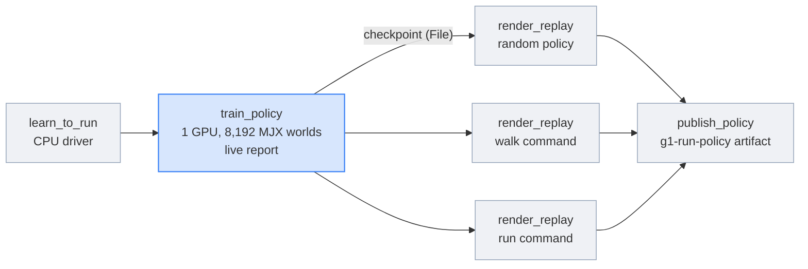
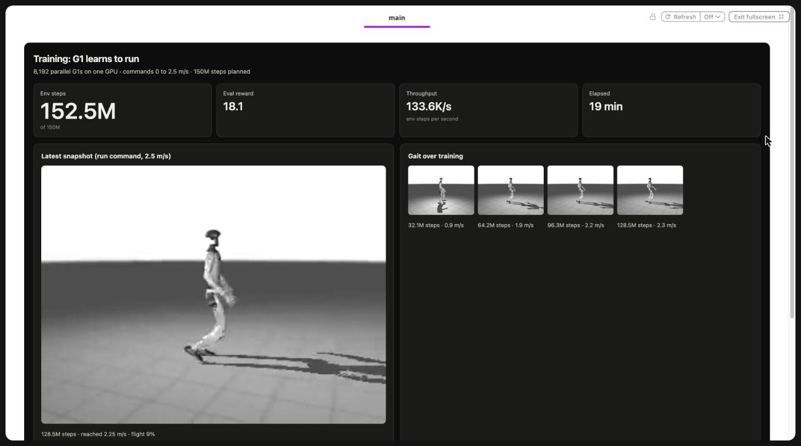
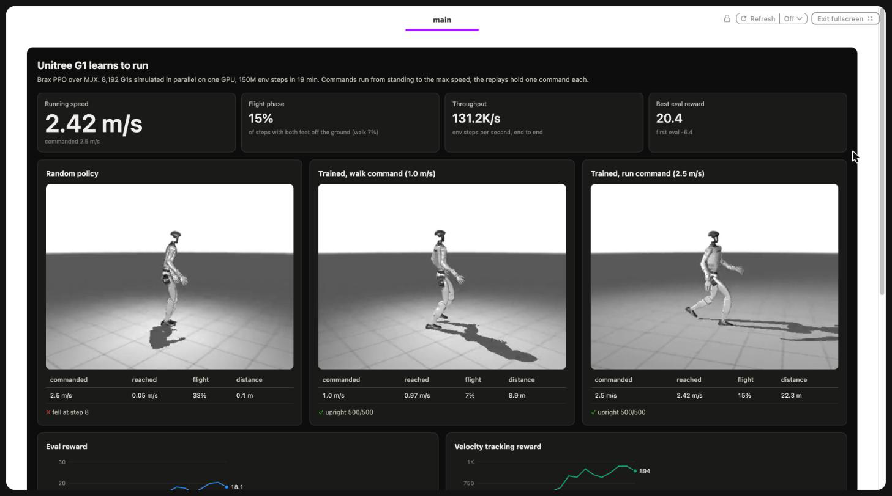
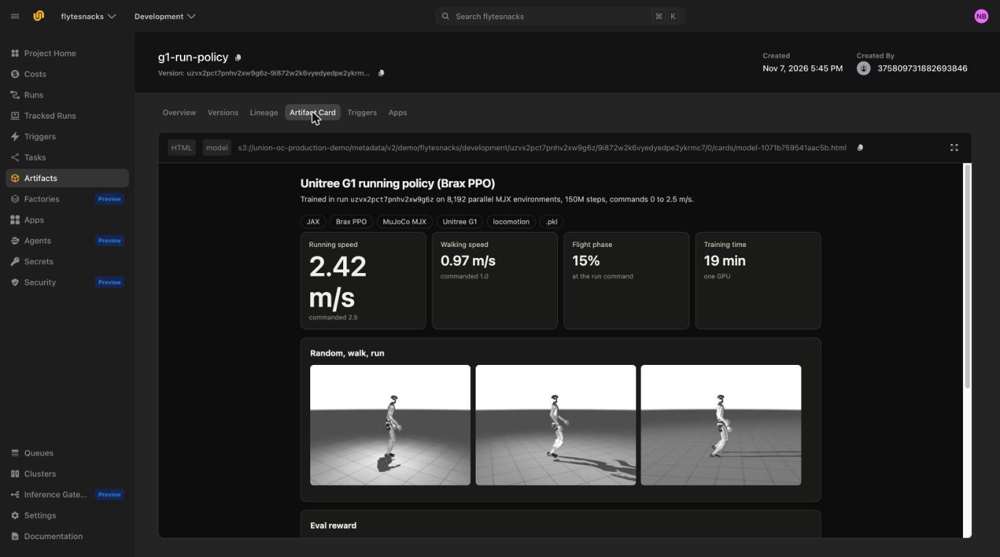

# Teach a humanoid to run

> [!NOTE]
> Code available [on GitHub](https://github.com/unionai/unionai-examples/tree/main/v2/tutorials/humanoid_locomotion).

A humanoid gait takes hundreds of millions of simulation steps to learn. The classic way to get
them is to fan simulators out across many CPU workers and ship their rollouts to a GPU learner.
This tutorial does the opposite: [MuJoCo MJX](https://mujoco.readthedocs.io/en/stable/mjx.html)
compiles the physics into the same XLA program as the learner, so 8,192 copies of the
[Unitree G1](https://www.unitree.com/g1/) step in parallel on one GPU and there is no Python
between simulation, scoring, and the gradient step. Flyte's job is everything around that
loop: the GPU, the image, a live report you can watch the robot learn in, CPU replays that
prove the result, and a versioned artifact for the trained policy.

By the end you will have:

- a running policy for the G1, trained with [Brax](https://github.com/google/brax) PPO on
  DeepMind's tuned [MuJoCo Playground](https://playground.mujoco.org/) environment;
- a training report that streams the reward curve and films the policy every few evaluations;
- three replays filmed side on, a random policy and the trained policy at walking and running
  speed, each measuring the speed it reached and how often both feet left the ground;
- the policy published as the model artifact `g1-run-policy`, with a model card.

## Why one GPU, and where Flyte fits

| Approach | Where the simulator runs | What limits it |
| --- | --- | --- |
| CPU simulators, GPU learner | Many CPU workers | Moving rollouts to the learner, and Python in every step |
| MJX on the GPU (this tutorial) | Inside the learner's XLA program | GPU memory for the parallel worlds |

The single-GPU design keeps the loop simple, but it does not make the infrastructure go away.
The image needs JAX with CUDA, MuJoCo, Brax, Playground, an EGL renderer, and the robot models.
Rendering needs a different backend than training. And a policy is only worth something if you
can see what it does and load it later. Each of those is one Flyte construct:

| Need | Construct |
| --- | --- |
| A reproducible JAX, MuJoCo, and EGL image with the robot models baked in | `flyte.Image` layers, built remotely |
| One GPU for training, CPUs for filming | One `flyte.TaskEnvironment` per role |
| Watch the gait change while it trains | `report=True` and `flyte.report.replace` from a Brax callback |
| Prove the result next to a baseline | Three replay tasks run in parallel with `asyncio.gather` |
| Keep and find the trained policy | `flyte.artifacts` with a model card |



## Getting started

You need a Union.ai cluster with an NVIDIA L40S, or another GPU with at least 40 GB of memory,
and a Flyte config that points at it (see the
[quickstart](../../../user-guide/get-started/quickstart)). To use a different card, change
`gpu_env` in `learn_to_run.py`. The script declares its dependencies in an inline header, so
`uv run` installs them.

```bash
git clone https://github.com/unionai/unionai-examples
cd unionai-examples/v2/tutorials/humanoid_locomotion
uv run learn_to_run.py
```



The first run builds the image, which takes a while because of the CUDA wheels for JAX. Later
runs reuse it. `--smoke` trains 20 million steps in about 8 minutes, which is enough to check
the plumbing but not enough for the robot to stay up. `--checkpoint <uri>` skips training and
only replays and reports an existing policy, without publishing a new `g1-run-policy` version.
`<uri>` is the storage URI of a `train_policy` output: open the `train_policy` action of an
earlier run in the UI and copy the URI from its Outputs tab.

## The image and environments

The image pins Python 3.12 and every package that affects the physics, including MuJoCo-Warp's
`warp-lang` through the `mujoco-mjx[warp]` extra. JAX stays on 0.9 because Brax 0.14 still calls
a JAX API that 0.10 removed. The last layer downloads the robot models from
[MuJoCo Menagerie](https://github.com/google-deepmind/mujoco_menagerie) (the G1 model is
BSD-3-Clause) into Playground's package directory at build time. The G1 environment can't be
built without them, and a pod without them clones the repository from GitHub at startup.



Three environments share the image. Training gets the GPU, with JAX told not to preallocate
most of the card, because MJX's Warp kernels allocate memory outside JAX's pool. Replays run
MJX's JAX backend on CPU and render with MuJoCo over headless EGL, since MJX has no renderer.
The driver only waits on the other tasks, so it is small.



## The running environment

The environment is DeepMind's `G1JoystickFlatTerrain`: the policy gets a velocity command and
proprioception, and it is rewarded for tracking the command while staying upright, with feet
in the air on schedule. Upstream it learns to walk at up to 1 m/s. This version changes the
commands, the reward, and the gait clock so that it runs:

- forward commands run from 0 to `max_speed`, 2.5 m/s by default (upstream: -1 to 1 m/s);
- lateral commands narrow to ±0.3 m/s (upstream ±0.5) and yaw commands to ±0.5 rad/s (upstream
  ±1.0), so most of the training goes to running forward;
- the `tracking_lin_vel` reward weight rises from 1.0 to 1.5, and `feet_air_time` from 2.0 to
  2.5, which pays for flight;
- the gait clock speeds up with the command, so a fast command asks for a faster cadence
  instead of ever-longer strides.

It also raises `njmax`, the constraint budget, from 90 to 128: a G1 in ground contact needs
about 93. When MJX runs out of constraint rows, the feet sink into the floor, and MuJoCo-Warp
prints an `nefc > njmax` warning. That warning stays on. The two solver iteration-limit
warnings are turned off, because Warp prints them for every world on every step, which
otherwise dominates the wall-clock time.



## Training with a live report

`train_policy` is one Brax `ppo.train` call. Brax runs the whole loop on the GPU and calls back
into Python twice: `progress_fn` after every evaluation, with the metrics, and
`policy_params_fn`, with the current weights. The task uses the first to redraw its report, and
the second to film the policy on the run command every few evaluations. A failed snapshot is
logged and skipped, so filming can never kill a long run.



The policy is asymmetric: the actor sees sensor-shaped observations, and the critic also sees
privileged simulator state, which it only needs during training. The checkpoint is a pickle of
the parameters, the network configuration, the training history, and the snapshots, returned as
a `flyte.io.File`.

## Replays: proof, not a number

An eval reward says little on its own. The driver films three replays in parallel on CPU: a
random policy, and the trained policy holding a walking and a running command. Each replay
measures what the robot actually did.



The flight phase is the share of steps with both feet off the ground. It is what separates a
run from a fast walk.



## The driver and the artifact

The driver trains, replays, writes the final report, and publishes the checkpoint as a model
artifact. A later run, an evaluation job, or an app can look it up with
`flyte.remote.Artifact.get("g1-run-policy")`, which returns the artifact record; downloading the
checkpoint it points at is a separate step.





## Results

A run with the defaults trained 150 million steps in 19 minutes on one L40S, about 131,000
steps per second. Each replay holds one command for 10 seconds (500 control steps):

| Replay | Speed reached | Flight phase | Distance | Upright |
| --- | --- | --- | --- | --- |
| Random policy, 2.5 m/s command | 0.05 m/s | 33%, while falling | 0.1 m | fell at step 8 |
| Trained, 1.0 m/s command | 0.97 m/s | 7% | 8.9 m | 500 of 500 steps |
| Trained, 2.5 m/s command | 2.42 m/s | 15% | 22.3 m | 500 of 500 steps |

At the run command the robot reaches 97% of the commanded speed, and both feet are off the
ground in 15% of steps, twice as often as at walking speed. For a robot with legs about 0.7 m
long, 2.4 m/s is a jog (a Froude number of about 0.85; people switch from walking to running
at about 0.5), not a sprint.

The live report of `train_policy` shows progress, the latest filmed snapshot, and a filmstrip
of the gait as it forms:



The driver's final report puts the three replays side by side:



The `g1-run-policy` artifact carries the same results in its model card:



## Going further

- **Train longer.** Upstream's G1 config trains for 200 million steps. At the measured rate, a
  billion steps takes about 2.1 hours on one L40S.
- **Rough terrain.** Pass `terrain="rough"` to `learn_to_run` to train on Playground's
  heightfield instead of the flat floor. Training starts from scratch: `train_policy` doesn't
  load an earlier checkpoint. The heightfield adds contacts, so watch the logs for the
  `nefc > njmax` warning and raise `njmax` in `g1.py` if it appears.
- **Scale out instead.** To run a simulator that cannot be compiled to the GPU, fan rollouts
  out to a warm pool of CPU workers, as the [GRPO tutorial](../grpo-lora/_index) does for LLM
  generation.
- **Sweep it.** Every `train_policy` call is independent, so a hyperparameter sweep is an
  `asyncio.gather` over several calls, each on its own GPU.

## Related

- [Reinforcement learning](../../../user-guide/reinforcement-learning/_index) in the user guide
- [Reports](../../../user-guide/tasks/task-programming/reports)
- [Artifacts](../../../user-guide/artifacts/_index)
