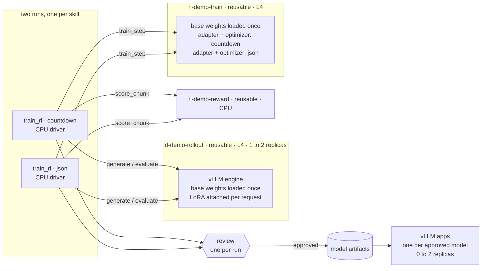

# Concurrent RL runs on a shared base model

> [!NOTE]
> Code available [on GitHub](https://github.com/unionai/unionai-examples/tree/main/v2/tutorials/rl_multi_lora).

Say you have one base model and several things you want it to get better at: one team wants reliable
JSON extraction, another wants arithmetic reasoning. Each is a separate reinforcement learning (RL) run
with its own reward. If every run is its own job, every run loads the same base model onto its own GPUs,
and each GPU sits idle whenever its run is between steps. The runs also need someone to look at the
result before a model ships, and every approved model needs an endpoint.

This tutorial runs that whole lifecycle on Union.ai for two skills at once:

- **Concurrent runs on shared GPUs.** Both RL runs are in progress at the same time and call into the
  same warm GPU replicas. The base model is loaded once; each run trains its own LoRA adapter on top.
- **Distributed and autoscaled.** Generation, scoring, and training run in separate containers sized
  for the work. The rollout pool grows from one GPU replica to two when both runs are generating, and
  shrinks when they are idle.
- **Resilient.** Each run checkpoints every iteration and resumes there after a preemption. Shared
  replicas recover from a crashed engine or a failed step without disturbing the other run.
- **A review for each run.** After its final eval, each run pauses until a person approves or rejects
  that skill's model. Nothing is published without an approval.
- **Serving for each model.** Every approved model is published as an artifact and served by its own
  autoscaling vLLM app, next to the base model and a side-by-side chat.

The example uses `Qwen/Qwen2.5-1.5B-Instruct` on L4 GPUs. You do not need a Hugging Face token or a
dataset. If RL for LLMs is new to you, [RL for LLMs with GRPO and LoRA](../grpo-lora/_index) covers a
single run in more detail.

## The ideas, in plain terms

**Policy.** The thing being trained. Here it is the language model.

**Rollout.** One answer the policy produced for one problem. The loop samples several answers per
problem so it can compare them.

**Reward.** A number that says how good an answer was. Where that number comes from is the main choice
you make:

| | Where the reward comes from | Use it when |
|---|---|---|
| **RLVR** (RL with verifiable rewards) | A program checks the answer: does the expression equal the target, does the JSON match | Correctness can be checked by code. This tutorial does this |
| **RLHF** (RL from human feedback) | People rate or rank answers, usually through a reward model trained on those ratings | Quality is a matter of preference: tone, helpfulness, style |
| **Judge model** | Another LLM grades the answer against a rubric | Checking needs reading comprehension and you have no human labels |

Only the reward changes between these. [Change the reward](#change-the-reward-rlvr-rlhf-or-a-judge)
shows the one function to replace.

**GRPO.** The update rule. For each problem, compare every sampled answer with the other answers to the
same problem. Answers that scored above their group's average become more likely, and answers below it
become less likely:

```
advantage_i = (reward_i - mean(group rewards)) / (std(group rewards) + eps)
loss        = -mean( advantage_i * average log-probability of answer_i's tokens )
```

There is no critic network to train. The full GRPO algorithm also clips the update and adds a KL
penalty. This tutorial leaves both out and takes one small gradient step per iteration.

**LoRA.** Instead of changing all 1.5 billion weights, training adds a pair of small matrices next to
each layer and trains only those. The base weights stay frozen. An adapter is tens of megabytes where
the base model is gigabytes. This is what lets several runs share one base model: the large frozen part
is identical for all of them, and only the small adapter differs.

## The two skills

Both are defined in `tasks.py`, which is pure Python with no ML dependencies.

| Skill | What the base model gets wrong | Reward |
|---|---|---|
| `countdown`: combine the given numbers with + − × ÷ to hit a target, using each number once | guesses, reuses numbers, makes arithmetic mistakes | 0 unless it reasons in `<think>` first; +0.1 for a valid expression; +1.0 if it is correct |
| `json`: turn a messy support email into a strict 8-field JSON record | wraps the JSON in markdown, picks the cc'd person's email, skips normalization rules | +0.2 bare JSON, +0.2 exact keys, +0.6 × fraction of fields correct |

Problems are generated, so there is an unlimited supply for training, plus a fixed held-out set of 100
that training never sees. The reward is a checker, not an answer key for the model to copy:



Partial credit matters. A reward that is 0 for everything except a perfect answer gives the model
nothing to climb at the start, when almost every answer is wrong.

## How the work is laid out

Each kind of work gets its own **task environment**: a container image plus the hardware it needs.

| Environment | Hardware | Reusable | Tasks |
|---|---|---|---|
| `rl-demo-rollout` | 1 × L4 | yes, 1 to 2 replicas | `generate`, `evaluate` |
| `rl-demo-reward` | 1 CPU | yes | `score_chunk` |
| `rl-demo-train` | 1 × L4 | yes, 1 replica | `init_adapter`, `train_step`, `merge_adapter` |
| `rl-demo-driver` | 1 CPU | no | `train_rl`, the loop and the review |

A **reusable** environment keeps its containers alive between task calls. The Python process, and
anything it has loaded into GPU memory, is still there for the next call. For an RL loop that is the
difference between loading a model once and loading it hundreds of times.

Reusable environments are also shared **across runs** by default (`ReusePolicy(scope="global")`). When
the countdown run and the JSON run are both active, they call into the same replicas:



While one run is in its gradient step, the other is generating, so both GPUs stay busy. The second run
never waits for a model load.

## Run it

You need a Union.ai deployment with L4 capacity and a Flyte config pointing at it
(`flyte create config`).

```bash
uv sync

# 1. Train both skills: two runs in progress at once, sharing the same warm replicas.
#    The first time, this also copies the base model into your object store.
python train.py --task all

# 2. Each run pauses for review after its final eval. Approve it on the run page, or:
python review.py <run-name> --approve     # or --reject

# 3. Serve the base model, every approved model, and the side-by-side chat.
python serve.py                           # or: python serve.py --tasks json
```

`train.py` prints a URL per run. Open one to watch its report update after every iteration.

## Walkthrough of `train.py`

### 1. Environments

One image is used everywhere. It starts from the vLLM plugin's serving image, so training and serving
run the same vLLM, and adds `peft` for LoRA:



The rollout environment is reusable and autoscales between one and two replicas:



The trainer is one reusable GPU replica. `concurrency` is the number of skills, so one step per run can
be in flight:



The driver is an ordinary container. `depends_on` tells Flyte to deploy the other environments with it:



### 2. Rollouts: one warm vLLM engine, a LoRA per request

The engine is built once per replica and cached. Every later call, from either run, finds the base
model already on the GPU:



The adapter is not baked into the engine. Each request names the adapter to apply, so one engine can
generate with countdown's adapter in one batch and JSON's in the next:



vLLM remembers adapters by an integer id. Because the engine is shared, the id has to be unique across
runs, so it is derived from the adapter's storage path. A version counter would collide: every run has
its own v1, v2, and so on. The id also has to fit in a signed 32-bit integer.

`generate` renders the prompts with the model's chat template, samples `GROUP_SIZE` answers for each,
and returns the text together with the exact token ids that were sampled:



`evaluate` uses the same engine with greedy decoding on the 100 held-out problems. It runs once before
training with no adapter and once after with the final adapter:



### 3. Reward

Scoring takes microseconds of Python, so it runs in a small CPU container instead of on a GPU:



### 4. Trainer: one base model, one adapter per skill

The trainer keeps its state in a module-level dictionary, which survives between calls because the
container is reusable. The base model is loaded once. Each skill gets a named LoRA adapter on that base,
with its own optimizer:



Each call checks whether the adapter it was handed is the one already in memory for that skill. If it
is, the only work is switching the active adapter. Otherwise it loads that one adapter and leaves the
base model and the other skill alone.

The group-relative advantage is a few lines:



The GPU part of a step computes the loss on the sampled tokens, takes one optimizer step, and saves the
adapter:



`train_step` wraps it. The lock makes the GPU work take turns, because the active adapter is a single
switch on the shared model. Downloading inputs and uploading the new adapter happen outside the lock,
so they overlap with the other run's GPU work:



The new adapter goes back to the driver as a `flyte.io.Dir`. Flyte uploads it to object storage and
hands the next `generate` call a reference, so there is no shared filesystem to set up.

### 5. Driver: the loop

The driver is a `for` loop that calls the other tasks. It evaluates the base model, runs the
iterations, evaluates again, waits for the review, and publishes the approved model:



Things to notice:

- **Calling a task is an `await`.** `await generate(...)` runs on a rollout replica and returns the
  result. `asyncio.create_task` runs two chunks in parallel, which is what makes the rollout pool scale
  to its second replica.
- **Scoring overlaps generation.** Each chunk is scored as soon as it arrives, while the other chunk is
  still generating.
- **Checkpoints.** After every iteration the driver saves where it is and where the latest adapter
  lives. See [What happens when something fails](#what-happens-when-something-fails).
- **Report.** `report=True` gives the task a live HTML page. `report_helpers.py` draws the reward curve
  and the before and after cards with no extra dependencies.
- **Groups.** `flyte.group("iter-3")` folds each iteration's tasks together in the run view.

### 6. Review the result

When the final eval is done, the run pauses on a condition. A condition is an action that waits for a
value from outside the run, here a yes or no from a reviewer. The prompt is Markdown, so the reviewer
sees the accuracy before and after and the same held-out problem answered by both models:



Each run creates its own condition, named after its skill (`approve-json`, `approve-countdown`), so the
two runs are reviewed separately. A reviewer can approve the JSON model the moment it finishes while the
countdown run is still training.

While a run waits, it holds only its 1-CPU driver. The shared GPU replicas keep serving the other run,
and once no run is using them they scale down on their own.

If the reviewer rejects the model, the run fails with a clear message and publishes nothing. If nobody
answers within `REVIEW_TIMEOUT` (24 hours), `wait` raises `flyte.errors.ConditionTimedoutError` and the
run also ends without publishing.

To review, open the run in the Union.ai UI and answer the condition there, or use `review.py`, which
finds the pending condition on a run and signals it with `flyte.remote`:



See [External conditions](../../../user-guide/tasks/task-programming/conditions) for the CLI and the
other payload types.

### 7. Publish the model

An approved adapter is merged into the base weights, which produces an ordinary checkpoint that any
server can load with no adapter handling:



The driver returns it wrapped as a **model artifact**, with a model card holding the accuracy numbers:



The task must be declared with `produces_artifacts=True`. Without it the run succeeds and no artifact
is recorded.

### 8. Launch one run per skill



`--task all` submits one run per skill without waiting between them. Each run has its own driver,
report, checkpoint, review, and artifact. They share the rollout, reward, and trainer replicas.

## What happens when something fails

A long RL run will see failures, and on shared replicas a failure must not take the other run down with
it. The example handles each case in a specific place:

| What fails | What happens |
|---|---|
| The driver's container is preempted | The platform retries the driver. The retry loads the last checkpoint and continues from the next iteration with the same adapter, history, and base eval. Problems are generated from the iteration number, so the resumed run sees the same problems it would have |
| The vLLM engine process crashes | `generate` clears the cached engine before it raises, so the replica builds a fresh engine on the next call instead of handing the dead one to the other run |
| A `train_step` fails halfway through | The step marks the in-memory adapter as unpublished before it starts. A retry reloads the adapter it was given instead of training on top of half-updated weights |
| A replica is lost | The next call lands on another replica, which loads the base model and the adapter from object storage. Nothing is stored only on a replica's disk |

## Distributed and autoscaled

Nothing in the loop says how many machines it runs on. That is set by the environments:

- **Rollouts** scale between one and two GPU replicas (`replicas=(1, ROLLOUT_CHUNKS)`). Each iteration
  splits its problems into two `generate` calls, and with two runs active there are up to four calls
  waiting at once, so the pool grows to its second replica. When the runs go quiet, idle replicas shut
  down after `scaledown_ttl`, and the whole pool after `idle_ttl`.
- **Scoring** runs on one CPU replica that takes eight calls at a time.
- **Training** is one GPU replica that holds both skills. The runs take turns on the GPU, which is the
  point: one L4 holds the base model once instead of once per run.
- **Serving** scales per model, from zero replicas when nobody is using a model to two under load.

To train more skills at once, raise the rollout pool's maximum replicas. For bigger models, change the
`L4` resources to a larger GPU. The driver code does not change in either case.

## Serve and compare

`serve.py` deploys one vLLM app per model. Each is bound to an artifact by name, and the weights stream
from object storage straight into GPU memory:



A model that was rejected in review has no artifact, so serve only the approved ones with
`python serve.py --tasks json`.

Every model app autoscales on the number of requests in flight and scales to zero when idle:



The first request to a model that has scaled to zero waits for a replica to start. For a live demo, set
`MODEL_SCALING` to `Scaling(replicas=(1, 1))` beforehand and put it back afterwards.

The chat app (`chat_ui.py`) sends the same prompt to two models and grades both answers with the same
checker used in training, so you see a pass or fail badge next to each.

## What to expect

Both runs were launched together with `python train.py --task all` on a Union.ai cluster with L4 GPUs.
Accuracy is greedy decoding on the 100 held-out problems. Run time covers training only, not the time a
run waits for its review.

| Skill | Iterations | Base model | After RL | Run time |
|---|---|---|---|---|
| `json` | 30 | 5% | 92% | 31 min |
| `countdown` | 60 | 6% | 26% | 48 min |

The same skills trained one at a time ended at 94% and 25% to 29%, so sharing the replicas did not cost
accuracy. Your numbers will differ by a few points from run to run.

JSON extraction is mostly a formatting and attention problem, and the model learns it almost completely.
Countdown needs search and arithmetic, which a 1.5B model improves at more slowly. More iterations or a
larger base model move it further.

## Make it yours

### Add a third skill

A skill is a problem generator, a system prompt, and a reward. To add one:

1. In `tasks.py`, add its name to `TASKS`, its system prompt to `SYSTEM_PROMPTS`, a branch in
   `make_problem` that returns `(user_message, answer_json)`, and a branch in `score` that returns
   `(reward, formatted, correct)`.
2. In `train.py`, add an entry to `TASK_CONFIG` with the iteration count and the maximum answer length.
3. For the chat UI, add a branch in `tasks.verdict` and a few entries in `tasks.PRESETS`.

`python train.py --task all` then starts three runs, each with its own review. The trainer's
`concurrency`, the artifact names, and the serving apps follow `tasks.TASKS`, so nothing else changes.
Check the base model's accuracy on the first report card before a long run: if the base already scores
above about 30%, make the problems harder.

### Change the reward: RLVR, RLHF, or a judge

`score_chunk` is the only place the loop learns what "good" means. Keep its signature, a list of
rollouts in and a list of numbers out, and change what is inside.

For RLHF with a reward model trained on human preferences, give the reward its own GPU environment and
keep the model warm the same way the rollout engine is. This sketch shows the shape and is not part of
the tested example:

```python
reward_env = flyte.TaskEnvironment(
    name="rl-demo-reward",
    image=image,
    resources=L4,
    reusable=flyte.ReusePolicy(replicas=1, concurrency=1, idle_ttl=600),
)


@alru_cache(maxsize=1)
async def _load_reward_model(uri: str) -> Any: ...  # load your preference model once per warm replica


@reward_env.task
async def score_chunk(task: str, rollouts: list[Rollout]) -> list[float]:
    model = await _load_reward_model(REWARD_MODEL_URI)
    return model.score([(r.question, r.completion) for r in rollouts])
```

For a judge model, `score_chunk` calls a served LLM with a rubric and parses a score from the reply. For
direct human ratings, the task reads the ratings your labeling tool stored for those rollouts. In every
case the driver, the trainer, and the rollout engine stay as they are.

Whatever the source, scale rewards to a small range and give partial credit where you can. GRPO only
looks at differences within a group, so a group where every answer gets the same reward teaches nothing.

### Change the review

The review is a `bool` condition, but a condition can also return an `int`, `float`, or `str`. A `str`
condition could collect the reviewer's notes and put them in the model card. A `float` condition could
ask for a minimum accuracy and publish only above it. To skip human review for a skill, replace the
`_review` call with a check on `final_eval.accuracy`.

### Knobs

| Setting | Where | Effect |
|---|---|---|
| `PROMPTS_PER_ITER`, `GROUP_SIZE` | `train.py` | Rollouts per iteration. More is a steadier gradient and a slower iteration |
| `LEARNING_RATE` | `train.py` | Raise it if the reward curve is flat. Lower it if the curve climbs and then collapses |
| `LORA_RANK` | `train.py` | Adapter capacity. Also sets `max_lora_rank` for the vLLM engine |
| `rollout_env` replicas | `train.py` | Raise the maximum if rollouts from several runs queue up |
| `MICRO_BATCH` | `train.py` | Sequences per backward pass. Lower it if the trainer runs out of GPU memory |
| `REVIEW_TIMEOUT` | `train.py` | How long a finished run waits for a reviewer |
| `MODEL_SCALING` | `serve.py` | Replicas per served model and when to add one |
| `ReusePolicy(scope="run")` | `train.py` | Give every run its own replicas instead of sharing them |

### Isolating runs

Sharing replicas is what makes several runs cheap, and it means the code inside a replica cannot assume
it serves one run. This example keys all cached state by skill or by adapter path for that reason. If
you would rather give each run private replicas, for example to compare two learning rates for the same
skill at the same time, set `scope="run"` on the reusable environments. Two concurrent runs of the
*same* skill on shared replicas would otherwise take turns evicting each other's adapter from the
trainer.

## Troubleshooting

| Symptom | Cause |
|---|---|
| The run shows as running but nothing is happening | It is waiting for its review. Approve or reject it on the run page or with `review.py` |
| `review.py` says the run has no review waiting | The run has not reached its final eval yet |
| The run finishes and no model artifact appears | The model was rejected or the review timed out, or the task is missing `produces_artifacts=True` |
| `serve.py` fails to find an artifact | That skill's model was not approved. Pass only approved skills with `--tasks` |
| `EngineDeadError` from `generate` | The vLLM engine process crashed. Its own traceback is earlier in the same log. The replica drops the dead engine and the next call rebuilds it |
| `OverflowError: ... out of bounds for int32` in the engine log | A `lora_int_id` larger than 2³¹ − 1 |
| GPU tasks wait for resources for a long time | No L4 node is available. The memory request is 24Gi so the task fits a single-L4 node |
| Reward stays near zero | The reward has no partial credit, or the problems are too hard for the base model to ever get right |
| Format rate reaches 100% and accuracy falls | The model found a shortcut in the reward. The countdown reward requires reasoning in `<think>` for this reason |

## Files

| File | Role |
|---|---|
| `tasks.py` | Problem generators, system prompts, rewards, held-out eval set, chat presets |
| `train.py` | Environments, rollouts, reward, trainer, driver loop, review, artifact publishing |
| `review.py` | Approve or reject a run's review from the terminal |
| `serve.py` | One autoscaling vLLM app per model bound to its artifact, plus the chat app |
| `chat_ui.py` | Side-by-side Gradio chat with pass or fail grading |
| `report_helpers.py` | The live training report |
| `DEMO.md` | Talk track for presenting the chat live |
