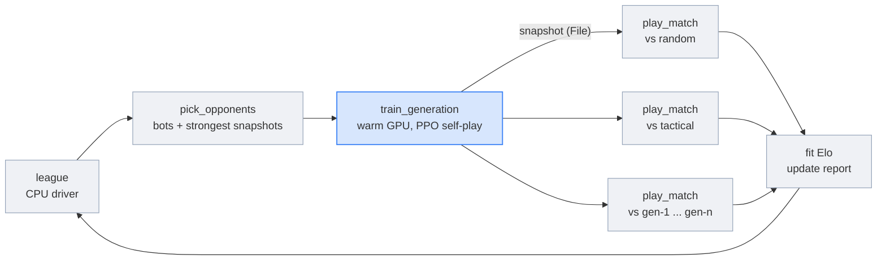

# Self-play league for Connect Four

> [!NOTE]
> Code available [on GitHub](https://github.com/unionai/unionai-examples/tree/main/v2/tutorials/self_play_league).

In a two-player game there is no fixed environment to beat: the opponent is the environment,
and the best opponent for a learner is usually another copy of itself. Self-play is how
AlphaGo, OpenAI Five, and AlphaStar were trained. It comes with a well-known failure: a learner
that only plays its current self can go in circles, learning to beat today's habits while
forgetting how to beat yesterday's. AlphaStar's answer was a *league*: keep every past snapshot
as an opponent, train against the ones the learner finds hardest, and rate everyone against
everyone so progress is measured instead of assumed.

This tutorial builds a small league for Connect Four. The game and the training both run as
batched tensors, so a generation plays tens of thousands of games on one GPU in a few seconds
per iteration. Flyte runs everything around it:

- a warm GPU learner that keeps its CUDA context between generations;
- a fan-out of head-to-head matches on a pool of CPU workers after every generation;
- a joint Elo fit over every result, and a live report with the ladder and the score matrix;
- the champion, published as an artifact and served as a FastAPI app you can play in the browser.

## How a generation works



1. The driver picks the learner's opponents for this generation: two scripted bots, and the
   three highest-rated snapshots so far.
2. `train_generation` plays 2,048 games per iteration against those opponents and itself, and
   runs a PPO update on the learner's moves. After 25 iterations it saves a snapshot.
3. The new snapshot plays every member of the league, 400 games per pairing, all at once on
   the CPU pool.
4. The driver refits Elo over every match so far and redraws the report.

| Need | Construct |
| --- | --- |
| Keep the GPU learner warm between generations | `flyte.ReusePolicy(replicas=1)` on the training environment |
| Rate a snapshot against the whole league at once | `asyncio.gather` over `play_match` calls on a reusable CPU pool |
| Don't redo work after a driver crash | `cache="auto"` on training and matches, and `retries=2` on the driver |
| One view per generation | `flyte.group` |
| Watch the ladder while it trains | `report=True` on the driver and on every training generation |
| Keep and serve the champion | `flyte.artifacts`, and a `FastAPIAppEnvironment` that loads the latest league output |

## Getting started

You need a Union cluster with an NVIDIA L4, or any CUDA GPU (change `train_env` in `league.py`).

```bash
git clone https://github.com/unionai/unionai-examples
cd unionai-examples/v2/tutorials/self_play_league
python league.py            # 20 generations, about 25 minutes
python league.py --smoke    # 2 short generations
python app.py               # serve the champion of the latest league run
```

## The game as tensors

Every board is stored from the point of view of the player to move, so one network plays both
sides. A move places a stone, checks for four in a row with a 2D convolution, and flips the
board for the other player. Thousands of games step together on the GPU.



The league starts with two scripted opponents. The tactical bot wins when it can, blocks when it
must, and otherwise prefers the center. It beats a random player almost every time, and it is
the bar the learner has to clear.



The network is a small residual convolutional network with a policy head and a value head.
Illegal moves are masked out of the policy.



## Self-play training

A training iteration plays one batch of games against the opponents, splitting the games evenly
between them. The learner moves first in half of the games. Only the learner's moves are kept,
and each one gets the final outcome of its game as its return.



The update is PPO with the value head as the baseline. Because the return is the game's
outcome, the advantage of a move is how much better the game went than the value head expected
from that position.



`train_generation` wraps this in a task. It loads the learner and its optimizer state from the
previous generation's checkpoint, trains, and returns the new checkpoint as a `flyte.io.File`.
Its live report shows the score against each opponent as the iterations go by.



## The league

The environments make the split between the two kinds of work explicit. Training is one warm
GPU replica that every generation of a run reuses. Matches are a pool of CPU replicas that grows
while a new snapshot plays the league, and shrinks after. Both cache their results, so a driver
that is retried after a crash replays finished generations from the cache instead of training
them again.



A match is a batch of games between two players, each greedy after a random opening, so that two
deterministic players don't replay the same game 400 times:



### Elo

Each match gives a score from one side's point of view. The ratings are fitted jointly over all
of them, Bradley-Terry style, with the random bot pinned at 0. A difference of 400 points means
the stronger player is expected to score 10 to 1.



### Choosing opponents

The learner always plays itself and the two bots. The rest of its games go to the three
highest-rated snapshots. Those are the opponents it has the most to learn from, and they stay in
the mix even after newer snapshots arrive.



### The driver



## Results

A run with the defaults, 20 generations of 25 iterations of 2,048 games, took 23 minutes on
one L4 and 231 matches (92,400 rated games) on the CPU pool.

| | Elo | Score against the tactical bot |
| --- | --- | --- |
| Random bot | 0 (pinned) | |
| Tactical bot | 456 | |
| First snapshot (generation 1) | about 390 | |
| Champion (generation 19) | 547 | 75% wins, greedy play |

The learner passes the tactical bot within two generations, then keeps improving more slowly.
In training, where both sides sample their moves, its score against the tactical bot climbs
from 2% to 88%.

How the league picks opponents matters. An earlier version trained against the three most
recent snapshots instead of the three strongest. Its 12-generation run stalled at the tactical
bot's level: the champion won 50% of greedy games against it. Training against the strongest
snapshots kept the learner improving.

The driver's report shows the ladder, a sample game against the tactical bot, and the training
curves:


The score matrix shows every pairing. Each row is a player's score against each column: later
generations (lower rows) score higher against earlier ones (left columns), and the bots' rows
darken as the league grows.


Because training and matches are cached, running the same league again replays every
generation from the cache. The rerun took 39 seconds instead of 23 minutes, and only the driver
did any work. A driver that crashes partway through resumes the same way.


## Play the champion

`app.py` serves the champion as a FastAPI app. The champion's checkpoint is an app parameter
whose value is a `RunOutput`: when the app is deployed, Flyte resolves it to the output of the
latest successful `league` run, so a new league run followed by a redeploy serves the new
champion with no code change. The app scales to zero when nobody is playing.



The page sends the board after each of your moves, and the app answers with the champion's
move, its move probabilities, and its value estimate for the position:



Here the champion has just blocked both ends of a three-in-a-row:


## Going further

- **Add search.** The network is a strong prior for a few plies of lookahead. Monte Carlo tree
  search on top of it, AlphaZero style, beats the raw policy by a wide margin.
- **A bigger league.** Add main exploiters, learners whose only job is to beat the current
  champion, as AlphaStar did. Each one is another `train_generation` call in the same loop.
- **Other games.** Anything that can be written as batched tensor steps, from Othello to
  simple card games, drops into `connect4.py` without changing the league.

## Related

- [Reinforcement learning](../../../user-guide/reinforcement-learning/_index) in the user guide
- [Reusable containers](../../../user-guide/tasks/task-configuration/reusable-containers)
- [Caching](../../../user-guide/tasks/task-configuration/caching)
- [FastAPI apps](../../../user-guide/apps/native-app-integrations/fastapi-app)
- [Passing parameters to apps](../../../user-guide/apps/configure-apps/passing-parameters)
