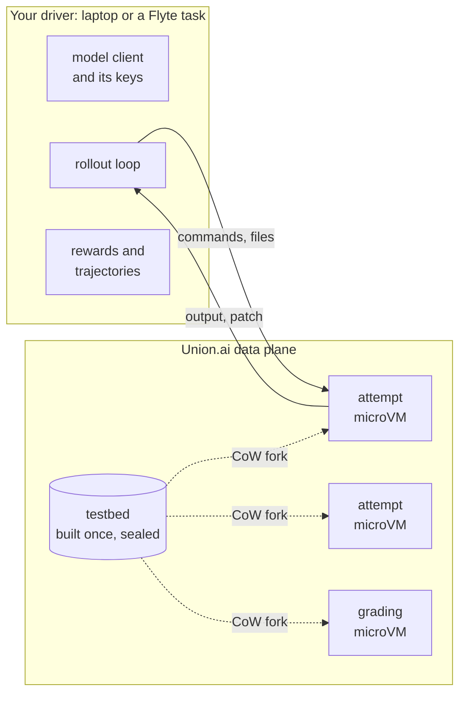

# SWE-Gym rollouts on Sandbox VMs

> [!NOTE] Early access preview
> This tutorial uses [Sandbox VMs](../../../user-guide/vm-sandboxes/_index), which are in early access and need microVM node pools in your data plane. It requires `flyteplugins-union` 0.23.0 or later.

You have a model that writes code, and you want to know how well it fixes real bugs, or you want training data from its attempts. A rollout system hands the model a bug, lets it run commands in a safe copy of the repository, and scores the fix with tests the model never saw.

This tutorial builds that system for [SWE-Gym](https://github.com/SWE-Gym/SWE-Gym), a set of bugs from real Python repositories. It is adapted from Modal's open-source SWE-Gym rollout example. The rollout logic is the same. Only the environment layer, the code that creates and talks to sandboxes, is new.

You will:

- Build each repository's testbed once, in a sandbox with network, and seal it as a committed disk.
- Run every attempt in its own microVM, on a copy-on-write fork of the testbed, with no network and no secrets.
- Grade every attempt in another fresh fork, so nothing the model did outside its patch leaks into grading.
- Publish testbeds as artifacts so later runs skip the build.
- Run the same loop from a laptop, and as a durable Flyte run with cached builds and retries.

## The problem

Each bug is an **instance**, taken from a real pull request. It has four parts:

| Part | Who sees it |
| --- | --- |
| The repository, at the commit just before the fix | The model works in it |
| The problem statement: the issue text | The model reads it |
| The gold patch: the real fix from the pull request | Hidden from the model |
| The hidden tests, which must go from failing to passing | Hidden from the model. They decide the reward. |

One try by the model at one instance is an **attempt**. Its **reward** is 1 if the hidden tests pass with its patch, and 0 otherwise. For GRPO-style training, you run a group of attempts per instance and train on which ones were rewarded.

The model runs commands it wrote itself. Everything it touches has to be disposable and cut off, and you need many attempts running at once. That decides the shape of the system.

## Architecture



| Choice | Why |
| --- | --- |
| Sandboxes are VMs with no network and no secrets | Whatever the model runs cannot reach the internet, your credentials, or another attempt. |
| The model client and its keys stay in the driver | The sandboxes never see an API key. |
| The testbed is built once and sealed | Installing a repository takes minutes. Doing it once per instance, not once per attempt, makes many attempts cheap, and every attempt starts from identical bytes. |
| Every attempt and every grading run gets a fresh copy | Attempts cannot see each other's changes. Copies are copy-on-write, so they start in seconds. |

One instance flows through five steps:

1. **Build.** Clone the repository and install it, in a sandbox with network.
2. **Seal.** Commit the disk as a `SandboxVolume`. It is never written again.
3. **Attempt.** Run the agent loop on a fresh copy, many attempts at once.
4. **Patch.** Take `git diff` of what the model changed.
5. **Grade.** Apply the patch and run the hidden tests on another fresh copy.

Steps 1 and 2 happen once per instance and are reused by later runs. Steps 3 to 5 happen once per attempt.

## Setup

```bash
pip install "flyteplugins-union>=0.23.0"
```

You need a `flyte` configuration for your Union.ai control plane and a project you can create runs in. For a run with nobody at the keyboard, sign in with an API key so an expired browser sign-in doesn't stop the run:

```bash
flyte create api-key --name swe-gym-driver
export FLYTE_API_KEY=<the key it printed>
```

## Two sandbox environments

The system uses two kinds of sandbox. Builds need the network for `apt`, PyPI, and GitHub. Attempts and grading get none.

```python
import flyte
from flyteplugins.union import sandbox
from flyteplugins.union.sandbox import Sandbox, SandboxEnvironment, SandboxVolume

attempt_env = SandboxEnvironment(
    name="swe-attempt",
    resources=flyte.Resources(cpu=2, memory="4Gi"),
    max_duration=7200,
    network=sandbox.Network.blocked(),
)

build_env = SandboxEnvironment(
    name="swe-testbed-build",
    resources=flyte.Resources(cpu=2, memory="4Gi"),
    max_duration=3600,
    network=sandbox.Network.internet(),
)
```

Neither environment declares secrets. The only sandbox with network is the build, which runs a script you wrote, not the model's commands.

## Build and seal a testbed

The build runs a setup script for the instance: install system packages, install the right Python version, clone the repository at its base commit, install it, and strip the git history after the base commit so the fix can't be read from it. Then it commits the disk:

```python
class InfrastructureError(RuntimeError):
    """The sandbox, not the agent, failed: the attempt is retried, not scored."""


async def build_testbed(inst: dict) -> SandboxVolume:
    name = f"build-{inst['instance_id'].split('__')[-1].lower()}"
    async with build_env.session(name) as sb:
        try:
            r = await sb.run(["/bin/bash", "-c", build_script(inst)], timeout=3000, check=False)
            if r.exit_code:
                raise InfrastructureError(f"build failed:\n{(r.stdout + r.stderr)[-4000:]}")
            return await sb.commit()  # sealed: sessions start on copies of it, never on it
        except BaseException:
            await sb.cancel("testbed build did not finish")
            raise
```

`build_script(inst)` returns the shell script for an instance's repository. Each repository needs its own recipe: a Python version and an install command.

The `except` branch cancels the session instead of closing it. This matters once you publish testbeds: a closed session publishes its disk, and a cancelled one publishes nothing, so a half-built testbed is never published.

### Check the testbed with the gold patch

A testbed built from source can differ from the environment the benchmark expects. Before any attempt uses it, apply the gold patch to a copy and run the hidden tests. The failing tests must pass:

```python
async def validate(testbed: SandboxVolume, inst: dict) -> None:
    async with attempt_env.session("validate", volume=testbed) as sb:
        await sb.fs.write_text("/tmp/gold.patch", inst["patch"])
        await sb.fs.write_text("/tmp/hidden_test.patch", inst["test_patch"])
        await sb.fs.write_text("/tmp/eval.sh", eval_script(inst))
        r = await sb.run(
            ["/bin/bash", "-c", "cd /testbed && git apply /tmp/gold.patch && bash /tmp/eval.sh"],
            timeout=1200,
            check=False,
        )
    report = grade_log(inst, r.stdout + r.stderr)
    if report["FAIL_TO_PASS"]["failure"]:
        raise InfrastructureError(f"the gold patch fails on this testbed:\n{(r.stdout + r.stderr)[-3000:]}")
```

The session runs on a copy of the testbed, so the gold patch never touches the sealed disk. This catches a broken build before it costs you attempts.

### Publish testbeds for later runs

Building every testbed on every run wastes minutes per instance. Set `publish_on_exit` on the build environment, and each build's disk is published as an artifact when its session closes. The next run starts from it:

```python
async def get_testbed(inst: dict) -> SandboxVolume:
    artifact = testbed_artifact_name(inst)  # for example "swe-testbed-moto-7023-v3"
    try:
        return await SandboxVolume.from_artifact(artifact)
    except Exception:
        pass  # not published yet

    publishing_env = SandboxEnvironment(
        name="swe-build",
        resources=build_env.resources,
        max_duration=build_env.max_duration,
        network=build_env.network,
        publish_on_exit=artifact,
    )
    ...  # build in publishing_env, as above
```

Put a version of the build recipe in the artifact name. When you change the recipe, the name changes, and old testbeds are not reused by mistake.

## The sandbox layer

Everything that touches a sandbox fits in four functions. The rollout loop calls these and nothing else:

```python
import contextlib
import shlex
import uuid


@contextlib.asynccontextmanager
async def attempt_sandbox(inst: dict, testbed: SandboxVolume, purpose: str = "attempt"):
    """A sandbox on a fresh copy of the instance's testbed, at its base commit."""
    name = f"{purpose}-{inst['instance_id'].split('__')[-1].lower()}-{uuid.uuid4().hex[:6]}"
    async with attempt_env.session(name, volume=testbed) as sb:
        rc, out = await command(
            sb, f"cd /testbed && git reset --hard {shlex.quote(inst['base_commit'])} && git clean -fd"
        )
        if rc:
            raise InfrastructureError("cannot reset repository: " + out[-2000:])
        yield sb


async def command(sb: Sandbox, code: str, timeout: float = 120) -> tuple[int, str]:
    """Run `code` under bash; return (exit code, stdout + stderr). 124 on timeout."""
    r = await sb.run(["/bin/bash", "-lc", code], timeout=timeout, check=False)
    return (124 if r.timed_out else r.exit_code), r.stdout + r.stderr


async def patch(sb: Sandbox) -> str:
    """`git diff` of everything the agent changed."""
    rc, out = await command(
        sb,
        "cd /testbed && git add -A && git diff --cached --binary HEAD -- . "
        "':(exclude)*.pyc' ':(exclude)__pycache__' ':(exclude).pytest_cache'",
    )
    if rc:
        raise InfrastructureError(f"cannot capture patch: {out[-2000:]}")
    return out


async def grade(inst: dict, testbed: SandboxVolume, prediction: str) -> float:
    """Apply the patch in a fresh sandbox and run the hidden tests."""
    async with attempt_sandbox(inst, testbed, purpose="grade") as sb:
        if prediction:
            await sb.fs.write_text("/prediction.patch", prediction)
            rc, _ = await command(sb, "cd /testbed && git apply --whitespace=nowarn /prediction.patch")
            if rc:
                return 0.0  # the patch does not apply
        await sb.fs.write_text("/tmp/hidden_test.patch", inst["test_patch"])
        await sb.fs.write_text("/hidden_eval.sh", eval_script(inst))
        rc, out = await command(sb, "bash /hidden_eval.sh", 1200)
        report = grade_log(inst, out)
        if not report["parsed"]:
            raise InfrastructureError("no trustworthy test results")
        return float(report["resolved"])
```

A few details:

- `command` passes `check=False`. A failing command is feedback for the model, not an error.
- Commands run as a list, `["/bin/bash", "-lc", code]`, so the model's text is one argument to bash and is never parsed by another shell first.
- `grade` opens its own sandbox. The hidden tests never enter a sandbox the model touched.
- Failures of the sandbox itself raise `InfrastructureError`, which the driver retries instead of scoring as 0. The model should not be penalized for infrastructure.

## The rollout loop

An attempt is a plain agent loop. The model has one tool, `bash`. Each turn it either asks to run commands or answers without a tool call, which means it is done:

```python
async def generate_rollout(inst: dict, testbed: SandboxVolume, model, max_turns: int = 20) -> dict:
    conversation = [
        {"role": "system", "content": SYSTEM_PROMPT},
        {"role": "user", "content": inst["problem_statement"]},
    ]
    stop = "turn_limit"
    async with attempt_sandbox(inst, testbed) as sb:
        for turn in range(max_turns):
            reply = await model.sample(conversation)  # keep each token's log-probability
            conversation.append({"role": "assistant", "content": reply.text})
            commands = parse_bash_calls(reply.text)
            if not commands:
                stop = "final"
                break
            for cmd in commands:
                rc, output = await command(sb, f"cd /testbed && bash -c {shlex.quote(cmd)}", 120)
                conversation.append({"role": "tool", "content": f"exit_code={rc}\n{output[-20000:]}"})
        prediction = await patch(sb)
    return {"conversation": conversation, "patch": prediction, "stop": stop}
```

| Detail | What the loop does |
| --- | --- |
| Why an attempt stops | `final`: the model answered without a command. `turn_limit`: 20 turns used. The full example also stops at `context_limit` and `generation_limit`. |
| A malformed tool call | The parse error is fed back as the tool result, so the model can correct itself. |
| What is saved for training | Every token of the conversation, the log-probability of each generated token, and a mask of which tokens were the model's. That is what a policy-gradient update needs. |
| Command output | Each result is cut to its last 20,000 characters before it goes back to the model. |

`model.sample` is where your policy plugs in: a Tinker client, an OpenAI-compatible server such as vLLM, or a scripted stand-in for smoke tests. It runs in the driver, so its keys never reach a sandbox.

## Run groups of attempts

For GRPO, run a group of attempts at each instance and compute each attempt's advantage as its reward minus the group mean. A group where every attempt scored the same carries no signal.

```python
import asyncio

INFRA_RETRIES = 2


async def attempt(inst: dict, testbed: SandboxVolume, model, slots: asyncio.Semaphore) -> float:
    async with slots:
        for tries in range(INFRA_RETRIES + 1):
            try:
                rollout = await generate_rollout(inst, testbed, model)
                return await grade(inst, testbed, rollout["patch"])
            except InfrastructureError:
                if tries == INFRA_RETRIES:
                    raise


async def run_group(inst: dict, testbed: SandboxVolume, model, group_size: int, slots) -> list[float]:
    rewards = await asyncio.gather(*(attempt(inst, testbed, model, slots) for _ in range(group_size)))
    mean = sum(rewards) / len(rewards)
    print(inst["instance_id"], "advantages", [round(r - mean, 2) for r in rewards])
    return list(rewards)
```

The semaphore caps how many sandboxes run at once. Size it to your microVM node pool.

## Drive it from a laptop

The driver can be any Python process. From a laptop, the plugin reaches each sandbox through the Union.ai data proxy, signed in as you. Nothing else runs in the cluster on your behalf: no task and no app.

```python
import time
import uuid


async def main(instances: list[dict], model, group_size: int = 4) -> None:
    # Outside a task every sandbox is a run of its own. One label groups this job's.
    job = f"{time.strftime('%m%d-%H%M')}-{uuid.uuid4().hex[:4]}"
    for env in (attempt_env, build_env):
        env.labels = {"swe-gym-run": job}
    print(f"sandboxes of this job are labeled swe-gym-run={job}")

    testbeds = await asyncio.gather(*(get_testbed(inst) for inst in instances))
    slots = asyncio.Semaphore(16)
    await asyncio.gather(
        *(run_group(inst, tb, model, group_size, slots) for inst, tb in zip(instances, testbeds))
    )


flyte.init_from_config(project="<your-project>", domain="development")
asyncio.run(main(load_instances(), make_model()))
```

List a job's sandboxes while it runs:

```bash
flyte get run --with-label swe-gym-run=<job>
```

Each call from a laptop makes a round trip through the data proxy, which adds latency to every command. That is fine for development and small jobs. For large jobs, run the driver in the cluster, as in the next section.

A smoke run with a scripted model that applies the gold patch on even attempts and gives up on odd ones gives rewards of `1 0 1 0` per instance. That confirms building, forking, patch capture, and grading all work before you spend GPU time:

```text
instance                         attempt reward turns  stop
getmoto__moto-7023                     0    1.0     3  final
getmoto__moto-7023                     1    0.0     2  final
getmoto__moto-7023                     2    1.0     3  final
getmoto__moto-7023                     3    0.0     2  final
python__mypy-16781                     0    1.0     3  final
python__mypy-16781                     1    0.0     2  final
python__mypy-16781                     2    1.0     3  final
python__mypy-16781                     3    0.0     2  final

mean reward 0.50 over 8 attempts
group 0 getmoto__moto-7023: mixed=True (GRPO advantages +0.50, -0.50, +0.50, -0.50)
group 1 python__mypy-16781: mixed=True (GRPO advantages +0.50, -0.50, +0.50, -0.50)
```

## Make it durable with Flyte

The same functions run inside tasks. Moving the driver into a Flyte run adds:

- **Cached builds.** `build_testbed` is a cached task that returns a `SandboxVolume`. A later run with the same instance reuses the committed disk.
- **Retries per attempt.** Each attempt is a task with `retries`. One failed attempt is retried on its own, and the rest of the group keeps its results.
- **Traced grading.** Grading runs in a `flyte.trace`, so a retried attempt replays its recorded verdict instead of grading again.
- **Direct calls.** Tasks call sandboxes directly inside the cluster, with no data proxy in between.
- **One view of everything.** Each sandbox is an action in the run, under the task that opened it.

```python
import json

env = flyte.TaskEnvironment(
    name="swe_gym_rl",
    image=flyte.Image.from_debian_base().with_pip_packages("flyteplugins-union>=0.23.0"),
    resources=flyte.Resources(cpu=1, memory="2Gi"),
    secrets=[flyte.Secret(key="TINKER_API_KEY", as_env_var="TINKER_API_KEY")],
)


@env.task(cache="auto", retries=1)
async def build(instance_json: str) -> SandboxVolume:
    inst = json.loads(instance_json)
    testbed = await build_testbed(inst)
    await validate(testbed, inst)
    return testbed


@flyte.trace
async def traced_grade(instance_json: str, testbed: SandboxVolume, prediction: str) -> float:
    return await grade(json.loads(instance_json), testbed, prediction)


@env.task(retries=2)
async def rollout(instance_json: str, testbed: SandboxVolume) -> float:
    inst = json.loads(instance_json)
    result = await generate_rollout(inst, testbed, make_model())
    return await traced_grade(instance_json, testbed, result["patch"])


@env.task
async def main(instance_ids: list[str], group_size: int = 4) -> list[float]:
    insts = load_instances(instance_ids)
    testbeds = await asyncio.gather(*(build(json.dumps(i)) for i in insts))
    calls = [
        rollout(json.dumps(inst), tb)
        for inst, tb in zip(insts, testbeds)
        for _ in range(group_size)
    ]
    return list(await asyncio.gather(*calls))
```

The model key is a Union.ai secret on the driver tasks only. The sandboxes still get no secrets.

## Limits of this approach

A sandbox runs the platform's base image, not the benchmark's per-instance Docker image. That is why this tutorial builds each testbed from source and checks it with the gold patch. It costs:

- A few minutes per instance, once. Published or cached testbeds make it once ever, not once per run.
- Repositories that need conda or heavy native builds, such as pandas, dask, and MONAI, need their own build recipes.
- The environment can differ from the benchmark's image. Tests that should pass with the gold patch but fail on the testbed are left out of grading.

## Next steps

- [Sandbox VMs](../../../user-guide/vm-sandboxes/_index): the full API.
- [Save and fork disks](../../../user-guide/vm-sandboxes/persist-and-fork): commit, fork, and publish.
- [Reinforcement learning](../../../user-guide/reinforcement-learning/_index): the trainer, rollout workers, and reward tiers around a loop like this one.
