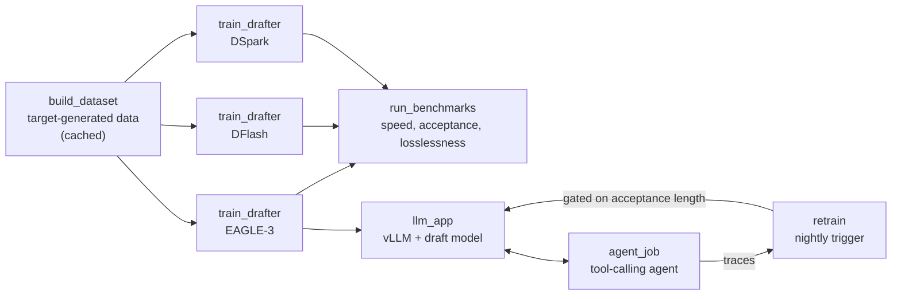

# Speculative decoding models

> [!NOTE]
> Code available [on GitHub](https://github.com/unionai/unionai-examples/tree/main/v2/tutorials/speculative_decoding).

Speculative decoding makes an LLM generate faster without changing what it generates. A small
**draft model** proposes several tokens ahead, and the large **target model** checks them all
in one forward pass. Every accepted token is one the target would have produced anyway, so the
output distribution is identical. The speedup depends on one number: how many tokens the
target accepts per forward pass, the **acceptance length**.

A draft model is only as good as its match to your traffic. Public draft models are trained
on general chat, and their acceptance length drops on tool calls, JSON, and the long repeated
context of agent workloads. These tutorials train draft models for Qwen3-8B on your traffic,
prove the speedup and that outputs are unchanged, serve them, and keep them matched as
traffic shifts.

## Three draft model families

All three read hidden states from several of the target's layers, so they see what the target
is about to say rather than only the text so far. They differ in how they draft:

| Family | How it drafts | Draft tokens per step | Starting point here |
| --- | --- | --- | --- |
| **EAGLE-3** | One transformer layer, one token per pass, autoregressively | 3 | Red Hat's public head, fine-tuned |
| **DFlash** | A small block-diffusion model drafts a whole block in one pass | 15 | Red Hat's public head, fine-tuned |
| **DSpark** | DFlash plus a Markov head across the block and a confidence head | 7 | Trained from scratch |

EAGLE-3 is the default in vLLM and SGLang, and the safest choice at high concurrency. Block
drafters cost one draft pass per block instead of one per token, so they pull ahead when the
target accepts long runs of drafted tokens: code, structured output, and low-concurrency
serving.

## How the tutorials fit together

Every tutorial uses the same pipeline and the same cached, target-generated dataset, so after
the first run, a new draft model costs only its own training and benchmarks.

Start with [Train an EAGLE-3 draft head](./eagle3-train), which builds the dataset the other
tutorials reuse. [Benchmark draft models](./benchmark) compares every family on identical
GPUs, and [Serve and retrain draft models](./serve-and-retrain) closes the loop.

## What {} provides

- **Fan-out with warm GPUs.** Data generation splits into shards that run in parallel on
  reusable containers. Each replica keeps one vLLM server loaded across shards.
- **Caching.** Generated data is cached, so every draft model trains on the same data without
  regenerating it.
- **One GPU per benchmark configuration.** Serving configurations run side by side on
  identical hardware, and a report compares them.
- **Reports everywhere.** Data synthesis, training, benchmarks, agent traffic, and every
  retraining decision render as reports in the UI, with live training curves.
- **Apps and tasks together.** Draft models are served as vLLM apps, and an agent task calls
  them. An app picks up its draft model from a pipeline run's output.
- **Traces as data.** Every model call in the agent is a `flyte.trace`, and each agent job
  returns its episodes as a file that nightly retraining collects.
- **Scheduled, gated retraining.** A cron trigger retrains the draft model every night and
  promotes it only if its acceptance length beats the current one.



On Union, each promoted draft model is also published as a versioned artifact with a model
card, and its training traces as a data artifact with a data card. The serving app follows
the latest version, and rolling back is one call.




