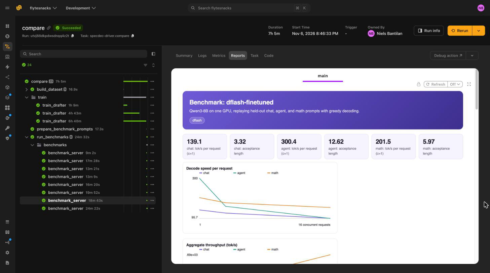
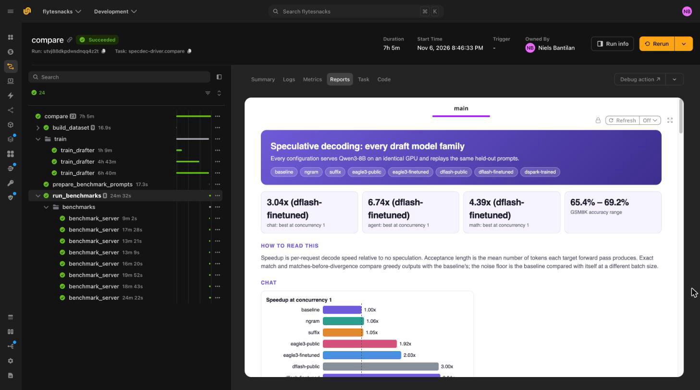

# Benchmark draft models

A speculative decoding claim needs two numbers: how much faster the target decodes, and
evidence that its outputs did not change. This page benchmarks eight ways of serving
Qwen3-8B on identical GPUs, covering every draft model family in these tutorials, and checks
both.

## Compare eight configurations

| Configuration | What drafts | Training |
| --- | --- | --- |
| `baseline` | Nothing. The target decodes one token per forward pass. | None |
| `ngram` | Matching n-grams copied from the prompt | None |
| `suffix` | A suffix tree over the prompt and earlier responses | None |
| `eagle3-public` | Red Hat's general-purpose EAGLE-3 head | Pretrained |
| `eagle3-finetuned` | The head from [Train an EAGLE-3 draft head](./eagle3-train) | Fine-tuned here |
| `dflash-public` | Red Hat's general-purpose DFlash head | Pretrained |
| `dflash-finetuned` | The drafter from [Train a DFlash block drafter](./dflash) | Fine-tuned here |
| `dspark-trained` | The drafter from [Train a DSpark drafter](./dspark) | From scratch here |

The two draft-free methods matter as baselines. On repetitive traffic, they can match or beat
a learned drafter without any training, so a learned drafter has to earn its place.

`compare` trains a drafter of every family, then benchmarks all eight configurations:



`train_drafter` is cached. If you already ran `pipeline.py`, `dflash.py`, and `dspark.py`,
`compare` calls it with the same data and arguments, reuses all three drafters, and goes
straight to the benchmarks. Otherwise it trains the three in parallel, each on its own GPU.

Each configuration is a `ServerConfig`. A drafter configuration takes its draft length from
its family's recipe:



## Measure on held-out prompts

`prepare_benchmark_prompts` draws three workloads that the training data never touched:



- **chat**: first-turn MT-Bench prompts, the standard for reporting acceptance length.
- **agent**: held-out ToolACE requests with their tool schemas. The response is usually a
  JSON tool call.
- **math**: GSM8K test questions, which also have checkable answers.

## Run one configuration per GPU

`benchmark_server` starts vLLM with one configuration, warms it up, and replays every
workload at concurrency 1, 4, and 16:



Each request streams, so the task records time to first token (TTFT), time per output token
(TPOT), and decode speed per request. Before and after each pass, it reads vLLM's speculative
decoding counters and takes the difference:



**Mean acceptance length** is `1 + accepted / drafts`: the tokens each target forward pass
produces, counting the one token the target always contributes. It is the headline draft
quality metric because it does not depend on how many tokens the drafter proposes.
Acceptance rate, `accepted / proposed`, falls as you propose more tokens even when the
drafter improves.

> [!WARNING] Never replay a prompt a caching method has seen
> Suffix decoding caches earlier responses and drafts from them. Replaying the same prompts
> at each concurrency level lets it draft the exact greedy answer it already produced. In an
> early version of this benchmark, that inflated its acceptance length from about 1.5 to 8.5.
> Each concurrency level here gets its own slice of prompts, and warm-up uses a prompt
> outside every workload.

`run_benchmarks` runs all eight configurations at once, each on its own GPU, and compares
them in a report:



```bash
python compare.py --smoke   # 20 training steps, 12 prompts per workload
python compare.py           # the full run
```

In the run, the three trainings sit in a `train` group and the eight benchmarks in a
`benchmarks` group. Each benchmark has its own report, with decode speed and throughput by
concurrency for each workload:



`run_benchmarks` renders the comparison: the best speedup per workload, the GSM8K accuracy
range, and speedup charts for every configuration:



## Verify that outputs are unchanged

Speculative sampling is lossless in theory: every accepted token is one the target would
have produced. In practice, three checks confirm it:



- **Agreement with the baseline.** At temperature 0, each configuration's outputs are
  compared with the baseline's, prompt by prompt: whether they match exactly, and how much
  of each output matches before the first differing character.
- **The noise floor.** The baseline replays its own prompts at concurrency 16 and is compared
  with itself the same way. Batched GPU kernels are not bit-identical across batch sizes, and
  over a few hundred tokens one rounding difference flips a token and the texts diverge. A
  lossless configuration agrees with the baseline about as well as the baseline agrees with
  itself, which on most GPUs is well below 100%.
- **Task accuracy.** GSM8K accuracy should be the same within noise for every
  configuration. This is the check that matters most, because two greedy paths that diverge
  after a rounding difference are usually both correct, while a broken drafter or verifier
  costs accuracy.

> [!NOTE] Bit-exact comparisons need batch-invariant kernels
> vLLM's `VLLM_BATCH_INVARIANT=1` makes outputs independent of batch size on Hopper and newer
> GPUs, at a throughput cost. Without it, expect exact match well below 100% for every
> configuration, including the baseline against itself.

## Results

These numbers come from one full run of `compare.py`: the drafters trained on 11,728 rows
regenerated by Qwen3-8B, and each configuration ran on one NVIDIA L40S. There were 78 prompts
per workload, 26 at each concurrency, with up to 256 output tokens at temperature 0 and
thinking turned off. Without speculation, Qwen3-8B decodes about 46 tokens per second
per request.

Speedup is decode speed per request, relative to `baseline` at the same concurrency.

### Chat (MT-Bench)

| Configuration | Acceptance length | Speedup, c=1 | c=4 | c=16 |
| --- | --- | --- | --- | --- |
| `ngram` | 1.12 | 1.06x | 1.12x | 1.06x |
| `suffix` | 1.30 | 1.05x | 1.15x | 1.11x |
| `eagle3-public` | 2.25 | 1.92x | 1.98x | 1.78x |
| `eagle3-finetuned` | 2.39 | 2.03x | 2.11x | 1.88x |
| `dflash-public` | 3.22 | 3.00x | 2.81x | 2.33x |
| `dflash-finetuned` | 3.32 | 3.04x | 2.87x | 2.33x |
| `dspark-trained` | 2.04 | 1.74x | 1.73x | 1.60x |

### Agent (ToolACE)

| Configuration | Acceptance length | Speedup, c=1 | c=4 | c=16 |
| --- | --- | --- | --- | --- |
| `ngram` | 2.21 | 1.95x | 1.70x | 1.49x |
| `suffix` | 2.83 | 2.24x | 1.98x | 1.72x |
| `eagle3-public` | 2.82 | 2.15x | 1.85x | 1.72x |
| `eagle3-finetuned` | 3.24 | 2.40x | 2.05x | 1.76x |
| `dflash-public` | 7.72 | 4.63x | 3.05x | 2.53x |
| `dflash-finetuned` | 12.62 | 6.74x | 4.10x | 2.99x |
| `dspark-trained` | 5.49 | 4.08x | 2.98x | 2.36x |

### Math (GSM8K)

| Configuration | Acceptance length | Speedup, c=1 | c=4 | c=16 |
| --- | --- | --- | --- | --- |
| `ngram` | 1.28 | 1.21x | 1.27x | 1.22x |
| `suffix` | 1.58 | 1.33x | 1.47x | 1.37x |
| `eagle3-public` | 2.46 | 2.03x | 2.09x | 1.99x |
| `eagle3-finetuned` | 2.66 | 2.18x | 2.26x | 2.11x |
| `dflash-public` | 5.87 | 4.35x | 4.02x | 3.61x |
| `dflash-finetuned` | 5.97 | 4.39x | 4.07x | 3.63x |
| `dspark-trained` | 2.39 | 1.99x | 2.03x | 1.88x |

### Outputs and accuracy

Prefix agreement is the mean fraction of each baseline output that a configuration
reproduces before the first differing character, at concurrency 1. GSM8K accuracy is over
the 26 questions at concurrency 1.

| Configuration | Chat | Agent | Math | GSM8K accuracy |
| --- | --- | --- | --- | --- |
| Baseline against itself, at c=16 | 50% | 99% | 73% | |
| `baseline` | 100% | 100% | 100% | 18/26 |
| `ngram` | 60% | 98% | 75% | 18/26 |
| `suffix` | 63% | 100% | 69% | 17/26 |
| `eagle3-public` | 51% | 99% | 68% | 17/26 |
| `eagle3-finetuned` | 51% | 99% | 68% | 17/26 |
| `dflash-public` | 60% | 99% | 72% | 18/26 |
| `dflash-finetuned` | 60% | 99% | 72% | 18/26 |
| `dspark-trained` | 55% | 99% | 72% | 17/26 |

Every configuration agrees with the baseline about as well as the baseline agrees with
itself at a different batch size, and GSM8K accuracy differs by at most one question. The
divergences are the floating-point noise described above, not lost accuracy. Accuracy is
below Qwen3-8B's published GSM8K score because thinking is off and answers are cut at 256
tokens; what matters here is that it is the same for every configuration.

## Read the results

- **DFlash is the fastest family on every workload.** It drafts 15 tokens per step and keeps
  enough of them to reach 3.0x on chat and 4.4x on math at concurrency 1.
- **Fine-tuning pays off most where traffic differs from the public head's training data.**
  On chat and math, which resemble the public heads' data, fine-tuning adds a few percent.
  On agent traffic, it raises DFlash's acceptance length from 7.7 to 12.6 tokens per step,
  and its speedup from 4.6x to 6.7x. [Serve and retrain draft models](./serve-and-retrain)
  keeps that gap open as traffic changes.
- **Agent traffic drafts best.** Tool calls repeat tool names and argument names from the
  schema, and JSON syntax is predictable. Draft-free methods help only here: `suffix` matches
  the public EAGLE-3 head on agent traffic with no training, and barely helps on chat.
- **A drafter trained from scratch needs more data.** `dspark-trained` saw 11,728 rows for
  five epochs. It beats EAGLE-3 on agent traffic but trails it on chat and math, where the
  public heads trained on far larger datasets. Warm-starting from a public head, as the
  EAGLE-3 and DFlash pipelines do, is the cheaper path when one exists.
- **Speedup shrinks at high concurrency.** At concurrency 1, the GPU is mostly idle while it
  waits on memory, so verifying draft tokens is nearly free. By concurrency 16, that idle
  compute fills with other requests. Block drafters, which verify the most tokens per step,
  lose the most: fine-tuned DFlash falls from 6.7x to 3.0x on agent traffic.
- **Compare families at the concurrency you serve.** Pick the configuration that wins where
  your traffic runs, on prompts that look like your traffic.
