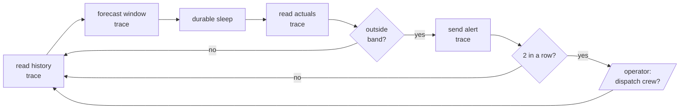

# Anomaly monitoring

> [!NOTE]
> Code available [on GitHub](https://github.com/unionai/unionai-examples/tree/main/v2/tutorials/timestral). See [Time series](../_index) for setup, the container image, and model loading.

A forecast with calibrated quantiles is also an anomaly detector: if a sensor's readings land outside the forecast's 1-99% band, something changed that the history didn't predict. This tutorial monitors a fleet of three pumps, each reporting vibration, bearing temperature, and discharge pressure every minute. For each 30-minute window, a monitor:

1. forecasts the window from the last two days of readings,
2. waits for the window's readings to arrive,
3. flags the window if the readings leave the forecast band, and
4. after two flagged windows in a row, pauses for an operator to decide whether to dispatch a maintenance crew.

A monitor is a long-running loop with side effects: it pages people and waits for hours. The loop is built from traces, durable sleep, and an external condition, so a crash never repeats an alert, loses the wait, or forgets a decision.



## Run it

```bash
python anomaly_monitor.py
```

The script crashes each monitor once, in its fifth window, to show recovery. When pump-02 trips, the run pauses on a condition named `dispatch-pump-02-<minute>`. Answer in the UI, or from the CLI. `flyte get condition` lists the paused conditions with their action names, and `flyte signal condition` takes the action name:

```bash
flyte get condition <run-name>
flyte signal condition <run-name> <action-name> true
```

If nobody answers within 15 minutes, the monitor dispatches the crew.

## The sensor feed

The feed is simulated, so the tutorial runs anywhere. Each pump follows a planned duty cycle: idle overnight, high load from 10:00 to 14:00 and 18:00 to 20:00, normal otherwise. Vibration, temperature, and pressure follow the load. Starting at a set window, pump-02's bearing begins to fail, and its vibration and temperature ramp up.



Readings are a pure function of the pump and the minute, so reading the same window twice returns the same values, as a historian query would. Plant time is compressed: each 30-minute window passes in `cycle_seconds` of wall-clock time, 20 by default.

## The traced steps

Each step with an external effect or a costly result is a function decorated with `@flyte.trace`. A trace records its inputs and outputs. When the task retries, a traced call that already completed returns its recorded output instead of running again.



`forecast_window` uses two Timestral features:

- **Multivariate forecasting.** All three sensors go through the model as variates of one series, `(1, 3, T)`, so the model forecasts them jointly.
- **Categorical known-future covariates.** The duty cycle is planned, so the operating mode is known for the forecast window too. Passing it as `categorical_known_covariates` lets the model anticipate the 10:00 shift to high load instead of flagging it.

## The monitoring loop



### Durable sleep

`flyte.durable.sleep.aio(cycle_seconds)` stands in for waiting until a window's readings exist. It records when it first started. If the task crashes during the wait and retries, the sleep waits only for the time that remains, and returns at once if that time has passed.

### Replay after a crash

The example raises `flyte.errors.RuntimeSystemError` in cycle 4 of the first attempt. The task has `retries=2`, so it runs again from the top. The retry replays cycles 0 through 3 from the trace record: no sensor reads, no forecasts, and no repeated alerts for windows that were already alerted on. It resumes live work at cycle 4.

Replay requires the loop to make the same calls in the same order on every attempt. Here, everything the loop decides comes from traced outputs or from the task's inputs, so a replayed attempt reaches the same state as the first one. Don't branch on the wall clock or unseeded randomness in a loop like this. For the current time, use `flyte.durable.now()`, which is recorded once and replayed.

### Don't learn the fault

A forecast model adapts to its context. Once a slow fault is in the history, the model forecasts it as the new normal, and the anomaly stops being flagged after its first window. The loop prevents this by passing readings from flagged windows as unobserved, through Timestral's `observation_mask`. The model treats them as missing and keeps forecasting healthy behavior, so a growing fault keeps getting flagged.

## Ask a human

After two flagged windows in a row, `request_dispatch` creates an external condition and waits for a typed answer.



The monitor pauses at `condition.wait.aio()` until an operator signals it from the UI, the CLI, or `flyte.remote.Condition`. If the 15-minute timeout passes first, the monitor dispatches the crew, because a missed bearing failure costs more than a wasted visit. The condition is part of the run's record, so the decision and when it was made are visible alongside the forecasts that prompted it. See [External conditions](../../../user-guide/tasks/task-programming/conditions).

## Watch the fleet

`monitor_fleet` runs one monitor per pump in parallel and renders a report: a row of windows per pump, alerts, dispatch decisions, and how many attempts each monitor took. Each anomalous window has a fan chart with the history, the forecast bands, and the actual readings.



### Run it on a schedule

The `triggers` argument attaches a cron trigger that runs the fleet monitor at the top of every hour. `flyte run` ignores triggers. They take effect when you deploy the task:

```bash
flyte deploy anomaly_monitor.py monitor_env
```

The trigger is created inactive (`auto_activate=False`). Activate it in the UI, or with `flyte update trigger hourly-fleet-monitor timestral-monitor.monitor_fleet --activate`. Each run receives its scheduled time as `trigger_time`. See [Triggers](../../../user-guide/triggers/_index).

## Adapt it to your plant

- Replace `read_sensors` with a query against your historian, and `send_alert` with your pager or ticketing call. Keep both traced.
- Replace the simulated duty cycle with your real production schedule, or with any other state you know in advance.
- Tune `alert_threshold`, the fraction of readings outside the band that flags a window. With a 1-99% band, about 2% of healthy readings fall outside by chance.
