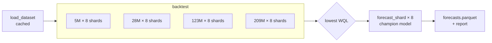

# Batch forecasting and backtesting

> [!NOTE]
> Code available [on GitHub](https://github.com/unionai/unionai-examples/tree/main/v2/tutorials/timestral). See [Time series](../_index) for setup, the container image, and the metrics.

This tutorial forecasts next week's hourly electricity consumption for 321 customers. It first backtests all four Timestral checkpoints on the last four weeks of history, picks the one with the lowest weighted quantile loss, and then forecasts every customer with it.

The work fans out into one task per model and shard of customers. Each task is cached, retried on spot capacity, and checkpointed, so:

- a re-run of the pipeline skips every shard that already finished,
- a preempted shard resumes from its last completed backtest window, and
- the driver that coordinates them stays small and on on-demand capacity.



## Run it

```bash
python batch_forecasting.py
```

The script runs the pipeline on the first 32 customers. To forecast all 321, pass `n_series=0`:

```bash
flyte run batch_forecasting.py forecast_pipeline --n_series 0
```

## The data

The [Monash electricity dataset](https://huggingface.co/datasets/autogluon/chronos_datasets) holds three years of hourly consumption, in kW, for 321 customers. Each row of the Parquet file is one customer, with its timestamps and values stored as arrays.



`load_dataset` copies the file into object storage once. Because it's cached, every later run of the pipeline reads the stored copy instead of downloading it again. Each shard task then reads only its own customers from that file.



## Two environments

Forecasting runs in a CPU environment. `interruptible=True` lets those tasks run on spot capacity. The driver only coordinates the run and renders the report, so it gets a separate small environment that isn't interruptible. A preemption then costs one shard, never the whole run.



## Backtest one shard

`backtest_shard` scores one checkpoint on one shard of customers. For each backtest window, it forecasts `horizon` hours from the `context_length` hours before the cutoff, then scores the forecast against what happened. All customers in the shard go through the model in one batched call.



Three layers make this task durable:

- **Caching.** `cache="auto"` keys the result on the task's inputs: the dataset, the customer IDs, the model, and the windows. Re-run the pipeline after adding a checkpoint and only the new checkpoint's shards execute.
- **Retries.** `retries=3` re-runs the task after a preemption, an out-of-memory kill, or a failed weight download.
- **Checkpoints.** After each window, the task saves the scores so far with `flyte.ctx().checkpoint`. A retry loads them and skips the finished windows. See [Intra-task checkpoints](../../../user-guide/tasks/task-programming/intra-task-checkpoints).

## Fan out the backtest

`backtest` launches every model and shard pair at once with `asyncio.gather`. Each checkpoint's tasks are grouped in the UI with `flyte.group`, and the per-shard scores are combined into one score per checkpoint, weighted by the number of forecasts.



The cutoffs are a rolling origin: the last `n_windows` one-week windows of each series. Each window's context ends where the window begins, so no forecast sees the values it's scored against.

## Forecast with the champion

`forecast_shard` forecasts the week after the data ends, for one shard, and writes all 21 quantiles per hour to Parquet.



The pipeline task ties the steps together. It picks the checkpoint with the lowest WQL, forecasts every shard with it, and returns two outputs: the champion's Hugging Face repo ID and the combined forecasts.



The run's report shows the leaderboard and fan charts for a few customers: history in grey, the median forecast, and the 10-90% and 1-99% bands.

The first output is a plain string, so the [online forecasting API](../forecast-api/_index) can be deployed to serve whichever checkpoint the latest run of this pipeline picked.

## Scale it up

- **More series.** The work per shard is fixed by `n_shards`. For larger datasets, raise `n_shards` so each task stays a few minutes long. A shorter task loses less work to a preemption.
- **Longer context.** Timestral reads up to 32,768 steps. A longer `context_length` costs more compute per forecast but lets the model see yearly seasonality in hourly data.



- **Reusable containers.** Each shard task loads its checkpoint from scratch. With [reusable containers](../../../user-guide/tasks/task-configuration/reusable-containers), shard tasks run in warm containers that keep the checkpoint loaded between tasks, because `load_forecaster` caches it per process. Add `unionai-reuse` to the image and a `reusable=flyte.ReusePolicy(replicas=8, concurrency=1)` to `forecast_env`.


