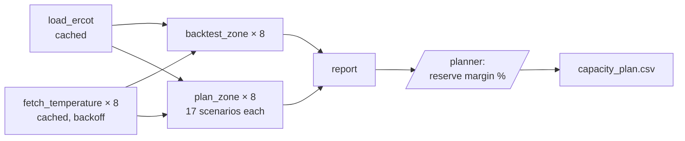

# Capacity planning with covariates

> [!NOTE]
> Code available [on GitHub](https://github.com/unionai/unionai-examples/tree/main/v2/tutorials/timestral). See [Time series](../_index) for setup, the container image, and the metrics.

Electricity demand in Texas follows the temperature: a hot afternoon in Houston means air conditioning across the coast. This tutorial forecasts hourly demand for the eight ERCOT weather zones with Timestral, conditioned on temperature and the calendar. It then plans next week's capacity:

1. **Backtest** three covariate configurations on the last eight weeks of data, to measure what each covariate adds.
2. **Plan** next week's peak demand under weather scenarios taken from the same week of every past year.
3. **Approve** the plan: the run pauses until a planner enters a reserve margin, then publishes the plan as a CSV.



## Run it

```bash
python capacity_planning.py
```

When the report is ready, the run pauses on a condition named `reserve-margin`. Enter a percentage in the UI, or from the CLI with the condition's action name, which `flyte get condition` lists:

```bash
flyte get condition <run-name>
flyte signal condition <run-name> <action-name> 15.0
```

Enter `0` to reject the plan, which fails the run. To stress-test the plan against hotter weather, shift every scenario up by a few degrees:

```bash
flyte run capacity_planning.py capacity_plan --heat_shift_c 3
```

## The data

Load comes from ERCOT's hourly demand per weather zone, 2004 through August 2021. Temperature comes from the [Open-Meteo historical weather API](https://open-meteo.com/en/docs/historical-weather-api), for one representative city per zone.



Both downloads are cached tasks. The weather API is rate-limited, so `fetch_temperature` retries with exponential backoff: 10 seconds, then 20, then 40, capped at two minutes. A burst of 429 responses delays the run instead of failing it, and once a zone's temperatures are fetched, no later run calls the API for them again.



## Covariates

Timestral takes two kinds of known-future covariates, values known for the history and the horizon alike:

- **Categorical**, as `categorical_known_covariates`: hour of day, day of week, and a US federal holiday flag. The forecaster encodes each category against the target, so the codes can be any numbers.
- **Numeric**, as `known_covariates`: hourly temperature.



Each covariate array spans the history plus the horizon, `T + horizon` steps. That is how the model sees the temperature during the hours it forecasts.

## Measure what the covariates add

`backtest_zone` forecasts each of the last `n_windows` weeks three ways: target only, with calendar codes, and with calendar codes and temperature.



On three zones with Timestral-28M, over the last eight weeks of summer 2021:

| Zone | Target only | + calendar | + calendar + temperature |
| --- | --- | --- | --- |
| COAST | 0.0331 | 0.0335 | 0.0196 |
| NORTH_C | 0.0426 | 0.0431 | 0.0228 |
| FAR_WEST | 0.0184 | 0.0183 | 0.0122 |

The values are weighted quantile loss; lower is better. Temperature cuts the loss by 34% to 47%. Calendar codes alone make little difference, because the model already reads the daily and weekly cycles from the 4,096 hours (about 24 weeks) of history in each context.

The backtest uses the observed temperatures over each horizon, as if the weather forecast were perfect. That's an upper bound on what temperature adds. With a real weather forecast, the gain shrinks with the forecast's error.

## Plan under weather scenarios

Next week's temperatures aren't known, so `plan_zone` builds one scenario per past year: the same calendar week's temperatures from that year. History is the same in every scenario, so all the scenarios, 17 with this dataset, go through the model as one batch of series that differ only in their temperature covariate.



For each zone, the plan records the median of the scenarios' peak median forecasts and the worst scenario's peak 99th-percentile forecast. The worst case drives the capacity plan.

## Approve and publish

`capacity_plan` fans out the downloads, backtests, and scenario forecasts across zones, renders the report, and waits for a planner.



`approve_reserve_margin` creates a `float` condition. The planner reviews the report and enters the reserve margin to apply on top of each zone's worst-case peak.



The run waits up to `approval_timeout_hours`, 24 by default. While it waits, every upstream result is already stored. If the run fails at this point, from a timeout or a rejection, running it again with the same inputs reuses the cached downloads, backtests, and scenario forecasts, and goes straight back to the approval. See [External conditions](../../../user-guide/tasks/task-programming/conditions) and [Caching](../../../user-guide/tasks/task-configuration/caching).

The published plan has one row per zone:

| Column | Meaning |
| --- | --- |
| `median_peak_mw` | Median, across scenarios, of the week's peak median forecast |
| `p99_peak_mw` | The worst scenario's peak 99th-percentile forecast |
| `worst_weather_year` | The year whose weather produced that worst case |
| `planned_capacity_mw` | `p99_peak_mw` plus the approved reserve margin |
