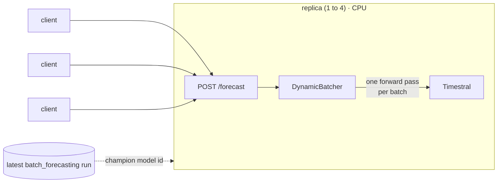

# Online forecasting API

> [!NOTE]
> Code available [on GitHub](https://github.com/unionai/unionai-examples/tree/main/v2/tutorials/timestral). See [Time series](../_index) for setup, the container image, and model loading.

This tutorial serves Timestral over HTTP as a Flyte app. A client posts a history and a horizon, and gets back the median and the quantiles it asked for. The app:

- loads the checkpoint once per replica, before the replica takes traffic,
- coalesces concurrent requests into batched forward passes with `DynamicBatcher`,
- keeps one replica warm and adds replicas as requests pile up, and
- can serve whichever checkpoint the latest [batch forecasting](../batch-forecasting/_index) run picked.



## Deploy it

Serve a fixed checkpoint:

```bash
python forecast_api.py --model mistralai/Timestral-28M
```

Or serve the checkpoint the latest batch forecasting run picked:

```bash
python forecast_api.py --champion
```

The command prints the app URL. Open `<app-url>/docs` for the interactive OpenAPI page.

## Request and response

A request carries the history, oldest first, with `null` for missing values. It can add known-future and past-only covariates. Quantile levels must be among Timestral's 21 levels.



```bash
curl -X POST <app-url>/forecast -H 'content-type: application/json' \
  -d '{"values": [12.1, 13.4, null, 15.0, 14.2, 13.9, 15.8, 16.1], "horizon": 4, "quantiles": [0.05, 0.95]}'
```

```json
{
  "model": "mistralai/Timestral-28M",
  "horizon": 4,
  "median": [15.8622, 15.5827, 15.4699, 15.4071],
  "quantiles": {
    "0.05": [12.5678, 11.6371, 10.858, 10.2948],
    "0.95": [18.5677, 19.5193, 20.8784, 22.1719]
  }
}
```

## Batch concurrent requests

One request is one series, but Timestral forecasts a whole batch of series in about the time it takes to forecast one. `DynamicBatcher` collects requests that arrive within 10 ms of each other, up to 64, and hands them to `_process` as one batch. Each caller awaits a future for its own result.



Histories differ in length, so `_process` left-pads the shorter ones with NaN. Timestral reads NaN as missing, so the padding doesn't change the forecast. Requests with covariates have their own shapes and go straight to the model. A lock keeps forward passes one at a time, because PyTorch already uses every core of the replica.

## The app

FastAPI's `lifespan` hook loads the checkpoint and starts the batcher before the replica reports ready. A new replica doesn't receive requests until the model is in memory.



`FastAPIAppEnvironment` serves the app. The checkpoint comes in through a parameter, exposed to the process as the `TIMESTRAL_MODEL` environment variable.



`flyte.app.Scaling` sets the replica policy:

| Setting | Value | Effect |
| --- | --- | --- |
| `replicas` | `(1, 4)` | One replica is always warm, so the first request never waits for a cold start. Up to four serve a spike. |
| `metric` | `Scaling.Concurrency(val=32)` | A replica is added when each replica has more than 32 requests in flight. |
| `scaledown_after` | `300` | Extra replicas are removed after five idle minutes. |

If a replica crashes, the platform replaces it, and the others keep serving in the meantime. The example sets `requires_auth=False` so you can call it with `curl`. Remove that line to require a  token on every request.

## Serve the champion from the pipeline

`--champion` swaps the literal model ID for a `flyte.app.RunOutput`. At deploy time, it resolves to the first output of the latest run of `forecast_pipeline`, the champion's Hugging Face repo ID.



Re-run the batch pipeline when new data arrives, then redeploy with `--champion`. The API serves whichever checkpoint scored best on the latest data, and the pipeline run that chose it is recorded in the app's spec.

## Load-test it

`forecast_client.py` sends concurrent requests with synthetic hourly histories of different lengths and reports throughput and latency:



```bash
python forecast_client.py <app-url> --requests 500
```

Raise `--requests` past 32 per replica in flight and watch the app add replicas in the UI.
