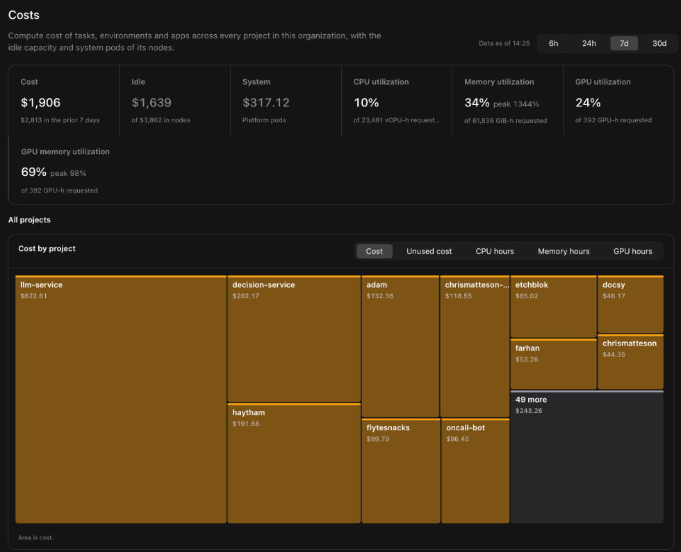
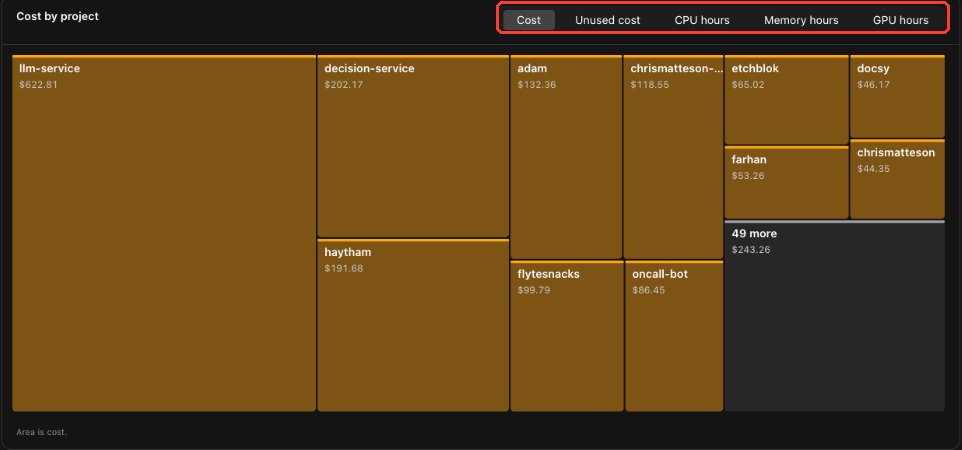
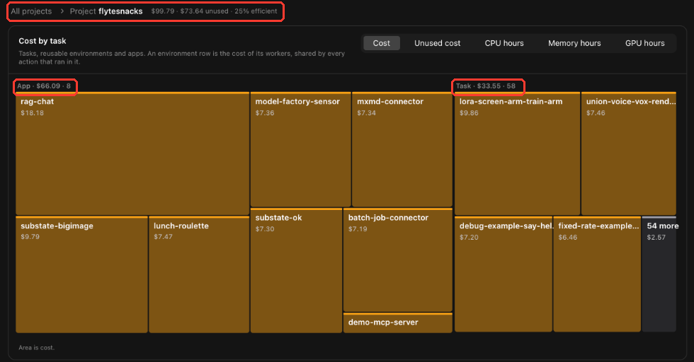
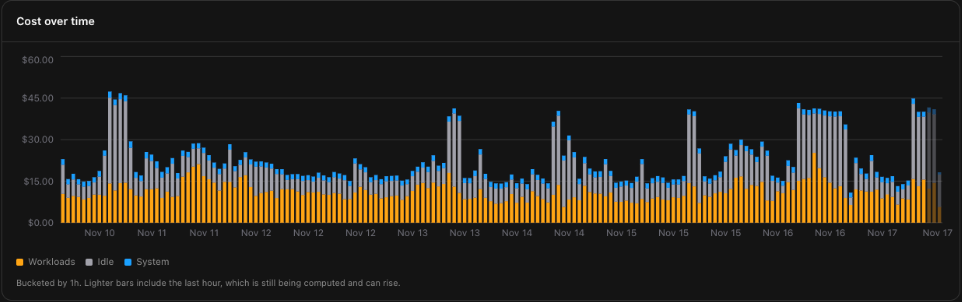
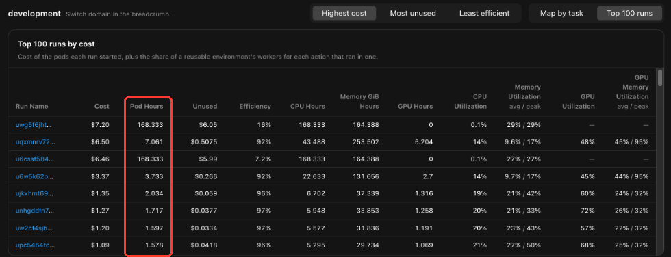
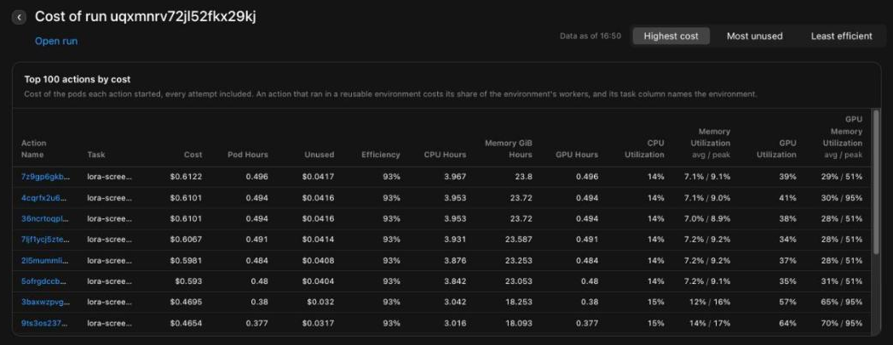

# Costs

> [!NOTE] Preview feature
> The Costs page is in preview and is not turned on for every organization. If you would like to use it, reach out to your Customer Solutions representative.

The Costs page shows what the compute behind your tasks, environments and apps costs on your cloud provider. You start with a view of the whole organization and can drill down through projects, tasks and runs to a single action.

> [!NOTE] Cost data lags by about an hour
> Cost is calculated hourly, so a run that just finished will not appear for up to an hour. **Data as of**, next to the range selector, shows when the numbers were last refreshed.

## What the numbers mean

Every figure on the page is an estimate of your cloud provider's list price for the nodes your work ran on. It is not your cloud bill and not your Union invoice.

* **Cost follows the resources you request.** Your work is charged for the share of a node it reserves. That share is set by whichever resource it requests the most of, relative to the node's size: CPU, memory or GPU. For example, a task that requests half of a node's memory and a tenth of its CPU is charged for half the node. A task that requests a node's only GPU is charged for the whole node.
* **Prices are public list prices.** On-demand nodes use the provider's published price for that instance type and region. Spot nodes use an average of recent spot prices, so your actual spot charges will differ.
* **Discounts are not applied.** Committed-use discounts, reserved instances and savings plans are not reflected, so your bill is usually lower than the page shows.
* **Every attempt counts.** If an action is retried, every attempt is included in its cost.
* **Reusable environments are shared out.** An action that ran in a reusable environment is charged its share of the environment's workers.
* **Only compute is counted.** Storage and network costs are not included.
* **Unpriced instance types are flagged.** An instance type with no known price shows as not priced rather than $0, and any total that includes it is a partial sum.

## Open the Costs page

There are two entry points in the sidebar:

* **Costs**, under **Home**, shows the whole organization.
* **Costs**, under **Project Home**, shows one project in the domain selected at the top of the page. To see another domain, switch it there.

Use the range selector to choose the last **6h**, **24h**, **7d** or **30d**.

## Summary tiles

The tiles at the top of the page all cover the same time range.

| Tile | What it shows |
|---|---|
| **Cost** | The cost of every task, environment and app pod in the range, with the total for the previous period of the same length. |
| **Idle** | The part of your nodes that no pod took, at list price. Organization level only. |
| **System** | DaemonSet and system pods on your nodes, at list price. Organization level only. |
| **CPU utilization** | CPU used as a share of CPU requested, with the vCPU-hours requested. |
| **Memory utilization** | Memory used as a share of memory requested, with the highest pod's peak. |
| **GPU utilization** | GPU busy time as a share of the GPU time requested. Shown when work in the range requested GPUs. |
| **GPU memory utilization** | GPU memory used as a share of the memory the pods could allocate, with the highest pod's peak. |

At the organization level, **Cost**, **Idle** and **System** add up to the list price of all your nodes in the range. Once you open a project, the tiles cover that project only, and **Idle** and **System** are no longer shown, since nodes don't belong to a project.

Utilization is not measured on GPUs that a node shares between pods, including time-sliced GPUs and MIG. Those tiles show "—" for that work, but its cost is still counted.

## Find where the money went

The map below the summary is a treemap: the bigger the tile, the bigger its share. Choose what the tile size represents: **Cost**, **Unused cost**, **CPU hours**, **Memory hours** or **GPU hours**.

The map starts with one tile per project.

Click a tile to go one level deeper:

1. Projects
2. A project's tasks, environments and apps, grouped into labelled blocks with their total and count
3. A task's runs
4. A run's actions

The breadcrumb above the map shows where you are, along with that level's cost, unused cost and efficiency. Click any level in it to go back up. Hover over a tile to see its cost, unused cost, efficiency and utilization. Tiles smaller than 2% of the map are grouped into one gray tile, such as **49 more**.

A table under the map lists the same rows, with cost, unused cost, efficiency, CPU, memory and GPU hours, and utilization. Sort it by **Highest cost**, **Most unused** or **Least efficient**.

### Efficiency and unused cost

**Efficiency** compares what the work needed with what it requested. It is the share of the node the work needed, divided by the share it requested. CPU is measured at its average use, memory at its peak, and GPUs are counted whole.

**Unused cost** is the part of the cost that the work requested but did not use. A task with high unused cost or low efficiency is a good candidate for smaller resource requests.

## Cost over time

The chart under the map shows how cost moved across the range, in one-hour bars. At the organization level each bar is split into workloads, system pods and idle capacity. On a project's Costs page it is split by domain. The chart is hidden once you drill into a task or a run.

The most recent bar is drawn lighter because that hour is still being calculated. Its value can still go up.

## Cost by instance type

The organization page ends with a table of every node in the range, grouped by instance type and capacity type (on-demand or spot). For each, it shows the node-hours, the hourly price, the total cost, and how that cost splits into workloads, system pods and idle capacity, plus idle GPU-hours.

Use this table to see which node types carry your idle capacity, or to compare the page with your provider's bill.

## A project's Costs page

A project's Costs page has the same summary and map, starting at the project. Switch between **Map by task** and **Top 100 runs** to see either the map or a ranked list of the project's most expensive runs.

**Top 100 runs** adds a **Pod Hours** column. A run's cost is the pods it started, plus its share of any reusable environment its actions ran in.

## Task and run cost pages

From a project's Costs page you can open a cost page for a single task or run:

* A **task** cost page lists that task's 100 most expensive runs in the domain for the selected range. Each run links to its own cost page.
* A **run** cost page lists the run's 100 most expensive actions, with the same sort options. **Open run** under the title takes you to the run itself. A run cost page has no range selector and covers the last 120 days.

## Limitations

While Costs is in preview:

* The longest range is 30 days. Custom date ranges are not available.
* Cost data cannot be exported, and there is no API or CLI access.
* You cannot override list prices with your own negotiated rates.
* Very large projects are truncated. Tables show at most 500 projects, 200 tasks, 100 runs and 100 actions, and the caption says when a limit was reached.
