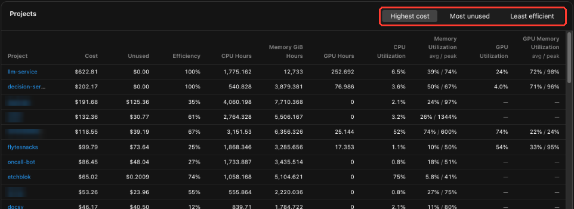
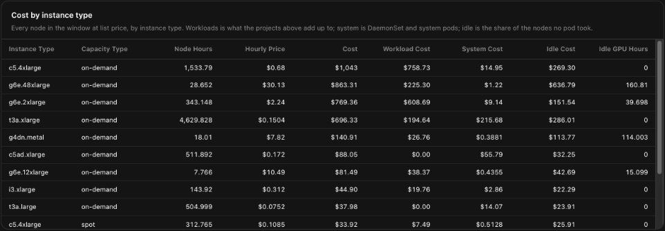
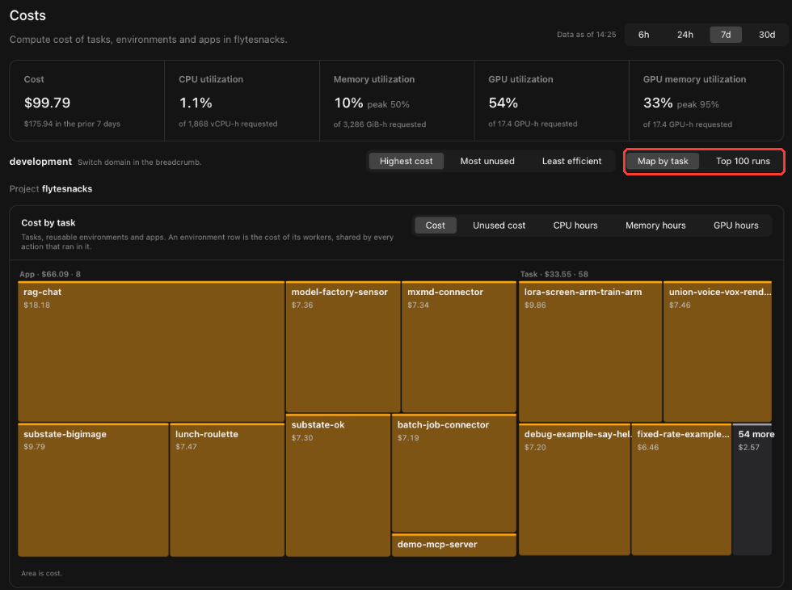

# Costs

> [!NOTE] Preview feature
> The Costs page is in preview and is not turned on for every organization. It is included in the [Enterprise plan](../deployment/product-tiers). If you would like to use it, reach out to your Customer Solutions representative.

The Costs page shows what the compute behind your tasks, environments, and apps costs on your cloud provider. Start with the whole organization, then drill down through projects, tasks, and runs to a single action.

> [!NOTE] Data freshness
> Cost is recalculated every 5 minutes. The cost of the last two hours can still rise as late usage data arrives. **Data as of**, next to the range selector, shows where the time range ends.

## How cost is estimated

Every figure on the page is an estimate of your cloud provider's list price for the nodes your work ran on. It is not your cloud bill and not your Union.ai invoice.

- **Cost follows the resources you request.** Your work is charged for the share of a node it reserves. That share is set by whichever resource it requests the most of, relative to the node's size: CPU, memory, or GPU. For example, a task that requests half of a node's memory and a tenth of its CPU is charged for half the node. A task that requests a node's only GPU is charged for the whole node.
- **Prices are public list prices** for AWS, Google Cloud, and Azure. On-demand nodes use the provider's published Linux price for that instance type and region. Spot nodes on AWS use a 30-day average of spot prices. Spot nodes on Google Cloud and Azure use the provider's current spot list price. Your actual spot charges differ.
- **Discounts are not applied.** Committed-use discounts, reserved instances, and savings plans are not reflected, so your bill is usually lower than the page shows.
- **Every attempt counts.** If an action is retried, every attempt is included in its cost.
- **Reusable environments are shared out.** An action that ran in a reusable environment is charged its share of the environment's workers.
- **Only compute is counted.** Storage and network costs are not included.
- **Unpriced instance types show "—".** An instance type with no known price shows "—" instead of a dollar figure, and totals leave it out. GPUs attached to Google Cloud N1 machines are not priced, so those nodes are priced without their GPUs.

## Open the Costs page

There are two entry points in the sidebar:

- **Costs**, under **Home**, shows the whole organization.
- **Costs**, under **Project Home**, shows one project. Its summary tiles and cost-over-time chart cover every domain of the project. The map and **Top 100 runs** show the domain named above the map. To switch domain, use the breadcrumb.

Use the range selector to choose the last **6h**, **24h**, **7d**, or **30d**.

To see the Costs pages, you need the `view_flyte_executions` action across the whole organization. The built-in Admin, Contributor, and Viewer policies include it. See [User management](./user-management). Anyone with that permission sees the costs of every project.

## Summary tiles

The tiles at the top of the page all cover the same time range.

| Tile | What it shows |
|---|---|
| **Cost** | The cost of every task, environment, and app pod in the range, with the total for the previous period of the same length. |
| **Idle** | The part of your nodes that no pod took, at list price. Organization level only. |
| **System** | DaemonSet and system pods on your nodes, at list price. Organization level only. |
| **CPU utilization** | CPU used as a share of CPU requested, with the vCPU-hours requested. |
| **Memory utilization** | Memory used as a share of memory requested, with the highest pod's peak. |
| **GPU utilization** | GPU busy time as a share of the GPU time requested. Shown when work in the range requested GPUs. |
| **GPU memory utilization** | GPU memory used as a share of the memory the pods could allocate, with the highest pod's peak. |

At the organization level, **Cost**, **Idle**, and **System** add up to the list price of all your nodes in the range. Once you open a project, the tiles cover that project only, and **Idle** and **System** are no longer shown, since nodes don't belong to a project.

The memory peak is measured against the memory a pod requested, not its limit. A pod that uses more memory than it requested, up to its limit, shows a peak above 100%. A peak of 1344% means that a pod used about 13 times the memory it requested.

GPU utilization is not measured on GPUs that a node shares between pods, such as time-sliced or MIG GPUs. GPU memory is not measured on time-sliced or MPS-shared GPUs. If none of the GPU work in the range was measured, the tile shows "—". The cost of that work still counts.

## Drill down into cost

The map below the summary is a treemap: the bigger the tile, the bigger its share. Choose what the tile size represents: **Cost**, **Unused cost**, **CPU hours**, **Memory hours**, or **GPU hours**.

The map starts with one tile per project.

Click a tile to go one level deeper:

1. Projects
2. A project's tasks, reusable environments, and apps, grouped into labeled blocks with their total and count
3. A task's runs, or a reusable environment's worker pods
4. A run's actions, grouped by task

Apps have no level below them. Clicking an action opens it in its run.

The breadcrumb above the map shows where you are, with the open item's cost, unused cost, and efficiency. Click any level in it to go back up. Hover over a tile to see its cost, unused cost, efficiency, utilization, and peak memory and GPU memory. Small tiles in each block are grouped into a gray tile, such as **49 more**.

A table under the map lists the same rows, with cost, unused cost, efficiency, CPU hours, memory hours, GPU hours, and utilization. Sort it by **Highest cost**, **Most unused**, or **Least efficient**.

### Efficiency and unused cost

**Efficiency** compares what the work needed with what it requested. It is the share of the node the work needed, divided by the share it requested. CPU is measured at its average use, memory at its peak, and GPUs are counted whole. Efficiency tops out at 100%, even when work used more than it requested.

**Unused cost** is the part of the cost that the work requested but did not use. A reusable environment's empty slots, the time its workers waited with nothing to run, count as unused. A task with high unused cost or low efficiency is a good candidate for smaller resource requests.

## Cost over time

The chart under the map shows how cost moved across the range, in one-hour bars, or four-hour bars for **30d**. At the organization level each bar is split into workloads, system pods, and idle capacity. On a project's Costs page it is split by domain. The chart is hidden once you drill into a task or a run. With a reusable environment open, it shows **Slot cost over time** instead, split into used and empty slots.

Bars from the last two hours are drawn lighter, because their cost can still rise.

## Cost by instance type

The organization page ends with a table of every node in the range, grouped by instance type and capacity type (on-demand or spot). For each, it shows the node-hours, the hourly price, the total cost, how that cost splits into workloads, system pods, and idle capacity, and the idle GPU-hours.

Use this table to see which node types carry your idle capacity, or to compare the page with your provider's bill.

## A project's Costs page

A project's Costs page has the same summary and map, starting at the project. Switch between **Map by task** and **Top 100 runs** to see either the map or a ranked list of the project's most expensive runs.

**Top 100 runs** adds a **Pod Hours** column. A run's cost is the pods it started, plus its share of any reusable environment its actions ran in. Click a run to open its cost page.

## Run cost page

A run's cost page lists its 100 most expensive actions, with the same sort options. **Open run**, under the title, opens the run itself. The page has no range selector and covers the last 120 days.

## Limitations

- The longest range is 30 days. Custom date ranges are not available.
- If your organization limits how long it keeps run history, the range starts no earlier than that limit, and the page says so.
- Cost data cannot be exported, and there is no API or CLI access.
- You cannot override list prices with your own negotiated rates.
- The map shows at most 500 projects, 200 tasks, environments, and apps in a project, 200 workers in a reusable environment, 100 runs of a task, and 100 actions of a run. Its caption says when it reached a limit. **Top 100 runs** and the run cost page show at most 100 rows.
