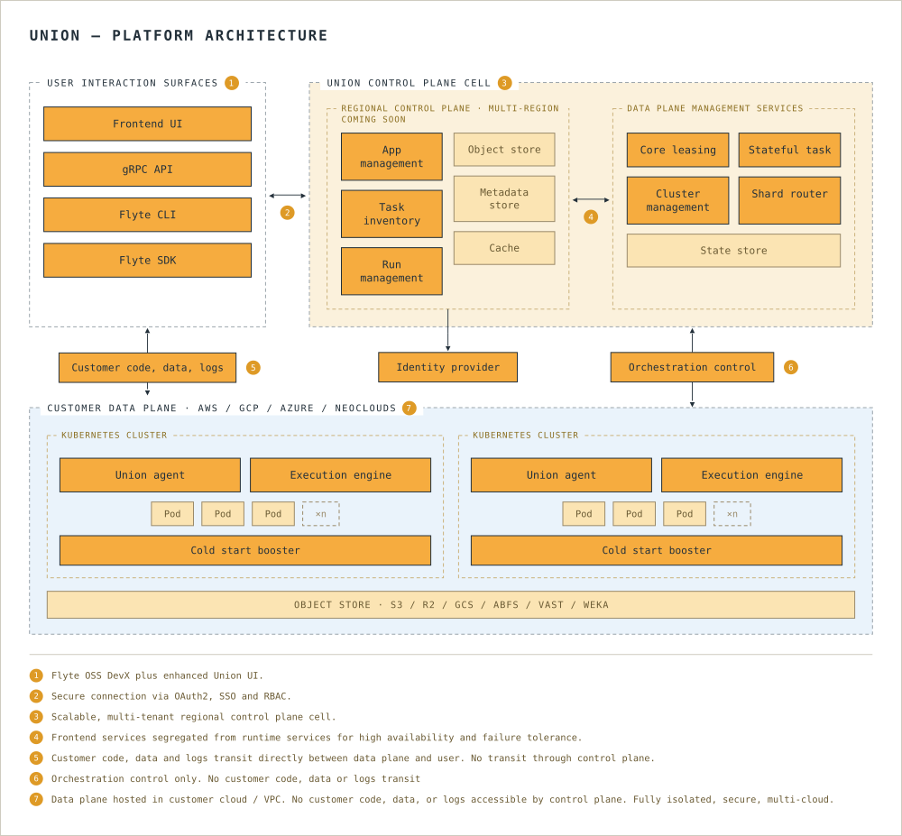

# Architecture

Union.ai is split into two planes.
The **control plane**, which Union.ai runs, orchestrates your work.
The **data plane**, a Kubernetes cluster in your own cloud account or on your own infrastructure, runs it and holds your data.

## Control plane

The control plane runs in Union.ai's cloud account. It:

- serves the Union.ai UI, the API that the `flyte` CLI and SDK call, and authentication and authorization;
- stores orchestration metadata: task and app definitions, run and action state, triggers, and error messages;
- decides which cluster runs each action, through [cluster pools and queues](../../clusters-and-queues/_index).

It doesn't store your task inputs, outputs, files, or code. See [Where your data lives](./where-data-lives).

## Data plane

The data plane is where your tasks and apps run. It consists of:

- a Kubernetes cluster, whose worker nodes run your task and app pods;
- an object store (Amazon S3, Google Cloud Storage, or Azure Blob Storage) for code bundles, inputs, outputs, and files;
- a container registry for the images your tasks run in;
- a secret store for the secrets your tasks use;
- the **Union.ai operator** and its supporting services, which connect the cluster to the control plane.

## How the planes work together

- **The data plane connects out.** The operator opens the connection to the control plane, so your cluster needs no inbound port for orchestration.
- **Work flows through the operator.** The control plane assigns actions to a cluster. The operator creates and tears down the pods that run them, and reports their status, health, and resource usage back.
- **Your data stays in the data plane.** Requests for your data, from the UI, the CLI, or the SDK, are served by the data plane: over a direct tunnel, or with presigned URLs to its object store that the data plane's `dataproxy` service issues. The data never passes through the control plane.

## What happens in a run

1. You start a run with `flyte run` or `flyte.run()`. The SDK uploads the code bundle and inputs to the object store, and sends the run to the control plane.
2. The control plane records the run and places its first action on a queue, which routes it to a cluster.
3. The operator in that cluster starts a pod for the action. The pod downloads the code bundle and inputs from the object store, runs your function, and writes its outputs back.
4. A task that calls other tasks creates further actions, which the control plane places the same way. Each action reports its state to the control plane, and the UI shows the run's progress.

See [How task run works](../../tasks/task-deployment/how-task-run-works) for the ways to start a run.

## Deployment models

Who builds and operates the data plane depends on your deployment model.
In a [Union-Managed](../../../deployment/byoc/_index) deployment, Union.ai builds and runs it in your cloud account.
In a [Self-Managed](../../../deployment/selfmanaged/_index) deployment, you do. See [Platform deployment](../../../deployment/_index).

For how the split protects your data, see [Architecture](../../../security/architecture/_index) in the Security section.
