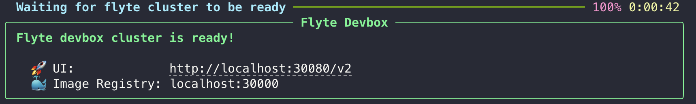
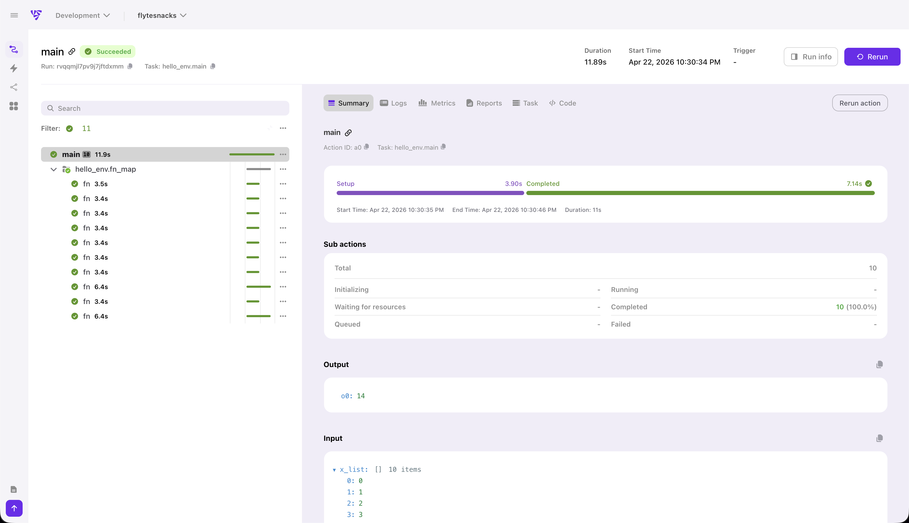

# Run on the Devbox




The Flyte 2 devbox is a great way to try a simplified Union.ai cluster on your local machine. It's a lightweight
cluster that runs on your machine with Docker. It includes a UI, scheduler, and object store, so you can test on-cluster
execution without connecting to a deployed cluster.







The Flyte devbox is a lightweight cluster that runs on your machine with Docker. It gives you a full Flyte environment, including the UI, scheduler, and object store, so you can test remote execution without connecting to a deployed cluster.



> [!NOTE] Try Devbox in your browser
> Prefer not to install anything locally? Create a Devbox in GitHub Codespaces.
>
> [](https://codespaces.new/flyteorg/flyte-devbox-codespace?quickstart=1)

## What you'll need

- Python 3.10+ in a virtual environment
- [Docker](https://docs.docker.com/get-docker/) installed and running
- [kubectl](https://kubernetes.io/docs/tasks/tools/)

## Install the SDK

If you haven't already, install the `flyte` package:

```bash
pip install flyte
```

## Start the devbox

Launch the devbox:





```bash
flyte start devbox
```







```bash
flyte start devbox --gpu
```




The `--gpu` flag requires an NVIDIA-enabled host. It does not support AMD GPUs. For a Mac's GPU, use the **Apple Silicon** tab.







```bash
flyte start devbox --apple-silicon
```

Requires `flyte` 2.12.0 or later and [uv](https://docs.astral.sh/uv/). See [Using the Apple Silicon GPU](#using-the-apple-silicon-gpu).







This pulls the necessary containers and starts a local Flyte instance. Once ready, the Flyte UI is available at `http://localhost:30080`.


The first start may take a few minutes while Docker images are downloaded.


## Check the devbox status

> [!NOTE]
> `flyte get devbox` requires flyte 2.6.2 or later.

To see whether the devbox is up, and where it is:

```bash
flyte get devbox
```

This reports the run state, the UI and image registry endpoints, the container image version in use, and where the cluster keeps its state on disk. It is the quickest way to tell a devbox that is still starting from one that is ready.

Add `--no-probes` to skip the readiness probe and the container resource sample, which makes the check faster and works offline:

```bash
flyte get devbox --no-probes
```

For a machine-readable report, pass an output format to the top-level command:

```bash
flyte -of json-raw get devbox
```

## Configure

Create a config file that points to the devbox:

```bash
flyte create config --devbox
```

This creates `.flyte/config.yaml` configured to talk to your local devbox cluster.

The `--devbox` flag requires flyte 2.6.1 or later. It is a shortcut for the explicit form, which you need on earlier versions:

```bash
flyte create config \
    --endpoint localhost:30080 \
    --project flytesnacks \
    --domain development \
    --builder local \
    --insecure
```

Both forms write the same config file. One difference: in an interactive terminal the explicit form offers to reuse a Docker login as your image registry, while `--devbox` skips that prompt, because the devbox pushes to its own in-cluster registry.

`--devbox` cannot be combined with `--endpoint`, but you can still override the project and domain alongside it:

```bash
flyte create config --devbox --project my-project --domain staging
```

## Run a workflow on the devbox

Using the same `hello.py` from the [Quickstart](../quickstart):



Run it on the devbox:

```bash
flyte run hello.py main
```

Without the `--local` flag, the workflow runs on the devbox cluster rather than in your local Python process. Tasks execute inside containers, exactly as they would on a deployed cluster.

## View results in the UI

Open `http://localhost:30080` to see your workflow execution in the Flyte UI. You can inspect task inputs, outputs, logs, and execution timelines.



## Stop the devbox

When you're done, shut down the cluster:

```bash
flyte stop devbox
```

## Inline configuration

Skip the config file entirely by passing parameters directly.




Use `flyte.init`:

```python
flyte.init(
    endpoint="localhost:30080",
    project="flytesnacks",
    domain="development",
    insecure=True,
)
```





Some parameters go after `flyte`, others after the subcommand:

```bash
flyte \
    --endpoint localhost:30080 \
    --insecure \
    --builder local \
    run \
    --domain development \
    --project flytesnacks \
    hello.py \
    main
```

See the [CLI reference](../../../api-reference/flyte-cli) for details.




## Delete the devbox

```bash
flyte delete devbox  # add the --volume flag to delete the Docker volume
```

## Using a CUDA-enabled GPU host

If you started the devbox with `flyte start devbox --gpu`, you can use GPUs in your workflows.

```python
import flyte

env = flyte.TaskEnvironment(
    name="gpu_env",
    resources=flyte.Resources(gpu=1),
)

@env.task
def gpu_task() -> bool:
    return torch.cuda.is_available()  # returns True if CUDA (provided by a GPU) is available
```

## Using the Apple Silicon GPU

If you started the devbox on a Mac with `flyte start devbox --apple-silicon`, tasks and apps that request the Apple Silicon accelerator run natively on the Mac instead of in their container. Their code can use the Mac's GPU through Metal, for example PyTorch's `mps` device or MLX.

Request it with `gpu="AppleSilicon"` or `gpu=flyte.APPLE_SILICON()`:

```python
import flyte

env = flyte.TaskEnvironment(
    name="apple_silicon_env",
    resources=flyte.Resources(gpu="AppleSilicon"),
)
```

`"AppleSilicon:1"` is also accepted. A count above 1, such as `"AppleSilicon:2"`, is rejected.

Requirements:

- `flyte` 2.12.0 or later.
- [uv](https://docs.astral.sh/uv/) on the Mac. `--apple-silicon` refuses to start without it.
- A devbox created from the current devbox image. Starting a stopped devbox doesn't pull a new image, so recreate an older devbox:

  ```bash
  flyte delete devbox && flyte start devbox --apple-silicon
  ```

`--apple-silicon` can't be combined with `--gpu` or with dev mode (`--dev`). Because workload code runs outside any sandbox, the flag publishes the devbox's ports on `127.0.0.1` only. They aren't reachable from the network, but other software on the Mac can reach them. To restart a stopped Apple Silicon devbox, run `flyte start devbox`. It restarts the Apple Silicon bridge without the flag.

Apple Silicon is a devbox-only accelerator, and a workload that requests it never falls back to the CPU:

- On a devbox started without `--apple-silicon`, the task fails with `APPLE_SILICON_NOT_AVAILABLE`, and the message says to restart the devbox with the flag.
- On a remote cluster whose backend includes Apple Silicon support, the task fails with `APPLE_SILICON_NOT_AVAILABLE`.
- On a backend that predates Apple Silicon support, including an older devbox image, the task's pod stays `Pending` instead of failing.
- Where a task would fail with `APPLE_SILICON_NOT_AVAILABLE`, deploying an app that requests Apple Silicon is refused with the same error.

## Next steps

- [**Core concepts**](../core-concepts/_index): Understand `TaskEnvironment`s, tasks, runs, and actions through working examples.
- [**Run on a deployed cluster**](./running-remote): Configure the CLI and SDK to run on a cluster in the cloud or on-premises.
