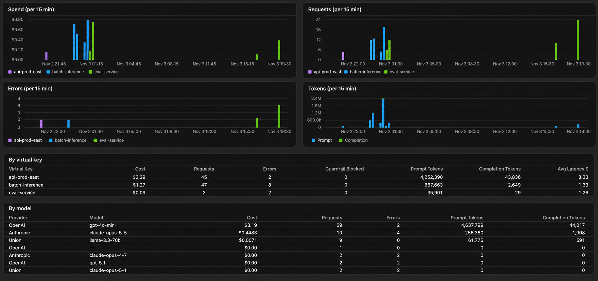

# Usage

The **Usage** tab shows what each virtual key has done over a time range you pick: how much it spent, how many requests it sent, how many failed, how many tokens it used, and how fast the calls were. Use it to see which team or user is driving spend, catch a key whose error rate suddenly climbs, or check a month's total before the invoice arrives.

## Open the Usage tab

Open **Settings → Inference Gateway** in the Union console and select the **Usage** tab.

Viewing usage requires permission to manage the gateway's virtual keys, because it shows per-key spend. If you can see the gateway but not its keys, the tab tells you that you lack this permission.

## Pick a time range

Choose a preset:

| Preset | Covers |
|---|---|
| **24h** | The last 24 hours. This is the default. |
| **7d** | The last 7 days. |
| **30d** | The last 30 days. |
| **Month to date** | From the start of the current month, in UTC, to now. |
| **Last month** | The whole previous calendar month, in UTC. |

Or open **Custom range** and pick any start and end, up to 92 days long. If you pick a longer range, the tab shortens it and says so. The charts group events into time buckets that grow with the range, from one minute for ranges of an hour or less up to one day for ranges longer than 31 days. The 24h default uses 15-minute buckets. Each chart's title shows its bucket size.

The tab shows the exact window it covers, in UTC. Usage records reach the tab a few minutes after the requests that produced them, so the most recent minutes of a range may still be filling in.

## Filter by virtual key

The **All virtual keys** menu narrows the tab to one key. The charts and the **By model** table then show only that key's traffic. The **By virtual key** table always lists every key, so you can compare them while you look at one.

Usage recorded without a virtual key appears as **(no key)**.

## What the tab shows

| Section | What it shows |
|---|---|
| **Spend** | Cost per time bucket, stacked by virtual key. |
| **Requests** | Requests per time bucket, stacked by virtual key. Divide by the bucket size in the title for a request rate. |
| **Errors** | Failed requests per time bucket, stacked by virtual key. Requests a guardrail blocked count as failed. |
| **Tokens** | Prompt and completion tokens per time bucket. Completion tokens usually cost several times more than prompt tokens. |
| **Latency of successful requests** | The median (p50) and 95th percentile (p95) response time per time bucket. Failed requests are left out, so fast rejections don't make latency look better than it is. |
| **By virtual key** | For each key over the whole range: cost, requests, errors, guardrail blocks, prompt and completion tokens, and average latency. |
| **By model** | For each provider and model: cost, requests, errors, and prompt and completion tokens. |

A key keeps the same color in every chart. Colors follow each key's spend in the selected range, so the highest-spending keys get the first colors and keys beyond the sixth are grouped as **Other**.

## How spend is calculated

Spend is computed the same way as for [budgets](./virtual-keys#budgets): from each request's token counts and the provider's price. A self-hosted provider with no cost set shows tokens and requests but no spend.

The **Virtual keys** tab also shows each key's totals for the last 24 hours. The **Usage** tab adds history, longer ranges, and the breakdown over time.

Usage records contain which key and model handled a request, its token counts, cost, status, and latency. They never contain prompts or answers. See [Runs in your cloud](./_index#runs-in-your-cloud).

## Self-hosted deployments

The **Usage** tab needs the Union console's analytics store. On self-hosted deployments without it, the tab says that usage over time is unavailable. Each key's 24-hour totals are still on the **Virtual keys** tab.
