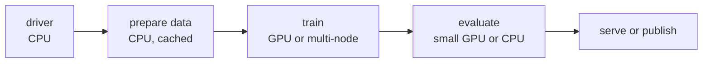

# Model training

A training job is more than a training loop. Data has to be prepared, the loop needs GPUs, the model has to be evaluated, and the result has to reach the people or apps that use it. Flyte runs each of these stages as a task, so each one gets its own hardware, its own retries, and its own cache.

## The shape of a training pipeline

Most pipelines in this section follow the same structure. Separate task environments hold each kind of work, and a lightweight driver task calls them in plain Python:



```python
data_env = flyte.TaskEnvironment(name="data", resources=flyte.Resources(cpu=8, memory="32Gi"), cache="auto")
train_env = flyte.TaskEnvironment(name="train", resources=flyte.Resources(gpu="A100:8", shm="16Gi"))
driver_env = flyte.TaskEnvironment(name="driver", depends_on=[data_env, train_env])
```

The driver is an ordinary `async` function. It can loop, branch on a metric, or fan out a sweep with `asyncio.gather`, and every task it calls shows up as a separate action in the run.

## What Flyte adds to a training job

| Need | Construct |
|---|---|
| Put each stage on the right hardware | One `flyte.TaskEnvironment` per stage, with `flyte.Resources` for CPU, memory, GPU type and count, and shared memory. See [Resources](../tasks/task-configuration/resources). |
| Train across several nodes | `flyte.clustered.ClusteredTaskEnvironment` runs torchrun across a group of pods. See [Pre-training](./pretraining). |
| Skip work that already ran | `cache="auto"` on data prep and training. A rerun with the same inputs and code returns the stored outputs. See [Caching](../tasks/task-configuration/caching). |
| Resume after a crash or preemption | `retries` plus `flyte.Checkpoint` restarts the loop from its last checkpoint. See [Resilient training](./resilient-training). |
| Pass datasets, checkpoints, and weights between stages | `flyte.io.Dir`, `flyte.io.File`, and DataFrames store data in your object store and pass a reference. See [Files and directories](../tasks/task-programming/files-and-directories). |
| Watch a run while it trains | `report=True` and `flyte.report` publish live charts to the run's UI. See [Reports](../tasks/task-programming/reports). |
| Run many trials at once | `asyncio.gather` or `flyte.map` fans out one task per trial. See [Hyperparameter optimization](./hyperparameter-optimization). |




On , trained models can also be published as [artifacts](../artifacts/_index) with lineage back to the run that produced them, and [queues](../tasks/task-configuration/queues) control which cluster and how much capacity each training job uses.




## Choose a page

| You want to | Read |
|---|---|
| Train a model from scratch, or on more GPUs than one node has | [Pre-training](./pretraining) |
| Adapt a pretrained model with SFT, LoRA, or preference tuning | [Post-training](./post-training) |
| Train scikit-learn or XGBoost models | [Classical machine learning](./classical-ml) |
| Sweep hyperparameters and stop weak trials early | [Hyperparameter optimization](./hyperparameter-optimization) |
| Measure a model on held-out data and compare it with a baseline | [Evaluation](./evaluation) |
| Keep a long job from losing progress | [Resilient training](./resilient-training) |

To optimize a model with rewards instead of labels, see [Reinforcement learning](../reinforcement-learning/_index). To serve the model you train, see [Deploy trained models](../inference/deploy-trained-models).



## Related

- [Model training tutorials](../../tutorials/model-training/_index): complete pipelines for fine-tuning and hyperparameter optimization.
- [Distributed LLM pretraining](../../tutorials/frontier-ai/distributed-pretraining/_index): a GPT model pretrained on multiple H200 nodes, end to end.
- [Computer vision tutorials](../../tutorials/computer-vision/_index): fine-tuning detectors and vision-language models.
