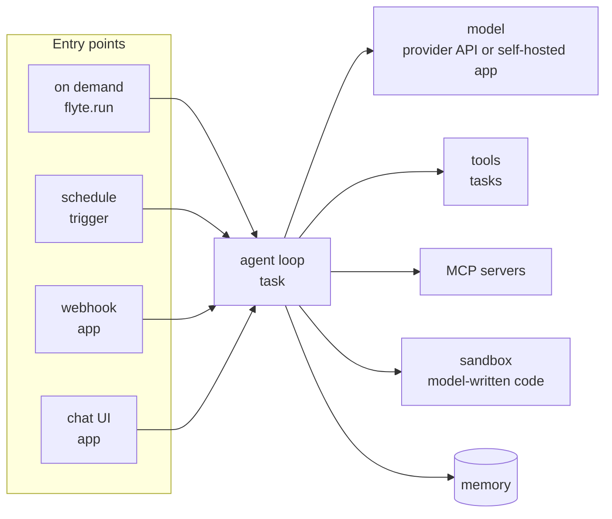

# Agent platform

This architecture runs agents as tasks. Each agent run is a task that loops over model calls and tool calls. Tools that need their own hardware or retries are tasks too, so every step is recorded in the run. Apps provide the parts that must stay reachable: webhooks, chat interfaces, MCP servers, and self-hosted models.

## Components

| Box | Construct | Details |
|---|---|---|
| agent loop | A task that runs `flyte.ai.agents.Agent`, your own loop, or a third-party framework | [Build an agent](../../agents/build-agent/_index) |
| tools | Functions or `@env.task` tasks passed to the agent's `tools` | [Flyte-native agents](../../agents/build-agent/flyte-agents) |
| model, hosted | A provider API, with the key stored as a `flyte.Secret` | [Providers](../../inference/providers/_index) |
| model, self-hosted | `VLLMAppEnvironment` or `SGLangAppEnvironment` | [vLLM](../../inference/self-hosted-endpoints/vllm) |
| MCP servers | The agent's `mcp_servers`, or an MCP server you host as an app | [Build an MCP](../../agents/build-mcp/_index) |
| sandbox | A sandbox that runs code the model wrote | [Sandboxing](../../agents/sandboxing/_index) |
| memory | State the agent reads and writes across runs | [Agent memory](../../agents/build-agent/agent-memory) |
| on demand | `flyte.run()` or `flyte run` | [Deploy an agent as a service](../../agents/build-agent/deploy-agent-as-service) |
| schedule | `flyte.Trigger` with `flyte.Cron` or `flyte.FixedRate` | [Deploy an agent as a service](../../agents/build-agent/deploy-agent-as-service) |
| webhook | A `FastAPIAppEnvironment` whose endpoint starts the agent task | [Deploy an agent as a service](../../agents/build-agent/deploy-agent-as-service) |
| chat UI | `flyte.ai.chat.AgentChatAppEnvironment` with `task_entrypoint` set to the agent task and `passthrough_auth=True`. Without `task_entrypoint`, or in your own `FastAPIAppEnvironment`, the agent runs inside the app process, not as a task. | [Agent chat UI](../../agents/build-agent/agent-chat-ui) |

## How the pieces connect

1. An entry point starts the agent task with a request. The webhook app submits the run and returns without waiting for the agent to finish.
2. The agent task calls the model, which can ask for tool calls. Each tool that is a task runs as its own action, on its own hardware.
3. With `flyte.ai.agents.Agent`, the loop repeats until the model answers without calling a tool, or until it reaches `max_turns`.
4. The agent task returns its result. To carry context from one run to the next, the agent reads and writes a memory store.

## Variations

- **Code instead of tool calls:** set `code_mode=True` on `flyte.ai.agents.Agent`. The model writes a short Python program each turn, which runs in a sandbox with the tools exposed as functions. Code mode requires `pydantic-monty` in the task's image. See [Programmatic tool calling for agents](../../agents/sandboxing/code-mode).
- **Bring your own framework:** run an agent from OpenAI, Claude, LangGraph, CrewAI, or another framework inside the task. See [Agent frameworks](../../../integrations/agents/_index).

## Gotchas

- **Per-tool approval doesn't apply in code mode.** If `code_mode=True`, the agent ignores `requires_approval` on its tools and logs a warning naming them. Use tool calls for agents whose tools need a person's approval.
- **An app that starts runs needs credentials.** In a webhook app, use passthrough auth (`FastAPIPassthroughAuthMiddleware` and `flyte.init_passthrough()`). A chat app with `task_entrypoint` must set `passthrough_auth=True`, which sets up both. Passthrough forwards the incoming request's `Authorization` and cookie headers, so each run is submitted with the caller's identity only when the caller sends  credentials with the request. See [Deploy an agent as a service](../../agents/build-agent/deploy-agent-as-service).

## Related

- [Agents](../../agents/_index)
- [Apps](../../apps/_index)
- [Agent tutorials](../../../tutorials/agents/_index)
