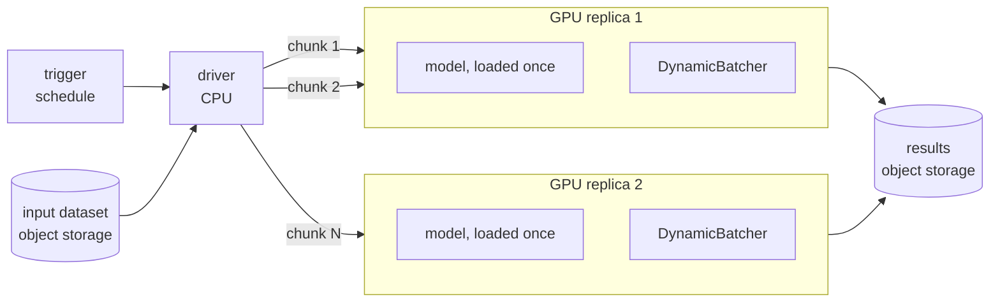

# Batch inference

This architecture runs a model over a dataset that is too large for one task. A trigger starts a driver task, which splits the dataset into chunks and fans them out to GPU workers. Each worker loads the model once and batches records so the GPU doesn't wait on data loading.

## Components

| Box | Construct | Details |
|---|---|---|
| trigger | `flyte.Trigger` with `flyte.Cron` or `flyte.FixedRate` | [Schedule triggers](../../triggers/schedules) |
| driver | A CPU task that splits the input and calls `flyte.map` | [Map](../../tasks/task-programming/map) |
| GPU replica | A GPU `flyte.TaskEnvironment`, or an app that serves the model | [Batch inference](../../inference/batch-inference) |
| batcher | `flyte.extras.DynamicBatcher`, or `flyte.extras.TokenBatcher` for LLMs | [Batch inference](../../inference/batch-inference) |
| input and results | `flyte.io.DataFrame`, `flyte.io.Dir`, or `flyte.io.File` | [DataFrames](../../tasks/task-programming/dataframes) |

## Choose where the model lives

The model must stay loaded across chunks, or every chunk pays the cost of loading it. Pick one of two designs:

| Design | How it works | Use it when |
|---|---|---|
| Reusable containers | The worker environment sets `reusable=flyte.ReusePolicy(...)`. Each replica's Python process is reused across chunks, so a model cached at process level loads once per replica. | The model is used only by this batch job. |
| App-backed | The model runs in a `FastAPIAppEnvironment`. Worker tasks send each chunk to the app over HTTP. | Other jobs or clients call the same model. |

[Batch inference](../../inference/batch-inference) shows how to use `DynamicBatcher` and `TokenBatcher` with a worked example of one of these designs.




> [!NOTE]
> Reusable containers run only on a Union.ai backend. See [Reusable containers](../../tasks/task-configuration/reusable-containers).




## How the pieces connect

1. The trigger starts the driver on a schedule. Its inputs can name the dataset or the time window to process.
2. The driver splits the input into chunks and calls `flyte.map.aio()` on the worker task, with `concurrency` set so it doesn't send more chunks than the workers can take.
3. Each worker feeds its chunk's records to the batcher, which groups them into batches for the GPU.
4. Each worker writes its results to object storage and returns a reference. The driver collects the references.




On , start the driver when new input data lands instead of on a schedule. Publish the input dataset as an [artifact](../../artifacts/_index) and attach a `flyte.OnArtifact` trigger to the driver. See [Trigger on new artifact versions](../../triggers/artifact-triggers).




## Gotchas

- **A failed chunk doesn't fail the driver.** By default, `flyte.map` returns a failed chunk's exception in place of its result and continues with the other chunks. Check each result, or pass `return_exceptions=False` to raise the failure in the driver instead.

## Related

- [Batch inference](../../inference/batch-inference)
- [Reusable containers](../../tasks/task-configuration/reusable-containers)
- [Scale your runs](../../run-scaling/_index)
