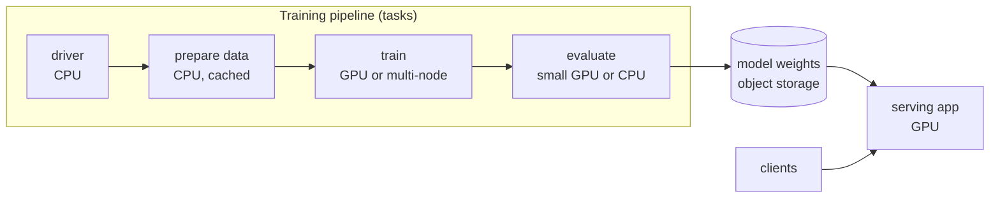

# Training and serving

This architecture takes a model from raw data to a live endpoint. A pipeline of tasks prepares data, trains, and evaluates. An app then loads the trained weights from object storage and serves them.

## Components

| Box | Construct | Details |
|---|---|---|
| driver | A CPU `flyte.TaskEnvironment` with the other environments in `depends_on` | [Model training](../../model-training/_index) |
| prepare data | A `flyte.TaskEnvironment` with `cache="auto"` | [Caching](../../tasks/task-configuration/caching) |
| train, one node | A `flyte.TaskEnvironment` with GPUs in `flyte.Resources` | [Resources](../../tasks/task-configuration/resources) |
| train, several nodes | `flyte.clustered.ClusteredTaskEnvironment` | [Clustered task environment](../../tasks/task-configuration/clustered-task-environment) |
| evaluate | A task that compares the new model with a baseline | [Evaluation](../../model-training/evaluation) |
| model weights | A `flyte.io.Dir` or `flyte.io.File` returned by the training task | [Files and directories](../../tasks/task-programming/files-and-directories) |
| serving app | `VLLMAppEnvironment`, `SGLangAppEnvironment`, or `FastAPIAppEnvironment` | [Deploy trained models](../../inference/deploy-trained-models) |

## How the pieces connect

1. The driver calls the data, training, and evaluation tasks in order. It can branch on the evaluation result, for example to stop before publishing a model that scores below the baseline.
2. The training task saves the weights and returns them as a `flyte.io.Dir`. The weights stay in object storage, and only a reference passes between tasks.
3. The serving app names the training task's output as a parameter. When you deploy the app, it resolves that reference and mounts the weights.




On , publish the weights as an [artifact](../../artifacts/_index) with `flyte.artifacts.new()` and `produces_artifacts=True`, and pass the artifact to the app. The app then refers to the model by name. It resolves the latest version when you deploy it, or the version you pin, which is how you roll back.






In Flyte, pass the training task's output to the app with `flyte.app.RunOutput`, naming the task with `task_name` or a specific run with `run_name`.




## Variations

- **Long or preemptible training:** add `retries` and `flyte.Checkpoint` so the training loop resumes from its last checkpoint. See [Durable training](../../model-training/durable-training).
- **Hyperparameter search:** have the driver fan out one training task per trial. See [Hyperparameter optimization](../../model-training/hyperparameter-optimization).
- **Fine-tuning a pretrained LLM:** replace the training stage with SFT, LoRA, or preference tuning. See [Post-training](../../model-training/post-training).



- **Retrain and redeploy automatically:** use a [factory that ends in an app](../../factories/serve) to retrain, check, and deploy in one step, with an accuracy gate or a person's approval before release.
- **Separate capacity for training:** send training jobs to their own [queue](../../tasks/task-configuration/queues) so they don't compete with other workloads for GPUs.



## Gotchas

- **The app serves the model it resolved at deploy time.** A model trained after you deploy doesn't reach the endpoint until you deploy the app again.
- **Run the training task before you deploy the app.** With `flyte.app.RunOutput(task_name=...)`, the app uses the latest successful run of that task, and the deploy fails if there is none.
- **vLLM and SGLang load only formats they support.** Save the weights in a format the engine can load. See [Deploy trained models](../../inference/deploy-trained-models).

## Related

- [Model training](../../model-training/_index)
- [Deploy trained models](../../inference/deploy-trained-models)
- [Model training tutorials](../../../tutorials/model-training/_index)
