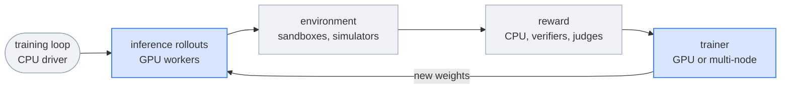

# Reinforcement learning

Reinforcement learning (RL) trains a policy from rewards instead of labels. The policy acts in an environment, a reward function scores what it did, and a trainer updates the policy toward higher-scoring behavior. For LLMs, the policy is the model, an action is a completion or an agent's trajectory, and the update is a method such as GRPO or PPO.

RL has more moving parts than supervised training, and they need different hardware at different times:

In Flyte, each part is a task environment, and the loop is a Python `for` loop in a driver task. Nothing runs that a stage doesn't need: the reward tier is CPU only, the trainer only holds GPUs during an update, and the number of rollout workers follows the number of prompts in flight.

## What Flyte adds to an RL loop

| Need | Construct |
|---|---|
| Size each part of the loop separately | One `flyte.TaskEnvironment` per role, each with its own `flyte.Resources`, retries, and timeouts |
| Write the loop as ordinary code | An `async` driver task that calls rollout, reward, and train tasks, and overlaps them with `asyncio` |
| Pass weights from the trainer to the rollout workers | The trainer returns a `flyte.io.Dir`, and rollout tasks read it from your object store. No direct connection between trainer and generators is needed. |
| Train on more GPUs than one node has | A `flyte.clustered.ClusteredTaskEnvironment` for the trainer |
| Survive a crashed driver or a failed step | `flyte.Checkpoint` for loop state, `retries` per task, and `@flyte.trace` so a retried step doesn't call a paid judge again |
| Try a new reward on old rollouts | Run recovery or caching reuses rollouts whose inputs didn't change |
| Inspect any iteration | `flyte.group` per iteration in the UI, and a live `flyte.report` of reward, accuracy, and loss |




On , [reusable containers](../tasks/task-configuration/reusable-containers) keep the inference engine loaded between rollout calls, and [volumes](../tasks/task-programming/volumes/_index) give every episode its own copy-on-write fork of an environment's filesystem.




Overlapping generation with a multi-node trainer step can hide the trainer's time almost entirely. See [Overlap generation with training](./training-loop#overlap-generation-with-training).

## The parts of the loop

| Page | Covers |
|---|---|
| [Training environment](./training-environment) | What the policy acts in: datasets of verifiable problems, simulators, and sandboxed agent environments |
| [Reward setup](./reward-setup) | Verifiers, reward functions, and LLM judges, and how to change the reward without regenerating rollouts |
| [Inference rollouts](./inference-rollouts) | Generating completions or trajectories from the current policy, and getting new weights to the generators |
| [Training loop](./training-loop) | The driver task that ties the parts together, the policy update, multi-node trainers, and overlapping generation with training |
| [Evaluation](./evaluation) | Sampling the policy on held-out problems, training-health metrics, and catching reward hacking |

The examples on these pages come from a GRPO loop with LoRA adapters and an agentic RL loop with sandboxed environments. To fine-tune on labeled data instead, see [Post-training](../model-training/post-training).



## Related




- [RL for LLMs with GRPO and LoRA](../../tutorials/reinforcement-learning/grpo-lora/_index): the GRPO loop on these pages, end to end, and its multi-node version.




- [Durable agentic RL with SkyRL and Harbor](../../tutorials/frontier-ai/agentic-rl-skyrl/_index): an agentic RL loop with sandboxes, verifiers, and judges. It has an open-source version, which the open-source code on these pages comes from.
- [Code sandboxing](../agents/sandboxing/code-sandboxing): run model-written code safely inside an environment or a reward.
