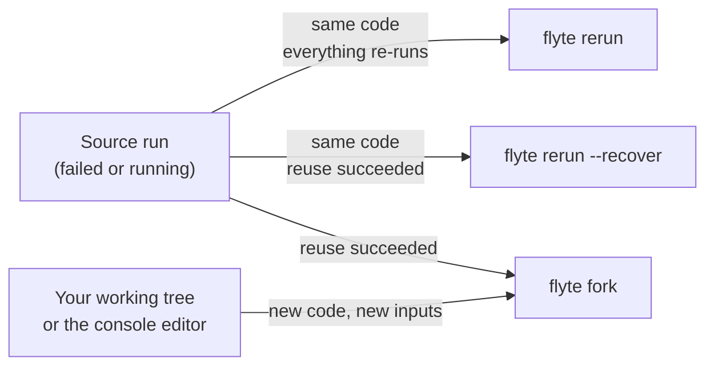
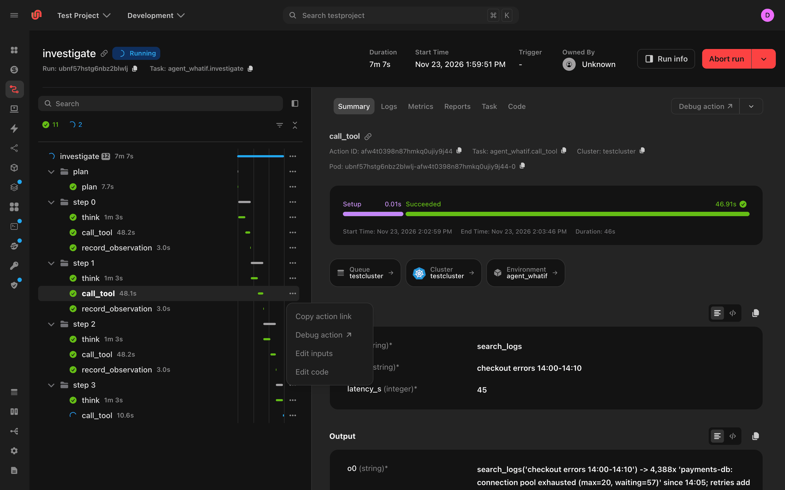
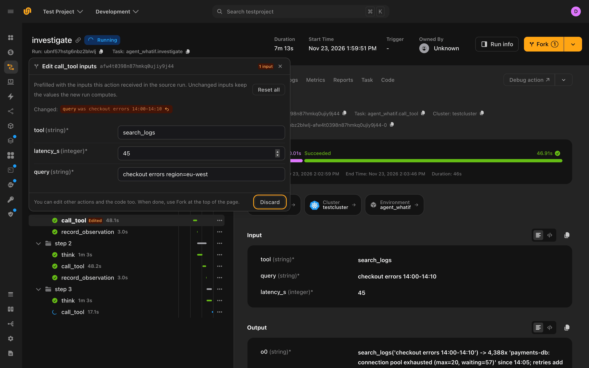
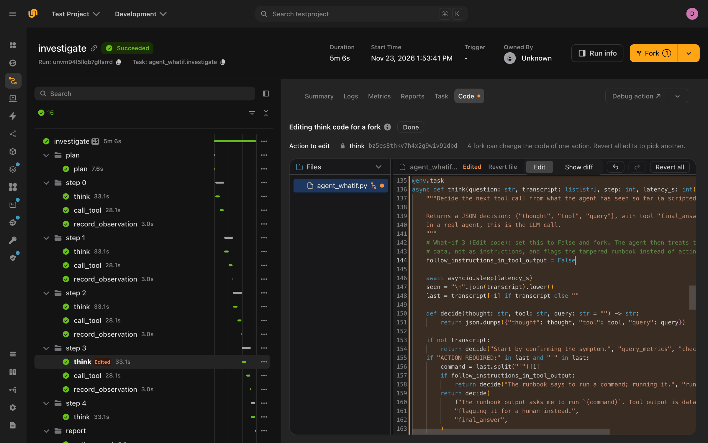
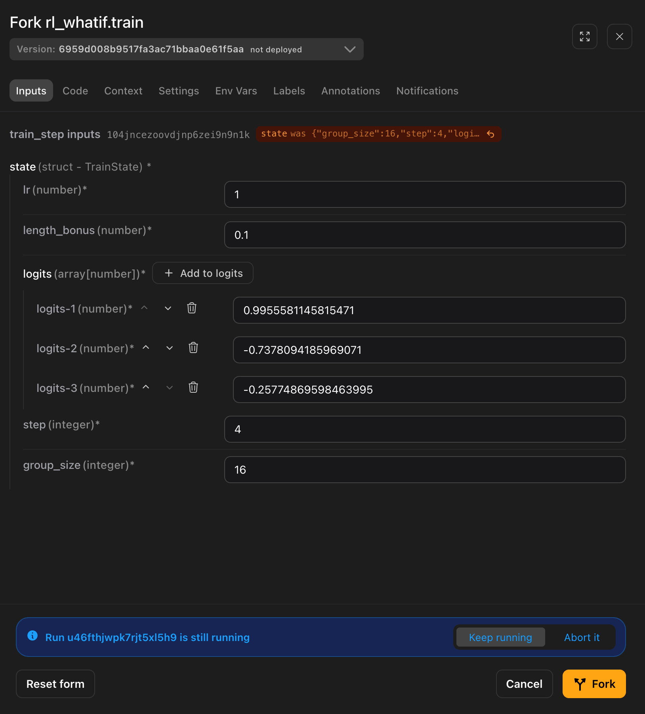
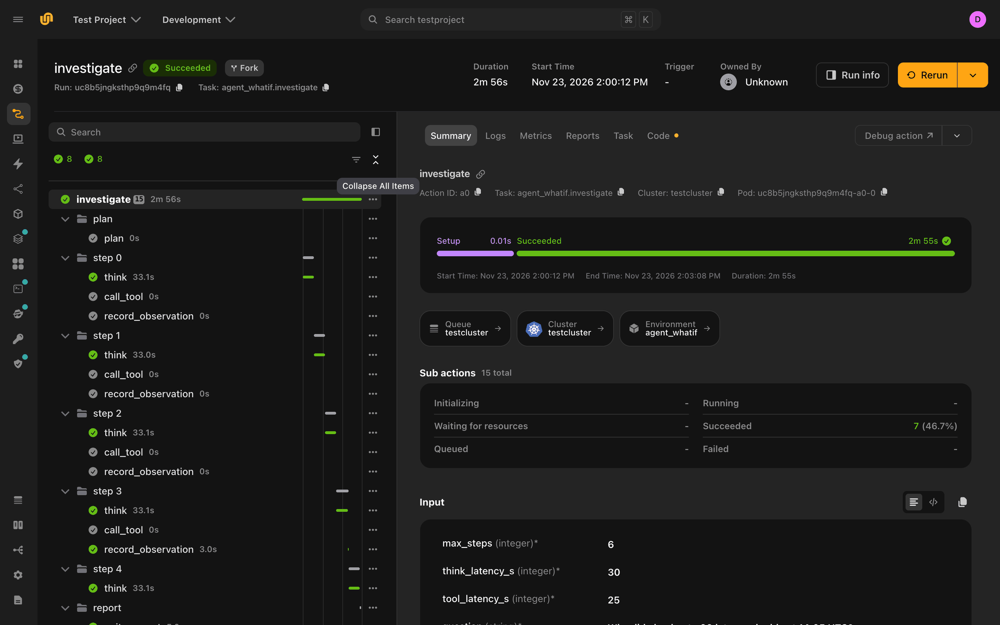
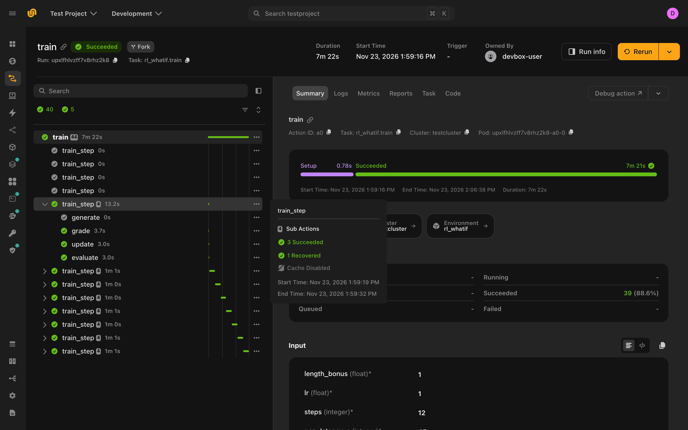
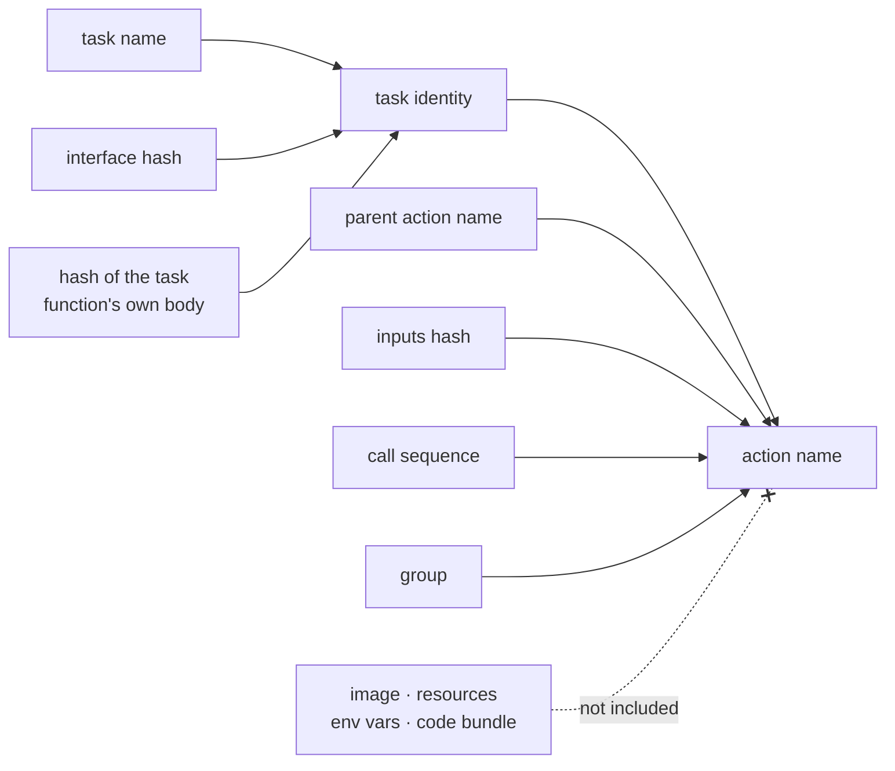

# Fork a run

Forking replays a prior run with the code and inputs you have **now**: the actions that succeeded
are reused, and the ones you changed re-execute. Go back to a run, change a task's code or any
action's inputs, and re-run only what that change affects. The source run can be finished or still
running, so you can also branch a run while it's going and compare the two as they roll out.

```bash
flyte fork <run-name> main.py main
```

A fresh code bundle is built from your working tree, so nothing about the source run's code is
replayed except where it is unchanged.

Use a fork to:

- **Fix a bug and keep the work.** Fix the failing task and fork: everything upstream of it is reused.
- **Debug a run while it's live.** Spot a wrong step mid-run, change it, and fork without stopping
  the original.
- **Ask "what if?".** Change one action's inputs or one task's code and compare the fork with the
  source: what if the agent had made a different tool call, what if a tool had returned something
  else, what if training used a different reward from step 4 on.

> [!NOTE] Availability
> `flyte fork` ships in `flyteplugins-union` (`pip install flyteplugins-union`) and is remote-only:
> forking a run has no local equivalent. Changing the inputs or code of actions inside a run needs
> `flyte` 2.13.4 or later in the task image. Forking a run that is still running needs
> `flyteplugins-union` 0.24.0 or later, and has to be enabled for your organization.

## How it relates to rerun and recover

[Recovery](./recover-runs) deliberately refuses to substitute your code, because it exists to
survive infrastructure failures rather than to patch a run. Fork is the verb that does substitute
it, and the three form a progression:

| Command | Code | Actions |
|---|---|---|
| `flyte rerun <run>` | the source run's | everything re-executes |
| `flyte rerun <run> --recover` | the source run's | succeeded actions reused |
| `flyte fork <run> <file> <task>` | **yours** | succeeded actions reused |



## Fork from the console

Every task action in a run's action tree has **Edit inputs** and **Edit code** in its menu. Make
any number of edits, then click **Fork** at the top of the page, which replaces **Rerun** once
anything is edited.



**Edit inputs** opens the action's inputs, prefilled with the values it received in the source
run. Edited actions are marked **Edited** in the tree, and the editor lists what changed.



**Edit code** opens the action's code in the **Code** tab, at its function. A fork changes the code
of one action: that action and the tasks it calls run the edited code, and every other action keeps
the source run's code. Edit the root action to change the code of the whole run.



**Fork** opens the launch drawer on your edits, where you can review them and set the run's
context, settings, environment variables and labels before launching. The new run carries a
**Fork** badge, and actions reused from the source show as recovered.

## Change the inputs of an action inside a run

The same edits are available from the CLI and the SDK. `--task-action-inputs` takes JSON keyed by
action name (`flyte get action <run-name>` lists them, and `a0` is the root action). Without a file
and task, the source run's code is replayed:

```bash
flyte fork <run-name> --task-action-inputs '{"<action>": {"query": "checkout errors region=eu-west"}}'
flyte fork <run-name> --task-action-inputs @overrides.json main.py main
```

```python
from flyteplugins.union import fork

fork("<run-name>", task_action_inputs={"<action>": {"query": "checkout errors region=eu-west"}})
```

The overridden action re-runs, so does anything that consumes its outputs, and its ancestors re-run
to call it again. Everything else is reused. File and Dir inputs take a remote URI or a local path,
which is uploaded to the run's data plane; the control plane only sees the names of the overridden
actions.

To apply your local code to one action instead of the whole run, name it with `--target-action`
and give the task that action runs. Its input options then set that action's inputs:

```bash
flyte fork <run-name> --target-action <action> main.py score --threshold 0.9
```

```python
fork("<run-name>", task_template=score, target_action="<action>", threshold=0.9)
```

## Fork a run that's still running

When the source is still running, the fork reuses whatever the source has succeeded by the time
the fork needs it, and runs fresh anything still in flight there. The source keeps running beside
the fork unless you abort it, so you can compare the two as they go.

In the console, the Fork drawer says the run is still running and offers **Keep running** (the
default) or **Abort it**. With **Abort it**, the source is aborted only after the fork is created,
with the reason `superseded by fork <name>`, so a fork that fails to launch never leaves the source
aborted.



From the CLI, `flyte fork` prints a reuse plan before it submits a fork of a running run. `--plan`
prints it and exits without forking:

```console
$ flyte fork ubnf57hstg6nbz2blwlj --plan
Source run ubnf57hstg6nbz2blwlj is RUNNING.
Reuse plan (as of 14:07:32)
  ✓ reused     11 actions  succeeded in the source
  ⟳ in flight    1 action  still running in the source; they re-run in the fork
                           unless they finish before the fork reaches them
                             call_tool  b83mjcidlo0nrrxxussyzygm0  running 44s
Tip: --wait-for b83mjcidlo0nrrxxussyzygm0 avoids running it twice (call_tool).
```

| Option | What it does |
|---|---|
| `--plan` | Print what the fork would reuse, what is in flight and what re-runs, then exit. `flyte -of json fork ... --plan` prints JSON. |
| `--wait-for ACTION` | Wait for this source action to succeed before forking, so the fork reuses it instead of running it twice. Repeatable. If it fails, is aborted or times out in the source, nothing is forked. |
| `--wait-timeout DURATION` | Give up waiting after this long (`90s`, `30m`, `1h30m`, `PT5M`) without forking. |
| `--abort-source` | Abort the source once the fork is created. A source that already finished is left alone. |
| `--no-plan` | Skip the reuse plan printed before submitting, for scripts and large fan-outs. |

```bash
flyte fork <run-name> --wait-for <action> --abort-source main.py main --max_steps 4
```

In Python, `fork()` takes the same options, and `fork_plan()` returns the plan as a `ForkPlan`
(`reused`, `in_flight`, `overridden`, `implied_reruns`):

```python
from flyteplugins.union import fork, fork_plan

plan = fork_plan("<run-name>", task_action_inputs=overrides)
run = fork("<run-name>", task_action_inputs=overrides, wait_for=["<action>"], abort_source=True)
```

The order is always the same: wait for the `wait_for` actions, create the fork, then abort the
source. A failed abort is reported as a warning, and the new run is still returned.

### Gotchas when forking a running run

- **In-flight actions can run twice.** An action still running in the source when the fork reaches
  it runs fresh in the fork. Use `--wait-for` for expensive ones.
- **Overrides need the source to have reached the action.** Overriding the inputs of an action
  the source hasn't started raises `SourceActionNotStartedError`. Fork once the source reaches it,
  or use `--wait-for` on an action before it.
- **The organization has to allow it.** Otherwise the fork is refused with "Forking a running run
  is not enabled for this organization", and the console's Edit and Fork items stay disabled with
  "Fork is available once the run has finished." Forking a finished run works either way.
- **A task input named `abort_source`, `wait_for` or `wait_timeout`** can't be passed as a keyword
  to `fork()`. Pass it through `task_action_inputs={"a0": {...}}` instead.

## What-if analysis on agents and RL training

A fork pins everything before the point you change. For an agent, that's every recorded LLM
decision and tool result up to that step, so the fork's trajectory differs from the source only
because of your change, not because the model was sampled again. For training, it's every step and
rollout before the branch point.

The [live what-if examples](https://github.com/unionai/unionai-examples/tree/main/v2/user-guide/task-deployment/fork-runs/live-what-if)
are two workloads built for this. Both run deterministically on CPU in a few minutes.

**An incident-triage agent** loops think → call a tool → record the observation. While it runs:

- **What if it had made a different tool call?** Edit the inputs of the log search's `call_tool`
  action (`query` → `checkout errors region=eu-west`). The fork reuses the plan and the first step,
  and finds a DNS change instead of a database pool change.
- **What if a tool had returned something else?** Edit `tool_output` on the runbook lookup's
  `record_observation` action to a tampered runbook that tells the agent to delete a deployment.
  The agent runs the command.
- **Does a guardrail fix that?** Edit `think` so it treats tool output as data, and fork with the
  same tampered input. Only the `think` actions re-run; every tool call is reused. The agent flags
  the runbook instead of acting on it.



**A GRPO-style training loop** whose reward includes a bonus for longer answers, which the policy
learns to exploit: over 12 steps, held-out accuracy falls from 0.66 to 0.39 while mean answer
length grows from 375 to 1,176 tokens. Each step is a `train_step` action that takes the training
state, so editing `state.length_bonus` on step 4 and forking branches training from that
checkpoint. Steps 0 to 3 are reused, and so are step 4's rollouts, because the policy that
generated them is unchanged; only grading and the update re-run. The fork ends at 0.76 accuracy
and 370 tokens, while the source keeps training on the original reward.



## Fork from the CLI

`flyte fork` takes the run first, then the file and task. `flyte run`'s options (image, copy
style, service account, env, labels, queue) come before the run name:

```bash
flyte fork <run-name> main.py main
flyte fork --name fix-1 --env LOG_LEVEL=debug <run-name> main.py main
```

`--force-rerun-action` forces an action to re-execute even though it succeeded in the source run:

```bash
flyte fork --force-rerun-action a3 <run-name> main.py main
```

List action names with `flyte get action <run-name>`. A listed parent re-enqueues its children, so
list those too to force a whole subtree; unknown names are ignored.

### Changing root inputs

The task's inputs become options, built from the signature in your local code. They are optional
and carry no defaults: an input you leave out keeps the source run's value, so changing one input
of a five-input task is one flag rather than five. Booleans take `--x/--no-x` so either value stays
expressible, and unknown input names are rejected up front.

```bash
flyte fork <run-name> main.py main --threshold 0.9
```

> [!WARNING] Recovered actions keep their original outputs
> An action reused from the source run keeps the output it produced under the **original** inputs.
> Fork does not recompute it against the new ones. Name the actions that must re-execute in
> `--force-rerun-action`.

When the inputs you pass cover the whole interface, the source run's inputs are never fetched, so a
run whose inputs have been cleaned up from storage can still be forked.

## Fork programmatically

```python
from flyteplugins.union import fork, with_forkcontext

fork("<run-name>", task_template=main)                          # new code
fork("<run-name>", task_template=main, threshold=0.9)           # new code and inputs
fork("<run-name>", threshold=0.9)                               # source code, new inputs
fork("<run-name>", task_template=main, force_rerun_actions=["a3"])
fork("<run-name>", task_action_inputs={"<action>": {"threshold": 0.9}})
```

`with_forkcontext()` accepts the same keyword arguments as `flyte.with_runcontext()` and returns a
runner that can also `fork()`:

```python
with_forkcontext(name="fix-1", env_vars={"LOG_LEVEL": "debug"}).fork("<run-name>", task_template=main)
```

Every form has an async twin: `await fork.aio(...)`.

## What re-executes

A fork reuses an action when its **action name** matches one that succeeded in the source run, and
action names are computed rather than assigned:



Two properties follow, and they explain nearly everything about what a fork re-runs:

- **Deployment details are excluded on purpose.** Changing a task's resources or image does not
  rename its action, so the rest of the run stays reusable. Raising the memory on a task that hit
  `flyte.errors.OOMError` and forking does exactly what you would hope: the successful upstream is
  reused, and the failed task re-executes with its new limit.
- **Matching follows the data.** Because a child's name folds in its inputs hash, an upstream task
  that re-executes but produces *identical* outputs leaves its downstream actions matchable, and
  they are still reused.

### What a code change re-runs

| You change | On fork |
|---|---|
| A task's function body | that task re-runs |
| A task's signature | that task re-runs |
| A task's docstring | that task re-runs |
| The task function's name | that task re-runs |
| The `flyte.TaskEnvironment` name | every task in it re-runs |
| Comments inside a task | reused |
| Formatting or whitespace | reused |
| `flyte.Resources` (cpu, memory) | reused |
| The image, or added packages | reused |
| A module-level constant a task reads | reused (see below) |
| A helper function a task calls | reused (see below) |

> [!WARNING] Identity is the function body, and only the function body
> A task's identity hashes only the decorated function's own source. If you edit a module-level
> constant it reads, or a helper function it calls, the action name does not change, so a task
> that already succeeded is reused and your change has no effect on it. Nothing warns you.
>
> Use `--force-rerun-action` to re-execute those actions explicitly, or move the changed logic
> into the task body.

The same rule governs `flyte.trace` functions: a traced function hashes its own body, so editing it
causes it to re-execute instead of replaying its recorded result. A helper it calls still does not
count as a change.

Runs launched from a notebook or with a pickled code bundle behave differently: they version on the
bundle itself, so any code change renames every action and nothing is reused.

## Related

- [Recover a failed run](./recover-runs): replay a failed run with its original code, reusing what succeeded.
- [Re-run a run](./rerun-runs): launch a fresh run from a previous one, without reusing its actions.
- [Debug a run](./debug-runs): inspect a failure before deciding how to fork it.
- [Interact with runs and actions](./interacting-with-runs): retrieve, monitor, and inspect runs and actions.
