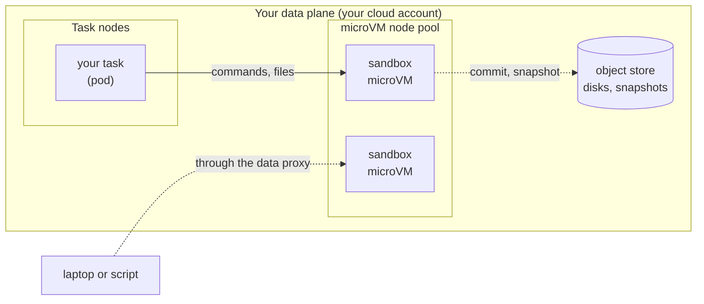

# VM sandboxes

> [!NOTE] Early access preview
> VM sandboxes are in early access. The API can change between releases. They are not enabled by default. MicroVM support needs special node configuration and setup in your data plane. To enable it in your Union.ai environment, talk to your Union.ai solutions team.
>
> VM sandboxes require `flyteplugins-union` 0.21.2 or later: `pip install "flyteplugins-union>=0.21.2"`.

A VM sandbox is a lightweight virtual machine with its own Linux kernel. You start one from Python, run commands and move files in it, and throw it away when you are done. Use VM sandboxes when you need to run code you did not write and do not trust: code from an LLM, from a coding agent, from your users, or from a reinforcement learning policy.

## Why VM sandboxes

A coding agent is fixing a bug in a customer's repository. Every turn, the model writes a shell command, and your agent has to run it somewhere. The command might be `pytest`. It might also be `curl` to an address the model picked up from a prompt injection, a `pip install` of a typosquatted package, or `rm -rf /`.

If you run that command in your task's container, it runs with your task's identity. It can read the task's secrets, call your cloud's metadata server for credentials, and reach other services in your cluster. A VM sandbox gives the command a machine of its own instead:

```python
import flyte
from flyteplugins.union import sandbox

# A VM with no network: the default.
code_runner = sandbox.SandboxEnvironment(name="code-runner")

env = flyte.TaskEnvironment(
    name="agent",
    image=flyte.Image.from_debian_base().with_pip_packages("flyteplugins-union>=0.21.2"),
)


@env.task
async def run_untrusted(code: str) -> str:
    async with code_runner.session("run-model-code") as sb:
        await sb.fs.write_text("main.py", code)
        result = await sb.run("python main.py", check=False)  # a failing script is a result, not an error
        return result.stdout + result.stderr
```

The code runs in a microVM that has no network and none of your task's secrets. The VM is torn down when the `async with` block exits. A new sandbox is ready in about a quarter of a second, and each later command on it takes a few milliseconds.

## What you get

- **A kernel per sandbox.** Each session is a Firecracker microVM with its own guest kernel, not a container that shares the node's kernel.
- **Closed network by default.** A sandbox starts with no outbound network. You can open it to the internet, or allow a list of hostnames such as PyPI or your package mirror. The cloud metadata server is unreachable in every mode, so code in a sandbox cannot read your node's cloud credentials.
- **Runs in your cloud.** Sandboxes run on your own Kubernetes clusters, in your data plane. The code, the data it touches, and the VMs themselves stay in your cloud account.
- **Durable state.** Commit a sandbox's disk and start new sandboxes on copies of it. Fork a running sandbox into several. Snapshot or suspend one with its memory and processes, and resume it later. Publish a disk as an artifact that later runs can start from. Saved disks and snapshots are stored in your data plane's object store.
- **Part of Union.ai.** A sandbox started from a task is an action of that task's run, so it shows up in the run in the UI, and it uses the same identity, projects, and queues as the rest of your workloads.

## How it works

Three terms recur in these pages. A `SandboxEnvironment` is the template: size, network, secrets, and lifetime. A session is one running microVM started from that template. A `Sandbox`, usually named `sb`, is the object your code uses to drive a session.



1. You declare a `sandbox.SandboxEnvironment` once: its CPU and memory, network, secrets, environment variables, and how long a session may live.
2. Your code opens a session with `env.session(name)`. Union.ai schedules a microVM on a node in your microVM node pool. No pod is started for it.
3. The session is yielded as a `Sandbox` object once it answers. You call `sb.run()`, `sb.start()`, and `sb.fs` to work in it.
4. When the block exits, the session's commands are stopped and the VM is torn down.

Sandboxes need nodes that can run hardware virtualization: bare-metal instances, or instance types with nested virtualization enabled. These nodes also need configuration that ordinary task nodes do not have, so you cannot enable VM sandboxes by adding a node pool yourself. Your Union.ai solutions team sets up the microVM node pool in your data plane when they enable VM sandboxes.

You can open sessions from a task, from an app, or from a laptop or script outside your cluster. Tasks and apps talk to the sandbox directly, which is the fastest path. From outside the cluster, every call goes through the Union.ai data proxy, signed in as you, which adds latency to each command. See [Use sandboxes outside a task](./outside-tasks).

## When to use VM sandboxes

Flyte offers other ways to run untrusted code. See [Sandboxing](../agents/sandboxing/_index) for the full picture.

| | VM sandbox | [Code sandbox](../agents/sandboxing/code-sandboxing) | [Workflow sandbox](../agents/sandboxing/workflow-sandboxing-flyte) |
| --- | --- | --- | --- |
| Isolation | microVM with its own kernel | Container | Sandboxed Python interpreter |
| Interaction | Interactive: many commands, files, and processes over one session | One script or command, then discarded | One orchestration program |
| State | Disk, memory, and processes can be saved, forked, and restored | None | None |
| Start | About 0.25 seconds | Seconds | Microseconds |
| Capabilities | Root in a full Linux VM: `apt`, `pip`, Docker, servers | Full Python and shell in a container image | Pure Python control flow that calls registered tasks |
| Best for | Coding agents, RL rollouts, live code execution in apps, per-user environments | One-shot jobs with known dependencies | LLM-generated orchestration code |

Use VM sandboxes for:

- **Coding agents.** Give each agent task its own machine to write files, install packages, and run tests. Allow only the package hosts it needs. Discard the VM when the task ends.
- **Reinforcement learning rollouts.** Build an environment once, then start each rollout on its own copy-on-write fork of it, in parallel. See the [SWE-Gym rollouts tutorial](../../tutorials/reinforcement-learning/swe-gym-sandboxes/_index).
- **Code execution in live products.** Run user or model code inside a data analysis assistant or an in-app code runner, at interactive speed.
- **Long-lived workspaces.** Suspend an agent's sandbox while it waits on a person or a long tool call, and resume it with its processes intact.

## Requirements

- A Union.ai data plane with microVM support enabled. This needs special node configuration and setup. Talk to your Union.ai solutions team to enable it.
- `flyteplugins-union` 0.21.2 or later, which needs `flyte` 2.13.4 or later and earlier than 2.15.0.
- Python 3.10 or later.


